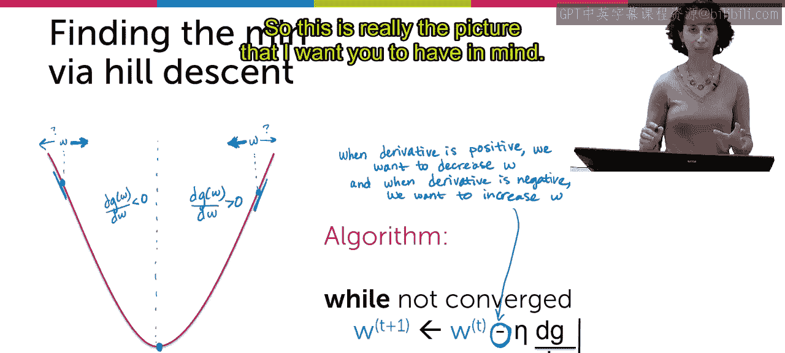

# 华盛顿大学《机器学习（回归，第2课⧸共4课）｜Machine Learning》中英字幕 p18 17_通过下山法找最小值.zh_en -BV11b421H7XL_p18-

。

But we can use the same type of algorithm to find the minimum of a function。

 so here our interest is min over W G of W and on that this picture here for this convex function。

 that's this point right here。But let's think a little bit about what happens in this case。

 So let's say。Or。Starting at some w value here。And I'd like to know whether I should move again to the left or to the right。

So increase or decrease W。Well， let's look at the derivative of the function。And what I see。

Is that the derivative is negative。The derivative is negative， and yet in this case。

 I want to be moving to the right and increasing W。

Let's look at a point on the other side of the optimum， so some point W here， look at the derivative。

 and this case， the derivative is positive。And。When I ask whether I want to move。

To the left or to the right， the answer in this case is I want to decrease the value of W。

 I want to move to the left。So what we're saying is that。When。The derivative。Is。Positive。Weiyi。😔。

Want to。Decrease。W。And when。The derivative。Is negative？We wantna increase w。So again。

 in this picture。I have that the derivative of this function G。

Everywhere on the left hand side of the optimum in this case is negative。

 everywhere on the right hand side is positive。So when I go to do what I'm going to call a hill descent algorithm to contrast with a hill climbing algorithm。

 the update is going to look almost exactly the same as the hill climbing except。

Because of what we just discussed， instead of having a plus sign here。

And moving in the the same direction， mean the same sign of the derivative。

 we're going to move in the opposite Okay， so when the derivative。

 just to be very clear when the derivative is positive， what's going to happen。

Well this term is going to be negative。 we're going to decrease W when the derivative。Is negative。

 this term， this joint term here is going to be positive， we're going to increase W。

So that satisfies exactly what we stated here。Okay。

 so that is finding the minimum of a convex function。

And I want to emphasize this slide right here because we're going to be looking at a lot of convex functions in this course and in this module。

 so this is really the picture that I want you to have in mind。

