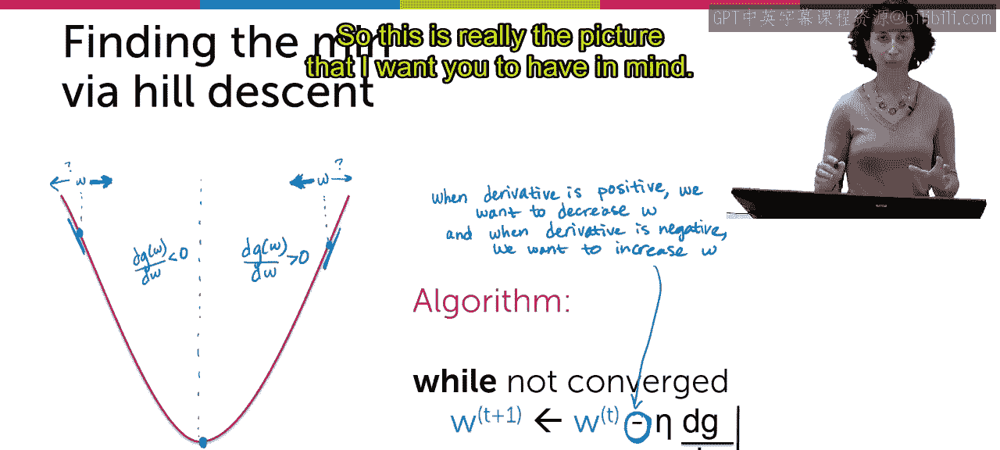

# 机器学习：第2课：通过下山法找最小值

在本节课中，我们将学习如何使用一种名为“下山法”的算法来寻找函数的最小值。我们将通过直观的几何图像和简单的数学公式来理解其工作原理，并重点关注凸函数这一重要概念。

## 概述

上一节我们讨论了寻找函数最大值的方法。本节中我们来看看如何寻找函数的最小值。我们将使用一种与“爬山法”非常相似的算法，但方向相反，因此称之为“下山法”。我们的目标是找到函数 `G(W)` 的最小值，即 `min over W G(W)`。

对于一个凸函数，其最小值点位于函数图像的最低点，如下图所示。

## 如何决定移动方向

假设我们从某个 `W` 值开始，我们需要判断是应该向左（减小 `W`）还是向右（增大 `W`）移动才能接近最小值点。关键在于观察函数在该点的**导数**。

以下是判断移动方向的逻辑：

*   **当导数为负时**：函数在该点处于下降趋势。为了找到更低的值，我们应**增大** `W` 的值，即向右移动。
*   **当导数为正时**：函数在该点处于上升趋势。为了找到更低的值，我们应**减小** `W` 的值，即向左移动。

在上图中，最小值点左侧的导数均为负，右侧的导数均为正。因此，我们的移动策略与导数符号**相反**。

## 下山法更新公式

基于上述观察，我们可以构建下山法的参数更新规则。它与爬山法非常相似，但符号相反。

**更新公式**：
`W_new = W_old - η * (dG/dW)`

其中：
*   `W_old` 是当前参数值。
*   `W_new` 是更新后的参数值。
*   `η`（读作“艾塔”）是**学习率**，一个正数，控制每次更新的步长。
*   `dG/dW` 是函数 `G` 在 `W_old` 处的导数。

让我们分析这个公式如何实现我们的移动策略：
*   当导数 `dG/dW` 为正时，减去一个正数，`W` 减小。
*   当导数 `dG/dW` 为负时，减去一个负数（即加上一个正数），`W` 增大。

这完美符合我们上一节制定的方向规则。

## 凸函数的重要性

理解凸函数的图像至关重要。在本课程及整个模块中，我们将频繁遇到凸函数。对于凸函数，其局部最小值就是全局最小值，这使得下山法能够可靠地找到最优解。请务必将本节展示的凸函数图像牢记于心。

## 总结

本节课中我们一起学习了“下山法”。我们了解到，为了寻找函数的最小值，我们需要沿着与导数符号相反的方向更新参数，其核心更新公式为 `W_new = W_old - η * (dG/dW)`。同时，我们强调了凸函数在优化问题中的重要性，因为它保证了算法能找到全局最优解，而非陷入局部最优。