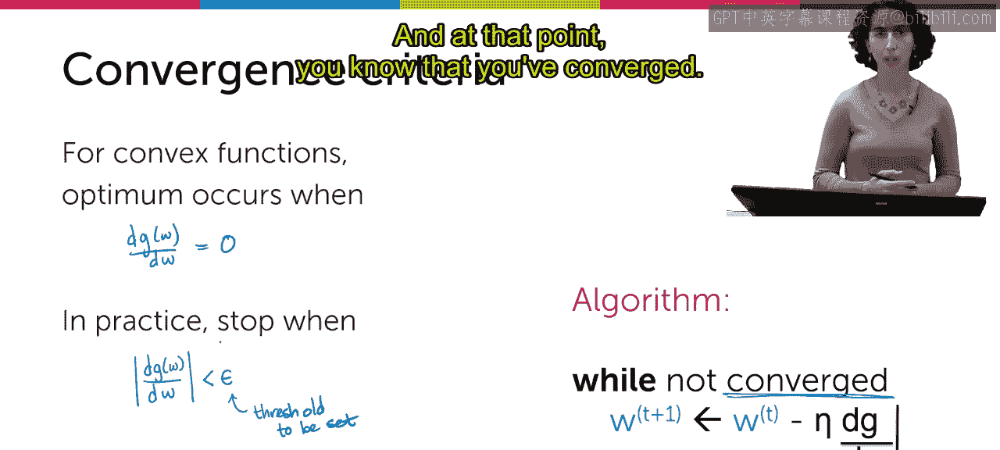

# 华盛顿大学《机器学习（回归，第2课⧸共4课）｜Machine Learning》中英字幕 p19 18_选择步长和收敛准则.zh_en -BV11b421H7XL_p19-

。

So in these algorithms， I said that there's a step size and you might be wondering well how do you choose that step size。

 so remember the step size we denoted as Ada。And there are lots of different choices you can make here and clearly they're very important。

 this determines how much you're changing your W at every iteration of this algorithm。Well。

 one choice you can look at is something called fixed step size or constant step size。

 where as the name implies， you just set eta equal to some constant， so for example maybe 0。1。

But what can happen is that you can jump around quite a lot。 So let's say I start far away。

 there's a really big ra。 I take a very big step and I keep taking these big steps。

 and then here I end up jumping over。The optimal to a point here and then I jump back and then I'm going back and forth and back and forth and I converge very slowly to the optimal itself and so an analogy here is you can think of a snow border in a halfpi where they just keep ramping up and back and up and back and slowly it's decaying。

And slowly they're going to just settle into the groove of that half pipe。

But you can imagine going back and forth and back and forth quite a number of times。

But I should mention that this fixed step size setting will work for a lot of cases we're going to look at in this module because in most of the cases these functions are going to be called they're going to be something that's called strongly convex。

 that's just a really well behave convex function， it's very clearly convex。

 it just never flattens out very much and in those settings you will still converge using this fixed step size。

 it just might take a little while。On the other hand， common choice。Is to decrease the step size。

As the number of iterations increase， okay， so this means that there's some step size it's often called a schedule so I can write that。

Or step size。Schedule that you need to set。And and common choices for this are that。

The step size you're using at iteration T。Is equal to some alpha over t or another common choice is。

S alpha over square root of T。嗯。And let's just plot what these functions look like。

 both of these functions。Look something like this。 So the step size。 so this would be。

The plot of eta of T over iterations T。So the step size is decreasing with the number of iterations。

So why does this make sense Well when I start out I'm typically assuming that I'm going be far decently far from the optimal。

 so I want to take large steps， but as I'm running my algorithm hoping I'm getting closer and I want to hone in more rapidly to the optimal so that's why I start decreasing the step size so that when I'm out here initially maybe I still take a really large jump but then。

As I'm going in。You know，Maybe I'll jump across once。

 but I'm going to hone in much more rapidly to this minimum here。

But one thing you have to be careful about is not decreasing the step size too rapidly because if you're doing that。

 then you're going to again take a while to converge because you're just going to be taking very。

 very， very small steps Okay， so in summary， choosing your step size is a bit of an art but here we've gone through a couple examples of things that are commonly used out there Okay so the other part of the algorithm that we left unspecified is this part where we say while not converged well how are we going to assess our convergence。

Well we know that the optimum occurs when the derivative of the function。Is equal to zero。Am。

But what we're going to see in practice is that the derivative it's going to get smaller and smaller and smaller and smaller and smaller。

 it's going to get very very， very， very， very， very， very small。

 but it won't be exactly zero at some point we're going to want to say， okay。

 that's good enough we're close enough to the optimum。

 I'm going to terminate this algorithm and I'm going to say that this is my solution。

So what we're saying is that。What we're going to need to specify is something where we say when the absolute value of the derivative。

 I don't care if I'm a little bit to the right or a little bit to the left of the optimum。

 but just what the absolute value is，If that is less than some epsilon。

So this is a threshold that I'm setting。嗯。Then if this is satisfied。

 then I'm going to terminate the algorithm and return whatever solution I have， WT。So in practice。

 we're just going to choose epsilon to be very small。

 and I want to emphasize that what very small means depends on the data that you're looking at。

 what the form of this function is， what are the range of gradients we might expect。

Is the value of the function， a plot of the value of the function over iterations。

 and you'll tend to see that the value decrease and it's basically not changing very much and at that point you know that you've converged。

