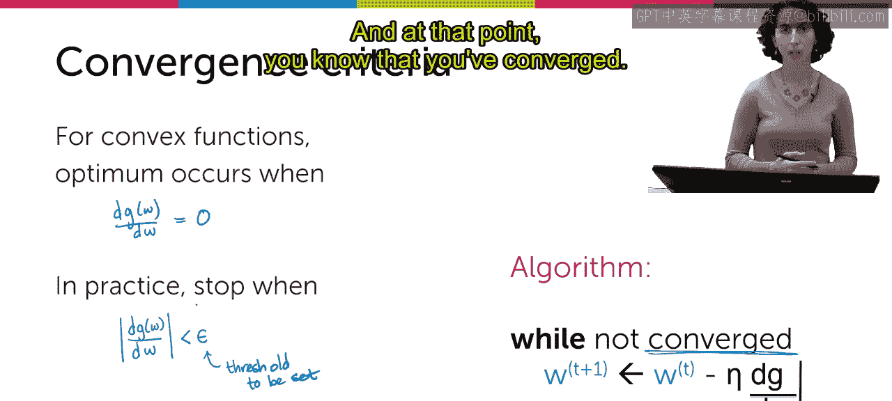

# 机器学习：第2课：选择步长与收敛准则

在本节课中，我们将学习梯度下降算法中的两个关键实践要素：如何选择步长（学习率）以及如何判断算法何时收敛。理解并正确设置这两个参数，对于确保算法高效、稳定地找到最优解至关重要。

## 步长的选择

上一节我们介绍了梯度下降的基本思想，即沿着负梯度方向更新参数。本节中我们来看看如何选择更新时的步长，即学习率 η。

步长决定了每次迭代中参数 **W** 的变化幅度。选择不当可能导致收敛缓慢甚至无法收敛。

以下是几种常见的步长选择策略：

**固定步长**
顾名思义，将步长 η 设置为一个常数，例如 `η = 0.1`。这种方法简单，但在某些情况下，如果步长设置过大，算法可能会在最优解附近反复震荡，需要较长时间才能收敛。不过，对于本模块中将要处理的大部分“强凸”函数（一种性质良好、形状明确的凸函数），固定步长策略通常是有效的。

**递减步长**
另一种常见的选择是随着迭代次数增加而减小步长。这被称为步长调度。其思想是：在开始时，我们可能离最优解较远，因此需要较大的步长快速接近；随着迭代进行，我们希望更精细地调整参数以精确收敛到最优解，因此需要减小步长。

以下是两种常用的递减步长公式：
*   **公式1**：`η_t = α / t`
*   **公式2**：`η_t = α / √t`

其中，`t` 是当前迭代次数，`α` 是一个需要设定的常数。这两种策略都使得步长随着迭代次数 `t` 的增加而减小。需要注意的是，步长衰减速度不宜过快，否则算法后期步长过小，同样会导致收敛速度变慢。

总而言之，选择步长是一门艺术，需要根据具体问题进行调整。上述策略为实践中常用的方法提供了起点。

## 收敛准则

算法中另一个需要明确的部分是“何时停止迭代”，即收敛准则。我们知道，函数在最优解处的梯度（导数）为零。但在实际计算中，梯度值会越来越小，无限接近但很难精确等于零。

因此，我们需要设定一个阈值来判断何时“足够接近”最优解。常见的做法是检查梯度的绝对值是否小于一个预设的极小正数 ε。

**收敛判断公式**：
`|∇f(W_t)| < ε`

如果上述条件满足，我们就终止算法，并返回当前的参数解 **W_t**。在实践中，ε 需要根据具体问题设定为一个非常小的值。所谓“非常小”的含义，取决于数据的尺度、函数的形式以及梯度的可能取值范围。

此外，观察目标函数值 `f(W)` 随迭代次数的变化曲线也是一种直观的辅助判断方法。当函数值在连续多次迭代中基本不再下降时，通常意味着算法已经收敛。

## 总结

本节课我们一起学习了梯度下降算法中两个重要的实践环节。首先，我们探讨了如何选择步长，介绍了**固定步长**和**递减步长**两种策略及其适用场景。接着，我们定义了**收敛准则**，通过判断梯度绝对值是否小于一个阈值 ε 来决定算法何时停止。正确理解和设置这些参数，是成功应用梯度下降法解决实际优化问题的基础。