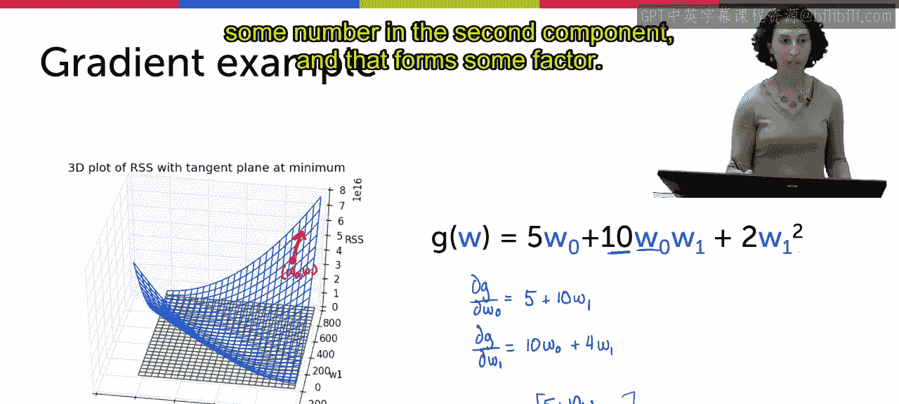

# 华盛顿大学《机器学习（回归，第2课⧸共4课）｜Machine Learning》中英字幕 p20 19_梯度：多维导数.zh_en -BV11b421H7XL_p20-

。

So up until this point we've talked about functions of just one variable and finding their minimum or maximum。

 but remember when we were talking about residual sum of squares， we had two variables。

 two parameters of our model， W0 and W1， and we wanted to minimize over both。嗯。

So let's talk about how we're going to move to functions defined over multiple variables。

 so moving to multiple dimensions here where when we have these functions in higher dimensions。

We don't talk about derivatives anymore， we talk about gradients in their place and what a gradient is。

 so let me write this， this is the notation for the gradient。

Of a function where this w is really a vector。Of different W。 So let's say W 0。

 W1 all the way up to some W。I didn't leave enough room there， sorry， it's to some WP。U。

And what the gradient is， it's pretty straightforward， actually the definition it's going to be。

A vector。we're going to look at what are called the partial derivatives of G。

 so we're going to look at the partial with respect to W0。Partial of G with respect to W1。

W1 all the way up to the partial of G with respect to。Some WP。

And let's describe what one of these looks like， so for example here。This partial derivative。

It's exactly like a derivative where we're taking the derivative with respect to in this case， W1。

 but what are we going to do with all the other Ws， W0， W2， W3 all the way up to WP。

 Well we're just going to treat them like constants。Okay， it's as if there were just numbers like 5。

7 and 10 when we talked about taking derivatives in one dimension。 Okay， so the partial derivative。

Is like a derivative。With respect。To W1 in this case。Treating all other variables as constants。Okay。

 so just to be clear， this gradient。Is in this case， if we assume that theres some。

Variables W0 all the way up to WP。 There's a reason I'm using this notation。

 We'll see it later in this course， but this represents a P plus1 because we're indexing starting at zero。

 This is a P plus one dimensional。Vectctor。Okay。So let's work through a little example here where I defined a function G of w to just be 5 w0 plus 10w0w1 plus 2w1 squared。

And let's compute the gradient of W。 and in this case， there are just two variables。

 so I have to take the partial of G with respect to W0。

 so I'm going to take the derivative of this thing here。Only interested in W 0。 So this term。

 I get a 5。 the next term， Well， I'm treating W1 like a constant， so。

Just like I would take the derivative and get the constant as the result。

 that's what I'll get so there's a 10。And there's a W1。

And then I take the derivative of this term it has nothing to do with W0， it's just like a constant。

 so the result is going to be zero。Now， I take。The partial respect to W1。

And this first term is just a constant with respect to W1。 so it doesn't appear this next term well。

I end up with these two terms。As the coefficient for W1。 and then I get to this last term。And again。

 using the same derivative properties we talked about before， when I have something to a power。

 I'm going to bring that power down so I'm going to get。For。W1 raised to the one power。Okay。

 so my greet aunt。Of， of G is going to be。5 plus 10 W1。10 W0 plus4 W1。So what does this mean？Well。

If I want to look at， let me switch to the red color so you can see it on this plot。

 if I want to look at the gradient。At any point on this surface。Well。

 I'm just going to plug in whatever the W1 and W0 values are at this point， so there's some W0 W1。

Value。 and I'm going to compute。The gradient。And it'll be some vector。 It's just some number。

And the first component sum number and the second component and that form sum vector。

