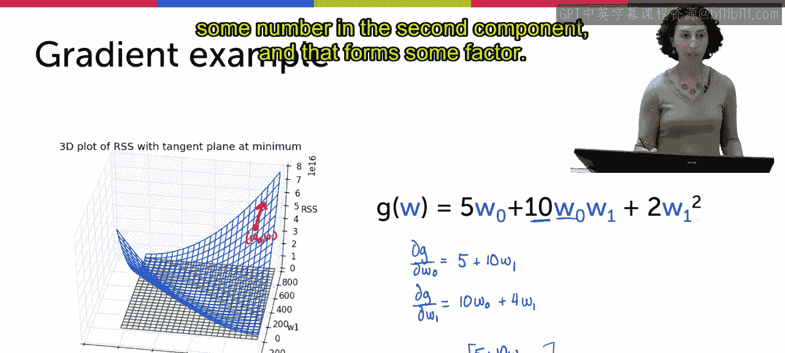

# 机器学习：第2课：梯度：多维导数


在本节课中，我们将学习如何将寻找函数最小值或最大值的思想，从单一变量扩展到多个变量。我们将介绍梯度的概念，它是导数在多维空间中的推广。

---

## 从单变量到多变量

上一节我们讨论了单变量函数的导数及其在寻找极值点中的应用。然而，在机器学习中，我们经常需要同时优化多个参数。例如，在最小化残差平方和时，我们有两个模型参数 **W0** 和 **W1**。本节中，我们来看看如何处理定义在多个变量上的函数。

## 梯度的定义

当我们处理高维空间的函数时，不再使用“导数”这一术语，而是使用“梯度”。梯度是一个向量。

对于一个函数 **G(w)**，其中 **w** 是一个包含多个变量的向量，例如 **w = [W0, W1, ..., Wp]**，其梯度记作 **∇G(w)**。

梯度的定义很直接：它是一个由函数 **G** 对每个变量的**偏导数**组成的向量。

**公式表示：**
```
∇G(w) = [ ∂G/∂W0, ∂G/∂W1, ..., ∂G/∂Wp ]
```

## 理解偏导数

那么，什么是偏导数呢？以 **∂G/∂W1** 为例：

*   **∂G/∂W1** 类似于对 **W1** 求导。
*   关键区别在于，在计算这个导数时，我们将所有其他变量（**W0, W2, W3, ..., Wp**）都视为**常数**。
*   这就像在一维求导中，把系数当作固定数字（如5、7、10）来处理一样。

**核心概念：**
偏导数 **∂G/∂W1** 是函数 **G** 在**仅改变 W1** 而**保持其他所有变量不变**时的变化率。

因此，梯度 **∇G(w)** 是一个 **P+1** 维的向量（如果我们从 **W0** 开始索引到 **Wp**）。

## 梯度计算示例

让我们通过一个具体例子来巩固理解。定义函数：
```
G(w) = 5*W0 + 10*W0*W1 + 2*(W1^2)
```
我们的目标是计算它的梯度 **∇G(w)**。这个函数只有两个变量：**W0** 和 **W1**。

以下是计算步骤：

首先，计算对 **W0** 的偏导数 **∂G/∂W0**：
*   第一项 **5*W0** 对 **W0** 求导，结果是 **5**。
*   第二项 **10*W0*W1** 中，**W1** 被视为常数，因此对 **W0** 求导，结果是 **10*W1**。
*   第三项 **2*(W1^2)** 不包含 **W0**，被视为常数，导数为 **0**。
*   所以，**∂G/∂W0 = 5 + 10*W1**。

接着，计算对 **W1** 的偏导数 **∂G/∂W1**：
*   第一项 **5*W0** 不包含 **W1**，导数为 **0**。
*   第二项 **10*W0*W1** 中，**W0** 被视为常数，对 **W1** 求导，结果是 **10*W0**。
*   第三项 **2*(W1^2)** 对 **W1** 求导，根据幂法则，结果是 **4*W1**。
*   所以，**∂G/∂W1 = 10*W0 + 4*W1**。

因此，函数 **G** 的梯度为：
```
∇G(w) = [ 5 + 10*W1, 10*W0 + 4*W1 ]
```

## 梯度的几何意义

梯度向量有什么作用呢？在函数的图像（例如一个曲面）上，任意一点 **(W0, W1)** 都对应一个梯度值。

**计算方式**：只需将该点的 **W0** 和 **W1** 的具体数值代入梯度公式 `[ 5 + 10*W1, 10*W0 + 4*W1 ]`，就能得到一个具体的二维向量。

这个梯度向量指向函数在该点处**上升最快**的方向，而其反方向则指向函数**下降最快**的方向。这个性质对于后续我们寻找函数最小值（如成本函数）至关重要。

---



本节课中，我们一起学习了如何将导数的概念扩展到多维空间，引入了**梯度**作为由**偏导数**组成的向量。我们通过一个具体例子演示了如何计算梯度，并理解了梯度向量指向函数最陡上升方向的几何意义。在下一课中，我们将利用梯度来寻找多变量函数的最小值。