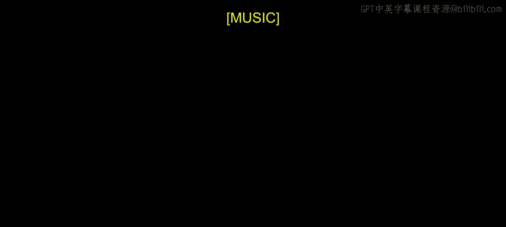
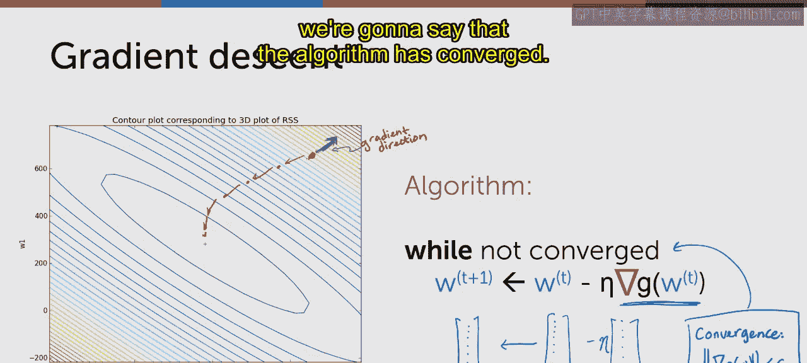
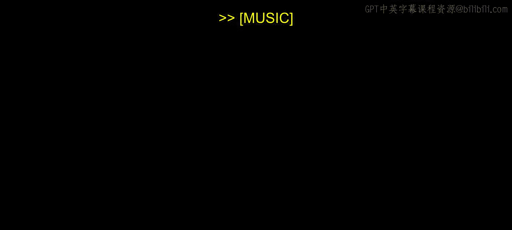

# 华盛顿大学《机器学习（回归，第2课⧸共4课）｜Machine Learning》中英字幕 p21 20_梯度下降：多维下山法.zh_en -BV11b421H7XL_p21-

。

So that defines a gradient， but one thing that's going to be useful is just a different way to visualize the surfaces that we're optimizing over。

 so instead of looking at these 3D mesh plots that we've been looking at。

 we can look at a contour plot where we can kind of think of this as a bird's eye view。那啊。

It's a bird's eye view of this function that we're examining。

Where here we've now taken this 3D mesh and just transformed it to 2D plane。

So we have just in case you can't see it in the slides， this is W0 here and this is W1。

That's a very big zero。Okay， and what each one of these curves is， again。

 I'm going to switch colors to red so it's more visible。So this curve， for example。

Represents just taking this mesh on the left hand side and slicing it。

 So it's just a slice through the 3D。Function。Ah， sorry， the pen is really misbehaving。

Slice of the 3D。Surface。Where all values。Here。Have the same。Value of this function， sorry。

 our functions are called G。W 0， W1。 So let me just step up and say what I'm trying to say here。

 which is。Every W0， W1 pair along。This ellipse here。

Has the same value of the function G because it was just a flat slice through that 3D contour that we're looking at。

Okay， so each of these rings have， in this case they're increasing values of the function as we go from blue blue means a low value of the function all the way out to red。

 that means a high value of the function， we're looking at different slices we're slicing the function at different values and that creates these different contours。

Okay， so this is what's called a contour plot and it's useful because。

It's easier to work with 2D when we're on a 2D surface here。

 so drawing things will be easier with this representation。Okay。

 so that was just a little detour into contour plots so that I can talk about the gradient descent algorithm。

 which is the naous algorithm to what I call the Hill descent algorithm in 1D。

But in place of the derivative of the function we've now specified the gradient of the function。

 and other than that， everything looks exactly the same， so what we're doing。Is we're taking。

We now have a vector of parameters。And we're updating them all at once。

 we're taking our previous vector。And。Where。Updating with our sum。Eta times our gradient。

 which was also a vector， so it's just the vector analog of the Hill descent algorithm。

But if I want to show this a little bit in pictures here。Again。

 switching back to red because it'll be easier to see on this plot。Well， if I'm out here at a point。

The gradient is actually it's pointing in the direction of steepest ascent， so that's uphill。

 it's pointing this way。But we're moving in the negative gradient direction。

Let me specify that this thing here is our ingredient。Graient。Direction。But then our steps。

Are going be in the opposite direction。 So let me actually draw， sorry to take up a little time here。

 but I think it's worthwhile for clarity。 Let me just happen to draw the gradient as a purple vector。

 so it's different from the vectors that I'm going to be drawing right now。Okay。

Because the other vectors that I'm going to be drawing right now are the steps of my gradient descent algorithm。

The actual steps I'm taking。Are gonna be。Moving。Here。Towards。This optimal value。嗯。

So it's exactly like what we saw in the 1D case， but now we're moving in a 2D space。

or really any dimensional space。 But what I'm drawing is just a 2D space。

 And in terms of assessing convergence in this case， well。

 in place of looking at the absolute value of the derivative，We're going to look at。The magnitude。

Of the gradient。And when the magnitude of the gradient is less than some epsilon that we're fixing。

 we're going to say that the algorithm has converged。

。

