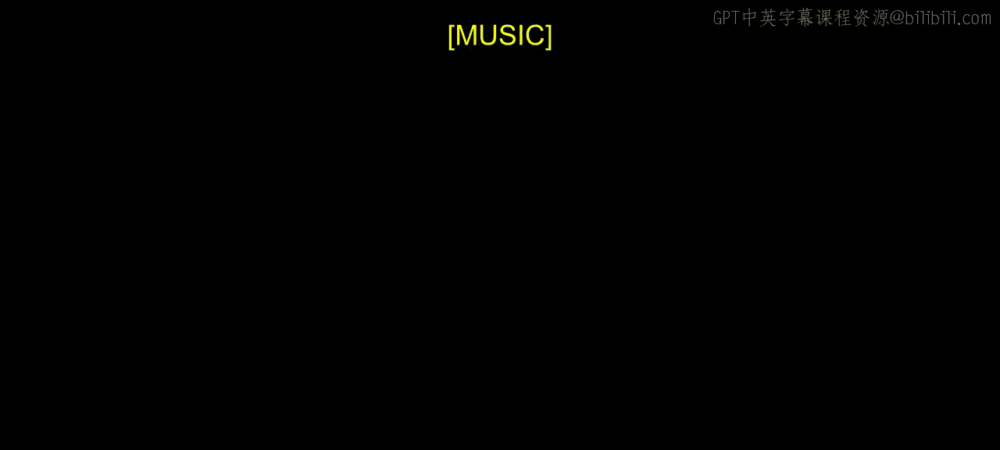
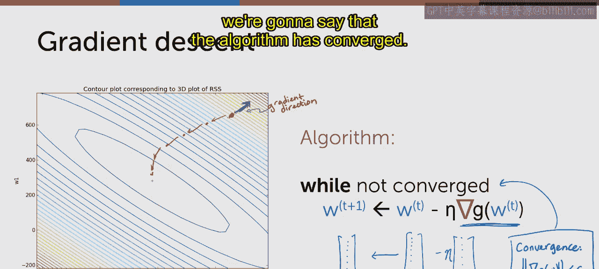
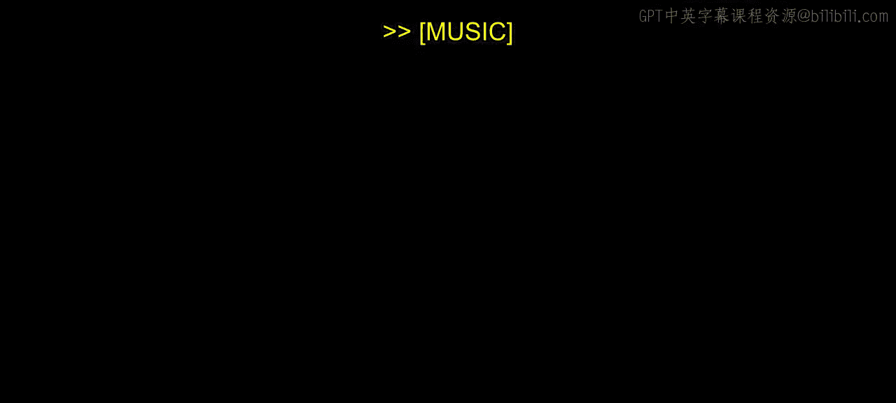

# 机器学习：第2课：梯度下降：多维下山法

在本节课中，我们将学习梯度下降算法在多维空间中的应用。我们将从理解等高线图开始，它为我们提供了观察多维函数的直观方式。接着，我们将把一维的“下山法”推广到多维，并学习如何评估算法的收敛性。

## 等高线图：二维视角

上一节我们介绍了梯度的概念，本节中我们来看看一种可视化优化曲面的不同方法。

我们不再观察之前使用的三维网格图，而是观察等高线图。这可以被视为我们正在研究函数的鸟瞰图。这里，我们将三维网格转换到了二维平面上。

为了清晰说明，图中横轴是 **W0**，纵轴是 **W1**。图中的每一条曲线，都代表从左侧三维曲面中切出的一个切片。在这个切片上，所有点的函数值都相同。

具体来说，沿着这个椭圆上的每一个 **W0** 和 **W1** 参数对，其函数 **G(W0, W1)** 的值都相等，因为它是从我们观察的三维等高面上切出的一个平面切片。

因此，图中的每一个环都代表一个函数值。通常，从蓝色（函数值较低）到红色（函数值较高），环所代表的函数值是递增的。我们通过在不同高度切割函数，得到了这些不同的等高线。

这种图被称为等高线图。它的优势在于，当我们在二维平面上工作时，使用二维表示更便于绘图和操作。

## 梯度下降算法：从一维到多维

了解了等高线图后，我们就可以讨论梯度下降算法了。它是之前一维“下山法”在多维空间的推广。

我们用函数的**梯度**替代了一维情况下的**导数**。除此之外，算法的核心思想完全相同。

以下是算法的步骤：
1.  我们有一个参数向量 **W**。
2.  我们同时更新所有参数。
3.  更新公式为：**W_new = W_old - η * ∇G(W_old)**。
4.  其中，**η** 是学习率，**∇G(W_old)** 是梯度向量。

这个公式就是一维下山法公式的向量形式。

## 算法可视化

为了更直观地理解，让我们在等高线图上描绘这个过程。

假设我们从一个点开始。该点的梯度向量指向函数值**最陡峭上升**的方向，即“上山”的方向。然而，我们的梯度下降算法是沿着**负梯度**方向移动。

因此，算法实际移动的步长方向与梯度方向相反。在图中，这些步长会引导我们朝着函数的最小值（最优值）移动。

这与一维情况完全类似，只不过现在我们是在二维（或更高维）空间中移动。

## 收敛性判断

在一维情况下，我们通过观察导数的绝对值来判断收敛。在多维情况下，我们需要观察**梯度的大小（模长）**。

当梯度的大小小于我们设定的某个阈值 **ε** 时，我们就可以认为算法已经收敛。

本节课中我们一起学习了如何通过等高线图可视化多维函数，并将一维梯度下降法推广到多维空间。我们理解了算法如何通过负梯度方向更新参数，并学会了通过判断梯度模长来评估收敛性。这是优化机器学习模型参数的核心方法之一。