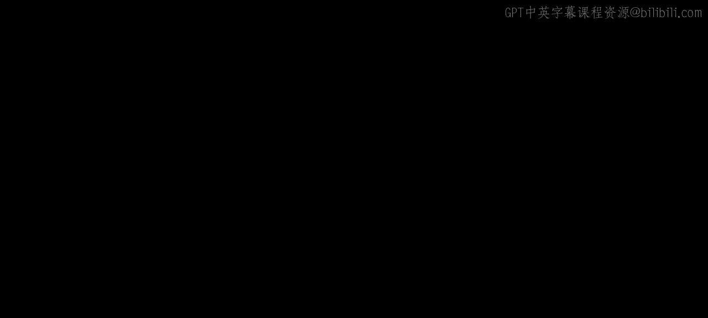
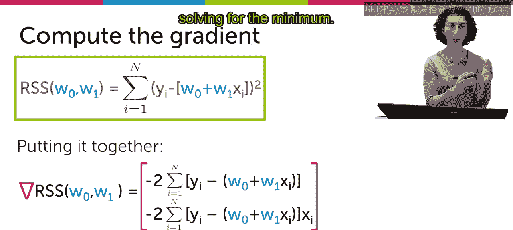
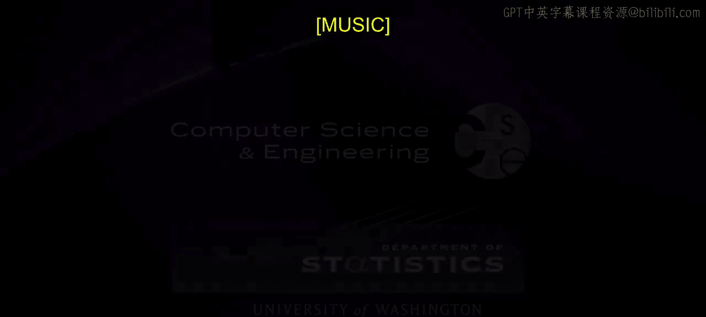

# 华盛顿大学《机器学习（回归，第2课⧸共4课）｜Machine Learning》中英字幕 p22 21_计算RSS梯度.zh_en -BV11b421H7XL_p22-

。

Okay， so now that all of you are optimization experts。

 well we can think about applying these optimization notions and optimization algorithms that we've described to our specific scenario of interest。

 which is searching over all possible lines and finding the line that best fits our data。

So the first thing that's important to mention is the fact that our objective is convex。

 so you can go and show that this is a convex function and what this implies is that。

The solution to this minimization problem。Is unique。

We know there's a unique minimum to this function， and likewise。

 we know that our gradient descent algorithm will converge to this minimum。Graadient descent。

Algorithm。Well。Converge。To the minimum。Okay， so this is good news for trying to find the line that best fits our data because this is a very it sounds like a very complicated problem。

 at least we have to search over all possible lines。And of course。

 we couldn't possibly go and test each one of these lines， and it's very。

 very helpful that there is this property so we can use these very straightforward algorithms that we described to go and solve for the solution to this problem。

Okay， so let's return to the definition。of our cost。

 which is the residual sum of squares of our two parameters， W0 and W1。

 which I've written again right here， but before we get to taking the gradient。

 which is going to be so crucial for our gradient descent algorithm。

Let's just note the following fact about derivatives。

 where if we take the derivative of the sum of functions over some parameter， some variable W。

Then we can write this equivalently， so this sigma notation。It's just shorthand for this。

Full sum over the n terms so n different functions G1 to GN。

 the derivative distributes across the sum， and we can rewrite this as the sum of the derivative Okay。

 so the derivative of the sum of functions is the same as the sum of the derivative of the individual functions。

 So in our case。We have that G I of W， the GI that I'm writing here is equal to。

Y i minus w0 plus W1 X I。Squared。And we see that the residual sum of squares is indeed a sum over n different functions of W0 and W1。

 And so in our case， when we're thinking about taking，The partial of the residual sum。Of squares。

With respect to you， for example， W0， this is going to be equal to。

The sum i equals 1 to n of the partial with respect to w0 of Yi minus w0 plus w1 X I。Squared。

 and the same holds for W1。Okay， so now let's go ahead and actually compute this gradient。

 and the first thing we're going to do is take the derivative or the partial with respect to W0。Okay。

 so。I'm going to use this fact that I showed on the previous slide to take the sum to the outside。

 and then I'm going to take the partial with respect to the inside so I have a function raised to a power so I'm going to bring that power down。

I'm going to get a two here， rewrite the function。That'sW1 X I。

And now the power is just going to be one here， but then I have to take the derivative of the inside and so what's the derivative of the inside when I'm taking this derivative with respect to W0 well。

What I have is I have a minus1 multiplying W0 and everything else I'm just treating as a constant。

 so I need to multiply by minus1。So I'll just rewrite this。

 I'm going to multiply the two by this minus1， I'm going to pull it outside the sum。

 so I'm going to get minus2 sum I equals 1 to n。Y I minus W0 plus W1。Xi。

I promise I'll try and minimize how many derivations we're doing in the slides like this。

 but I think this is really instructive。Let's go ahead and now take the derivative or the partial with respect to W1。

So in this case。Again， I'm pulling the sum out， same thing happens where I'm going to bring the two down。

And I'm going to rewrite the function here， the inside part of the function。

 raise it just to the one power， and then when I take the derivative of this part。

 this inside part with respect to W1， what do I have well all these things are constants with respect to W1。

 but what's multiplying W1， I have a minus X， so I'm going to need to multiply by minus X I。Okay。

 so again， rewriting this， I'm going to take the minus2 to the outside of the sum。

And I'm going to have Yi minus w0 plus w1。XI， it's a good thing you guys can put me on two speed and just get through all of this very quickly。

But here。We're multiplying by X I。 We have this extra term in the derivative with respect to W1。

 Okay， well， let's put this all together。And look， I went ahead and I typed it out。

 so I don't need to write it here， that's good。So this is the gradient of our residual sum of squares。

And it's a vector of two dimensions because we have two variables， W0 and W1。Now。

 what can we think about doing Well， of course we can think about doing the gradient descent algorithm。

 but let's hold off on that because what do we know is another way to solve for the minimum of this function。

And we know we can， just like we talked about in 1 D。

 taking the derivative and setting it equal to zero。

 that was the first approach for solving for the minimum。

Well here we can take the gradient and set it equal to zero。

