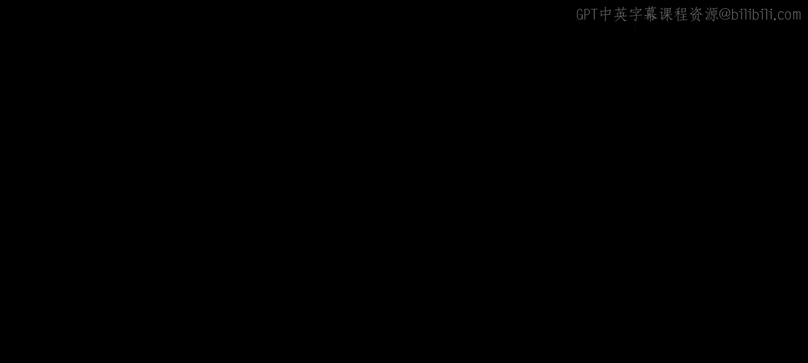
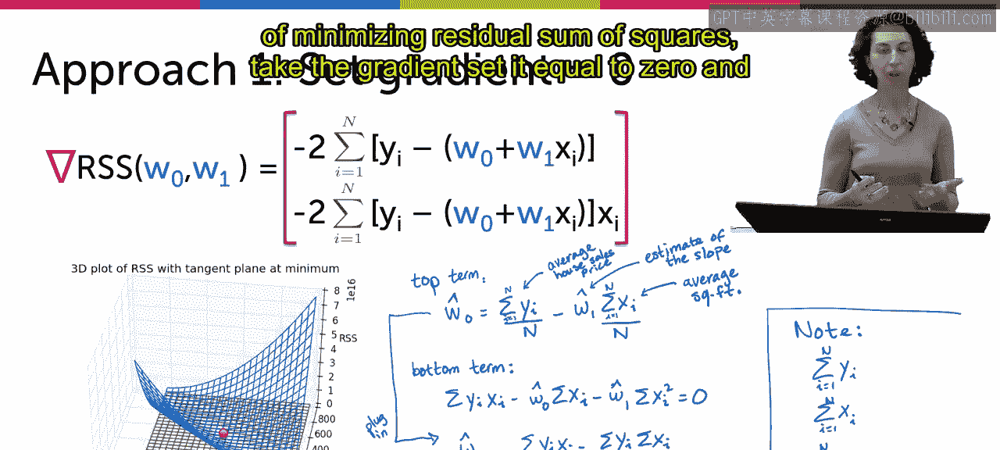
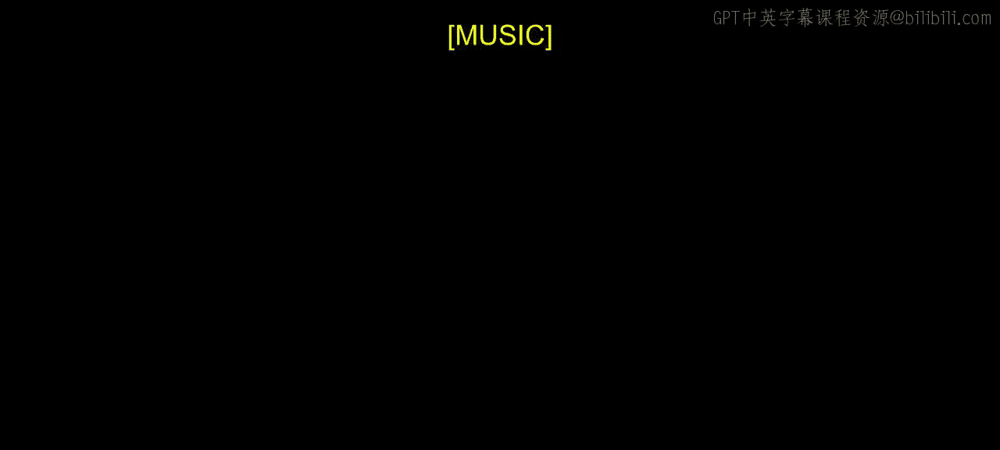

# 华盛顿大学《机器学习（回归，第2课⧸共4课）｜Machine Learning》中英字幕 p23 22_方法1：闭式解.zh_en -BV11b421H7XL_p23-

。

So this is going to be our approach one and。This is drawn here on this 3D mesh plot where that green surface。

Is the gradient at the minimum and what we see is that's where the gradient is equal to zero and that red dot is the optimal point that we're going to be looking at。

Okay， so let's go ahead， take this gradient， set it equal to0。

 solve for w0 and w1 those are going to be our estimates of our two parameters of our model that define our fitted line remember that's our goal okay so I'm going to take the top line and I'm going to do a little bit of algebra I'm going to do it quickly and I'm going to assume that you。

 if you would like to can go through and verify that what I did is correct。

But I'm going to take the first line， and I'm going to set it equal to zero。 The top line。

 when you set it equal to zero results in。W hat0 is equal to the sum of Yi over n。Minus W1 hat。

Some of X I。Over n and these sums go from I equals 1 to n just as they did here。

And the reason I'm putting the hats on are now these are our solutions。

 these are estimated values of these parameters。U。And what we see is that our estimate of the intercept for our regression line。

Well， it takes， what is this， this is our average。How sales price。

But we're not simply going to set W0 equal to the average house sales price。

 We're going to subtract off our estimate。Of the slope。Of the line， that's W hat1。

 And what is this term here that's multiplying W hat 1。 Well， this is our。Average。Square。

Feet of any house in our training data set。Okay， so there's a nice intuitive structure to our estimate for W hat zero。

 but again， this is in terms of W hat 1， so we have to provide another equation to actually get at a solution。

 and so if we look at the bottom line of this gradient the bottom term of this vector。

Shouldn't call it line， I guess I'll call it。The top term。Of the gradient。

 and this is the bottom term of the gradient。If we solve。Set it equal to0。

 we're going to get sum of Y I X minus w hat sum X minus w。

 sorry this should be w0 hat w1 hat sum X I squared equals to0。

And now what I'm going to do is I'm going to take W0。Hat my equation for it。

 and I'm going to plug it in。And so what I end up getting out is that W1 hat once I。

Plug W0 hat in in terms of W1 and solve for W1 hat。

 I get W1 hat is equal to the sum of Y I X I minus sum。Y I sum X I over n。

Divided by some X I squared minus sum X I。S of X divided by n。Anyway。

 the point is that it has a closed form。Pretty straightforward to go and compute what this is and what we see。

I want to note。That what we have to compute to compute W hat1 and then plug that in and compute W hat zero is we need to compute just a couple terms we need to compute some over all of our observations。

 Yi， we need to compute or our outputs， Y I， some over all of our inputs。

 Xi and then a few other terms that are multipliers of this。Or of our input and output。

So we need to compute just four different terms， plug them into these equations。

 and we get out what our W hat zero and W hat1 is。The optimal values that are minimizing are residual sum squares。

 but the take home message here is that one way we can solve this optimization problem of minimizing residual sum squares。

 take the gradient， set it equal to zero， and this is the result。

