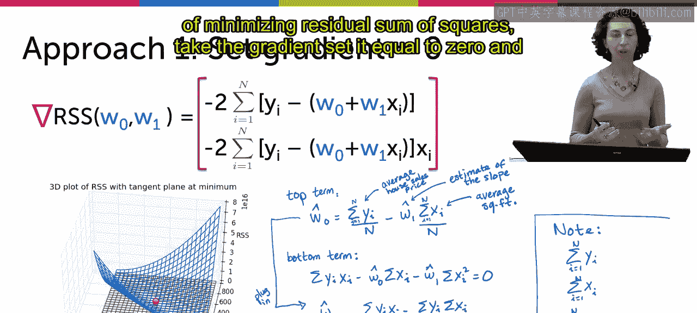

# 机器学习：第2课：方法1：闭式解 📐


在本节课中，我们将学习求解线性回归模型参数的第一种方法：闭式解。我们将通过将损失函数的梯度设为零，直接推导出模型参数 `w0` 和 `w1` 的解析解。

## 概述

我们的目标是找到一条最佳拟合线，以最小化残差平方和。这可以通过求解一个优化问题来实现。本节将展示如何通过数学推导，直接计算出最优参数 `w0` 和 `w1` 的闭式解公式。

## 梯度与最优解

上一节我们介绍了残差平方和作为损失函数。本节中我们来看看如何通过求导并令其为零来找到最小值点。

在三维网格图中，梯度为零的点（图中绿色曲面与零平面相交处）对应着损失函数的最小值。红色圆点即为我们寻找的最优参数点 `(w0, w1)`。

我们的方法是：对损失函数关于 `w0` 和 `w1` 分别求偏导，得到梯度向量，然后令该梯度向量等于零向量。

**梯度向量公式如下：**
```
∇RSS(w0, w1) = [ ∂RSS/∂w0, ∂RSS/∂w1 ]^T
             = [ -2 * Σ(y_i - w0 - w1*x_i), -2 * Σ((y_i - w0 - w1*x_i) * x_i) ]^T
```

接下来，我们令这个梯度等于零，并求解 `w0` 和 `w1`。

## 求解参数 w0 和 w1

以下是求解步骤。我们将梯度向量的两个分量分别设为零，并解方程组。

首先，令第一个分量（关于 `w0` 的偏导）等于零：
```
-2 * Σ(y_i - w0 - w1*x_i) = 0
```
经过代数运算，我们可以得到 `w0` 的估计值 `ŵ0` 的表达式：
```
ŵ0 = (Σy_i / n) - ŵ1 * (Σx_i / n)
```
这里，`ŵ0` 和 `ŵ1` 上的“帽子”符号表示它们是参数的估计值。

这个结果具有直观意义：我们的截距估计 `ŵ0` 等于输出 `y`（房价）的平均值，减去斜率估计 `ŵ1` 与输入 `x`（面积）平均值的乘积。然而，这个表达式仍然依赖于未知的 `ŵ1`，因此我们需要第二个方程。

接着，我们令第二个分量（关于 `w1` 的偏导）等于零：
```
-2 * Σ((y_i - w0 - w1*x_i) * x_i) = 0
```
将上面得到的 `ŵ0` 表达式代入这个方程，然后求解 `ŵ1`。经过推导，我们得到 `ŵ1` 的闭式解：

**核心公式：**
```
ŵ1 = [ Σ(y_i * x_i) - (Σy_i * Σx_i)/n ] / [ Σ(x_i^2) - (Σx_i)^2/n ]
```

得到 `ŵ1` 后，再将其代入 `ŵ0` 的表达式，即可计算出 `ŵ0`。

## 计算要点

为了计算 `ŵ1` 和 `ŵ0`，我们只需要从训练数据中计算几个简单的统计量：

以下是需要计算的四个关键项：
1.  `Σy_i`：所有输出值（房价）的总和。
2.  `Σx_i`：所有输入值（面积）的总和。
3.  `Σ(y_i * x_i)`：每个样本的输出与输入乘积的总和。
4.  `Σ(x_i^2)`：所有输入值平方的总和。

将这些值代入上述公式，就能直接得到最优的参数估计。

## 总结

本节课中我们一起学习了求解线性回归参数的**闭式解法**。该方法的核心是：
1.  构建残差平方和损失函数。
2.  对参数 `w0` 和 `w1` 求偏导，得到梯度。
3.  **令梯度等于零**，形成一个方程组。
4.  解该方程组，推导出 `ŵ0` 和 `ŵ1` 的**解析表达式**。




这种方法的优点是直接、精确，只需一次计算即可得到全局最优解。我们了解到，最终解可以通过几个基础的数据汇总量（总和、平方和、乘积和）方便地计算出来。