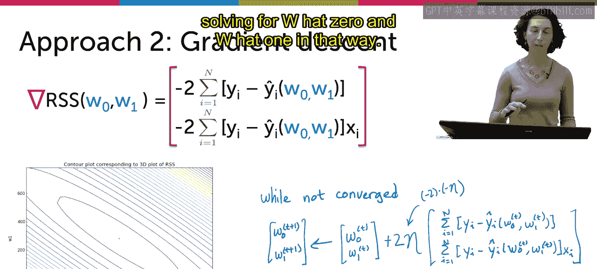

# 华盛顿大学《机器学习（回归，第2课⧸共4课）｜Machine Learning》中英字幕 p24 23_方法2：梯度下降.zh_en -BV11b421H7XL_p24-

。

Okay， well， like we discussed， the other approach that we can take is to do gradient descent where we're walking down this surface of residual sum of squares。

 trying to get to the minimum， of course we might overshoot it and go back and forth。

 but that's the general idea that we're doing this iterative procedure。And in this case。

It's useful to reinterpret this gradient of the residual sum squares that we computed previously。

 So this is what we've been working with。 But what I want to point out here is that this term Y I。

 this is our。Actual。How sales observation？And what is this term here？Well。

 it's the predicted value if we use。W0 and W1 to form that prediction。I'll call it。

The predicted value。Yhy hat， I， but I'm going to write it a function of W0 and W1 to make it clear that it's the prediction I'm forming when using W0 and W1。

Okay， so what we can do is。Rewrite this residual sum of squares。

In terms of these predicted observation values。Then when we go to write our gradient tocent algorithm。

 what's the algorithm say well we have while not converged。We're going to take our previous。

Vectctor of W0 at iteration T， W1 at iteration T。And what are we going to do while we're going to subtract。

' goinging to write it up here， we're going to subtract Eta times the gradient。

Maybe I'll write it in two steps， so we're subtracting。Ada。

Times the gradient and what's the gradient the gradient is。-2。Someam。I equals1 to n。Y I minus。

Yhy I hat W0 at iteration T。That's the value I'm using to predict my observation I。

 W1 at iteration T。And likewise， for。The second component for W1， but in this case。

I'm going to have to multiply by Xi because the gradient is a little bit different here。We want tea。

And then I'm going to multiply this by X I。And。That is my update to form。My next。Estimate of。

W0 and W1。Okay， let me just quickly rewrite this in the way that I was going to before where I see in both components of this gradient vector I have this minus2 term here and I have a minus atus I'm going to bring that minus2 out here。

 so I'm just going to erase this and rewrite this the minus2。

Times minus eta is going to turn into a plus sign。So I'll just write this explicitly。

 this was from minus2 times minus8ta。Okay， so we are doing gradient descent。

 even though you see a plus sign， we're still doing gradient descent。

 it's just that our gradient had a negative sign and that made it become a positive sign here， okay？

But I wanted in this form to provide a little bit of intuition here。

 because what happens if overall we just tend to be underestimating our values y。If overall were。

Under predicting。Why had I then。We're going to have that the sum。

Of Y I minus Y hat I is going to be positive because we're saying that Y hat I is always below or in general below the true value Y I。

 So this is going to be。Positive。And what's going to happen？Well。This term here。Is positive。

We're multiplying by a positive thing and adding that to our our W。 So W0。Is。Ging。To increase。

And that makes sense because we have some current estimate of our regression fit。

But if in general we're under predicting our observations， that means probably that line is too low。

 so we want to shift it up and what does that mean， that means increasing W0。

 so there's a lot of intuition in this formula for what's going on in this gradient descent algorithm and that's just talking about this first termw0。

 but then there's a second term W1 which is the slope of the line。

 and in this case there's a similar intuition。So I'll say similar intuition。For W1。

But we need to multiply by this XI accounting for the fact that this is a slope term。Okay。

 so that's our gradient descent algorithm for minimizing our residual sma squares where when we assess convergence。

 what we're going to output。Is W hat zero， W hat 1， that's going to be our fitted regression line。

And this is an alternative approach to studying the gradient equal to zero and solving for W hat zero and W hat1 in that way。

