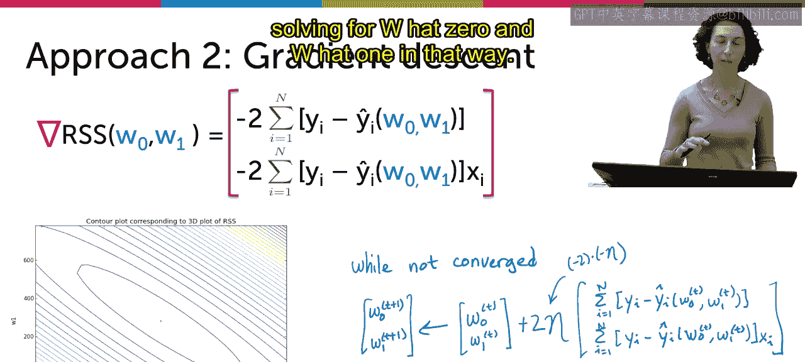

# 机器学习：第2课：方法2：梯度下降 📉


在本节课中，我们将学习线性回归的第二种核心优化方法：梯度下降。我们将了解其工作原理、更新公式背后的直观含义，以及如何通过迭代过程找到最小化残差平方和的最佳参数。

---

上一节我们讨论了通过求解梯度为零的方程来找到最佳拟合线。本节中我们来看看另一种迭代方法：梯度下降。其核心思想是沿着残差平方和构成的曲面“下坡”，逐步逼近最小值点。虽然过程中可能会因步长问题而出现反复，但总体方向是明确的。

为了应用梯度下降，我们需要重新审视之前计算过的残差平方和梯度公式。回顾一下，残差平方和关于参数 **w0** 和 **w1** 的梯度为：

**梯度公式：**
```
∇RSS(w) = [ ∂RSS/∂w0, ∂RSS/∂w1 ]^T
        = [ -2 * Σ(y_i - ŷ_i), -2 * Σ((y_i - ŷ_i) * x_i) ]^T
```
其中，**ŷ_i = w0 + w1 * x_i** 是使用当前参数 **w0** 和 **w1** 对第 **i** 个观测值的预测值。

我们可以利用这个梯度来设计迭代算法。梯度下降算法的基本框架如下：

以下是梯度下降算法的步骤：

1.  **初始化**：为参数 **w0** 和 **w1** 选择初始值（例如，设为0）。
2.  **迭代更新**：在未达到收敛条件时，重复以下步骤：
    *   计算当前参数下，所有数据点的预测值 **ŷ_i** 和残差 **(y_i - ŷ_i)**。
    *   按照以下公式更新参数：
        ```
        w0_new = w0_old + η * 2 * Σ(y_i - ŷ_i)
        w1_new = w1_old + η * 2 * Σ((y_i - ŷ_i) * x_i)
        ```
        这里，**η** 是学习率，控制每次更新的步长。
3.  **输出结果**：当参数变化非常小或达到最大迭代次数时，算法收敛。我们输出最终的 **ŵ0** 和 **ŵ1** 作为拟合的回归线参数。

注意，原梯度公式中的负号（-2）与减去梯度（-η * 梯度）中的负号相结合，使得更新公式中出现了加号（+）。这并不改变梯度下降的本质，我们依然是在向梯度反方向（即函数下降最快的方向）移动。

这个公式具有很好的直观解释。考虑截距项 **w0** 的更新：**Σ(y_i - ŷ_i)**。如果模型整体上**低估**了真实值 **y**（即预测值普遍偏小），那么残差和将为**正数**。根据更新公式，一个正数会被加到 **w0** 上，从而使其增大。这完全合理，因为如果回归线整体偏低，我们确实需要将其向上平移，即增加截距 **w0**。

对于斜率项 **w1** 有类似的直观解释，但需要乘以对应的 **x_i**。这考虑了每个数据点对斜率调整的贡献权重。

---



本节课中我们一起学习了梯度下降法。这是一种通过迭代调整参数来最小化目标函数（如残差平方和）的通用优化算法。我们推导了其在线性回归中的应用公式，并解释了更新步骤背后的直观意义。与直接求解正规方程相比，梯度下降法更适合大规模数据集或更复杂的模型。最终，我们通过算法输出拟合的回归线参数 **ŵ0** 和 **ŵ1**。