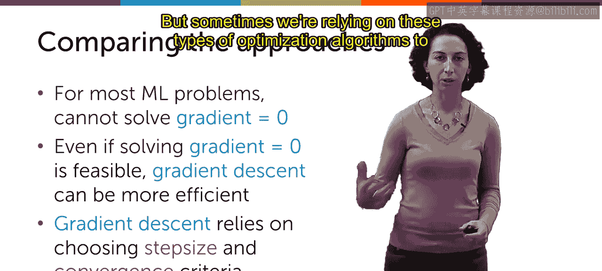

# 华盛顿大学《机器学习（回归，第2课⧸共4课）｜Machine Learning》中英字幕 p25 24_比较两种方法.zh_en -BV11b421H7XL_p25-

。

Okay， so let's take a moment to compare the two approaches that we've gone over。

 either setting the gradient equal to zero or doing gradient descent well in the case of minimizing residual sum of squares。

 we showed that both werere fairly straightforward to do but in a lot of the machine learning methods that we're interested in taking the gradient and setting it equal to zero while there's just no close form solution to that problem so often we have to turn to methods like gradient descent。

And likewise， as we're going to see in the next module where we turn to having lots of different inputs。

 lots of different features in our regression， even though there might be a closed form solution to setting the gradient equal to zero。

 sometimes in practice it can be much more efficient computationally to implement the gradient descent approach and finally one thing that I should mention about the gradient descent approach is the fact that in that case we had to choose a step size and a convergence criteria。

Whereas of course， if we take the gradient and are able to set it equal to zero we don't have to make any of those choices。

 so that is a downside to the gradient asscent approach is having to。

Specify these parameters of the algorithm， but sometimes we're relying on these types of optimization algorithms to solve our optimization objective。

🎼。