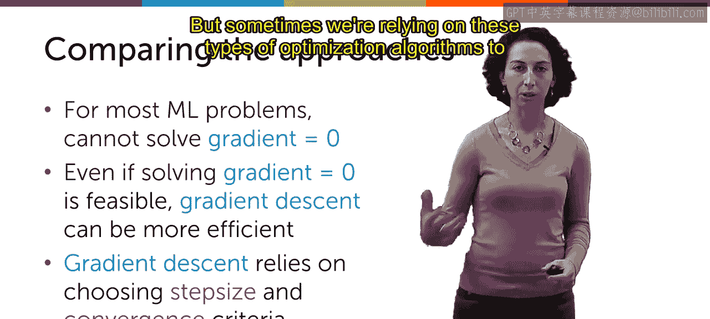

# 机器学习：第2课：比较两种优化方法

在本节课中，我们将比较两种用于最小化残差平方和（RSS）的优化方法：**解析解法**（令梯度等于零）与**梯度下降法**。我们将分析各自的优缺点，并讨论在不同场景下的适用性。

---

## 两种方法的回顾

上一节我们介绍了如何通过最小化残差平方和来拟合线性回归模型。本节中，我们来看看两种实现这一目标的具体方法。

第一种方法是**解析解法**，即直接对目标函数求导，并令导数等于零，从而解出参数的闭式解。对于线性回归的RSS目标，其梯度公式为：

**∇RSS(w) = -2Xᵀ(y - Xw)**

令其等于零，可得到最优参数的解析解：

**w* = (XᵀX)⁻¹Xᵀy**

第二种方法是**梯度下降法**，这是一种迭代优化算法。它通过反复沿负梯度方向更新参数来逼近最小值。其参数更新规则为：

**w_new = w_old - η * ∇RSS(w_old)**

其中，**η** 代表学习率（步长）。

---

## 两种方法的比较

以下是两种方法关键特性的对比分析：

**1. 解的精确性与形式**
*   **解析解法**：直接提供精确的闭式解。
*   **梯度下降法**：通过迭代提供近似解，精度取决于收敛准则。

**2. 计算复杂度与适用性**
*   **解析解法**：涉及矩阵求逆 **(XᵀX)⁻¹**。当特征维度很高或矩阵接近奇异时，计算可能非常昂贵或不稳定。
*   **梯度下降法**：每次迭代计算量较小，尤其适用于特征维度极高或数据量巨大的场景，因为可以避免直接计算矩阵逆。

**3. 算法参数需求**
*   **解析解法**：无需设置算法参数。
*   **梯度下降法**：需要手动选择学习率（步长）和收敛判断准则，这些选择会影响算法的效率与最终结果。

**4. 通用性**
*   **解析解法**：仅适用于存在闭式解的目标函数（如线性回归的RSS）。对于更复杂的机器学习模型（如逻辑回归、神经网络），通常不存在闭式解。
*   **梯度下降法**：是一种通用优化框架，只要目标函数可微，即可应用。它是训练大多数复杂机器学习模型的核心方法。

---

## 总结

本节课中我们一起学习了两种优化方法的核心区别。

*   当问题存在**简单闭式解**且计算可行时（如基础线性回归），**解析解法**是直接高效的选择。
*   然而，在大多数现代机器学习场景中，面对**高维数据**、**大数据集**或**复杂模型**（其目标函数无闭式解），**梯度下降法**及其变种因其灵活性和可扩展性而成为不可或缺的工具。其代价是需要谨慎调整学习率等参数。

理解这两种方法的原理与权衡，将帮助你在不同情况下选择合适的优化策略。