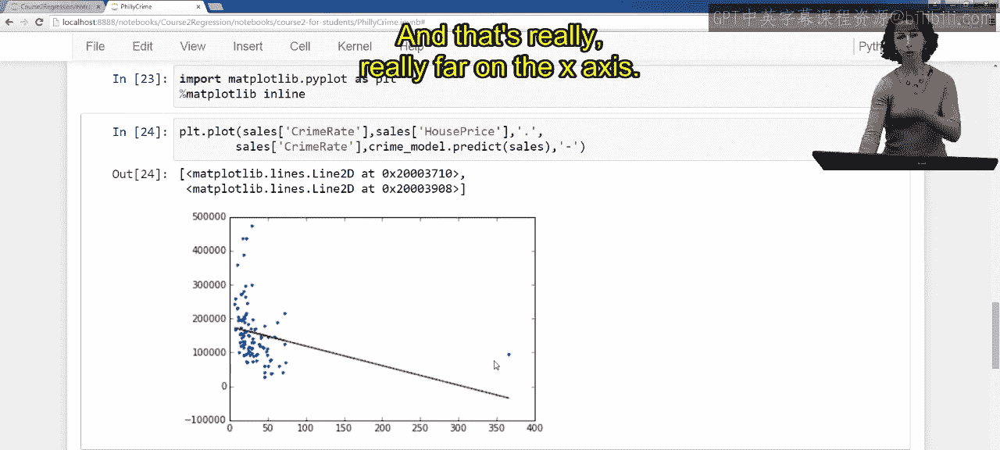

# 华盛顿大学《机器学习（回归，第2课⧸共4课）｜Machine Learning》中英字幕 p26 25_高杠杆点的影响：探索数据.zh_en -BV11b421H7XL_p26-

。

Now we're going to discuss an important issue of the influence of what are called high leverage points。

 and these are points that can be considered influential observations， but to have this discussion。

 I think it's really useful to just look at some data。

So to start with let's fire up GraphLb and then let's load some data and for this we're going to load our data into our S frame and I'm going to assume that you guys are familiar with a lot of what I'm doing here from the foundations course where we went through pretty slowly。

A lot of the GraphLb related code that we're seeing here。

 and I want to emphasize that throughout this course you'll actually learn how to implement these methods。

 but for the sake of this demo and other demos in this course。

 we're going to just use GraphLb C to keep the discussion at a much higher level about the concepts that we're trying to convey。

Okay， so the data set that we're looking at here in this example。

Is a Philadelphia housing data where in particular a data consists of the average house price in a whole collection of towns in the greater Philadelphia region。

 and we also have information about crime rates in each one of these towns。

 as well as how far that town is from Center City and Center City is the downtown region of Philadelphia。

So let's start analyzing this data。And to do this， what we're going to start with is just making a scatter plot of what's the relationship between。

Average house sales prices and crime rates。Okay， so here we are。

 we're going to do just a dot show command to show a scatter plot。Of。On the X axis。

 we have crime rate and each one of these little blue circles or can light blue circles is a different town in our data set and we have a total of 98 different towns and on the Y axis what we have is the average house value in that town。

Okay and so from this you can see that there's some relationship between our crime rate and our house sales price in particular we see that for towns that have lower crime rates。

 they tend to have higher house values and vice versa so that makes a lot of sense。

 so let's try and actually fit a relationship between crime rate and house price。

 so we're going to go through。And fit this regression model。

 doing our standard dot linear regression command， taking our。

Target or our output to be the house price in that region。

And taking our features to just be a single feature， which is crime rate in that town。Okay。

 so now what we've done is we've output this to something called crime underscore model and now let's look at what this fit results in so let's just。

Import our mappplloot LibB library to start making some plots here。

And what we're going to show is we're going to show a plot。Of the observations I we showed before。

 as well as our fitted line。 So this is our。Fitted。

 simple linear regression model is this green line。

 so these are predictions of house values for each crime rate going from zero up to somewhere around。

 I don't know， 360 or something like this。So we do see a trend where house value decreases as crime increases。

 the slope of this line is negative， but one thing that we pretty immediately see is there's an observation out here。

 there's this blue dot， which has extremely high crime rates， but the house value is。

 I mean it's low ish， not you know， but it's not as low。

 as the house values in other regions that have significantly lower crime rates。

And we see that our line， our fitted line， is getting pulled towards this observation that's all the way out here。

So it' it's being， at least it looks like from the picture being heavily influenced by this one observation that's really。

 really far on the X axis。

