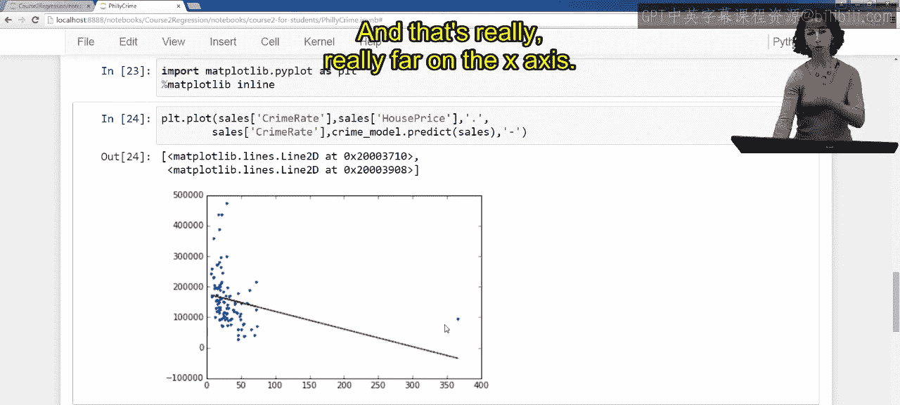

# 机器学习：第2课：高杠杆点的影响：探索数据 🎯

在本节课中，我们将要学习一个重要的概念——高杠杆点的影响。这些点可以被视为有影响力的观测值。为了深入理解这个概念，直接观察一些数据会非常有帮助。

## 数据加载与初步观察

首先，让我们启动GraphLab并加载一些数据。我们将数据加载到一个SFrame中。我假设大家通过基础课程的学习，已经对这里使用的GraphLab相关代码比较熟悉。需要强调的是，在本课程中，你将学习如何实现这些方法，但为了本次演示以及本课程中的其他演示，我们将使用GraphLab来保持讨论在更高的概念层面。

我们在这个例子中使用的数据集是费城住房数据。具体来说，该数据集包含了费城大都会区一系列城镇的平均房价信息，以及每个城镇的犯罪率数据，还有该城镇距离市中心（Center City，即费城中心城区）的距离。

让我们开始分析这些数据。首先，我们将创建一个散点图，来观察平均房屋售价与犯罪率之间的关系。

以下是创建散点图的步骤：

*   在X轴上，我们绘制犯罪率。每个浅蓝色的圆点代表数据集中的一个不同城镇，我们总共有98个不同的城镇。
*   在Y轴上，我们绘制该城镇的平均房屋价值。

从图中可以看出，犯罪率与房屋售价之间存在一定的关系。具体来说，犯罪率较低的城镇往往拥有较高的房屋价值，反之亦然。这很符合我们的直觉。

## 拟合回归模型

接下来，让我们尝试拟合犯罪率与房价之间的关系。我们将使用标准的线性回归命令来拟合这个模型。

我们将目标变量（输出）设置为该区域的房价，特征则仅使用该城镇的犯罪率这一项。

现在，我们已经将拟合结果输出到一个名为`crime_model`的对象中。让我们看看这个拟合的结果是什么。

我们将导入matplotlib库来绘制一些图形。我们将展示之前观察到的数据点，以及我们拟合的直线。

这条绿色的线就是我们拟合的简单线性回归模型。它代表了从犯罪率为0到大约360的范围内，每个犯罪率对应的房价预测值。

我们确实看到了一个趋势：随着犯罪率上升，房屋价值下降。这条线的斜率是负的。但是，我们立刻就能注意到一个现象：这里有一个观测点（那个蓝色的点），它的犯罪率极高，但其房屋价值虽然较低，却不像其他犯罪率显著更低的区域的房屋价值那么低。

我们可以看到，我们拟合的直线被这个位于X轴最远端的观测点“拉”了过去。至少从图片上看，这条直线似乎受到了这个单一观测点的严重影响。

## 总结

本节课中，我们一起学习了高杠杆点的概念及其对线性回归模型的影响。通过分析费城住房数据，我们观察到，一个在X轴上远离其他数据点的观测值（高犯罪率城镇）会显著地影响回归线的斜率，使其向该点倾斜。这直观地展示了高杠杆点如何对模型拟合产生不成比例的巨大影响。