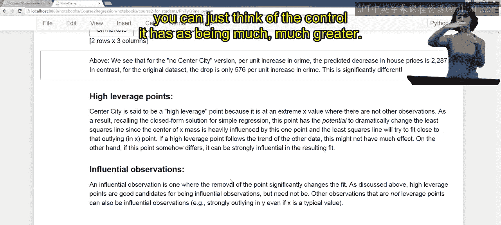

# 华盛顿大学《机器学习（回归，第2课⧸共4课）｜Machine Learning》中英字幕 p27 26_高杠杆点的影响：移除市中心.zh_en -BV11b421H7XL_p27-

。

So let's see what happens if we remove this observation and this observation here。

 this is the observation for center City， that downtown region。

 so not surprisingly that's where a lot of crimes happen。

 but it's also where there's a mixture of low value and very high value home。 So on average。

 the value。Is higher than one might expect for the amount of crime that occurs in that region。Okay。

 so what we're going to do now。Let's just oops， get down to。This line here。

 we're going to simply remove center city from our data， Okay。

 and I know that center City is the town。That is zero miles。

 if we go back to this column that we discussed before。

 it's zero miles to Center City because it is center City。So we're just removing。

That row of our data， and then we're going to redo our scatter plot。If we scroll down， we see that。

What we have is our cloud of points， but for a much smaller range of crime。

 now that outlying center city has been removed。Okay。

 so now what we're going to do is we're going to go and refit。Our simple regression model。

 but on this data set where Center City has been removed。

 so I'm calling this crime model underscore no CC， meaning for no center city observation。

Now let's look at the fit associated。With this new。ModelWell， actually it's the same model。

 but just on a revised data set。And what we see again is this downward trend with house value。

 with increasing crime rate， but we see a much better fit to the observations that are remaining in our data set。

But to make this a little bit more explicit， let's actually compare the coefficients between the fit that we had when Center City was in our data and the fit that we got when we removed Center City。

Okay， so here are the coefficients， our intercept and our slope when we had Center City。

And here are the coefficients when we remove Center City， so let's talk about this slope term。

When Center City was in our data， we said that the average house value decreased by an amount of $576 per unit increase in crime rate remember we know how to interpret these coefficients and that's what I'm doing right now。

In contrast， when I remove Center City。What is the predicted decrease in crime rate I'， I mean sorry。

 predicted decrease in house value that I'm getting per unit increase in crime rate？Now。

 just removing one observation。My predicted decrease is $2287。 That's significantly different。

 So when I'm going and I'm making an interpretation about。

How much crime rate affects drops in house value， I have significantly different interpretations when I include Center City in the data versus removing it。

So now let's just discuss a little bit about why this is。

 and this brings us to two points I've put a little paragraph of text。

 we're going to share these notebooks with you， you can go through。

 rerun everything we're doing do different analyses and also read the comments that I've put here。

 but let's discuss this idea of what are called high leverage points。And influential observations。

So a high leverage point is a point that along the X axis， along our input axis。Is an outlier。

 so it's very in extreme value， either an extremely large or extremely small relative to where we have other observations。

 So if we go back up to the plot。That has center City in it。

 we see clearly that the crime rate associated with Center City is very。

 very different than the crime rates we see for other towns。

So what that means is that point is a high leverage point because if we go back and think about our closedform solution for our simple regression model。

 for estimating the coefficients of this model，Well， if you go and look at those equations。

 you'll see that there's a term that relates to the center of mass of our x values。

 so the average x value。And so including a point that's very far out is going to strongly influence where the center of mass of this line is。

So that's going to dramatically change the fit as well as。

Another term that depends on the value of this observation which is going to have this line trying to get close to this observation and remember we're trying to minimize residual sum of squares so if it ignored it and it just drew a line very steeply going down we'd have a very massive residual sum of squares for this point here so it's going to try and hit this point and thus the influence of that point can be very large okay so this gets us to a point of influential observations Now let's just return to this little text I have here。

Where， just because an observation is a high leverage point。

Meaning that it's outlying either very small， very large X doesn't mean that it's going to strongly influence the fit because if that observation follows the trend of the other data。

Then it might not influence things very much at all， removing that observation。

 you might get a very similar fit， had center city。

 had a similar kind of trend to what we saw for the other observations。However。

 it has the potential to strongly influence the fit， as we've seen in this demo。

So an influential observation is an observation where if you remove it from the data set。

 you get a very different fit。But I also want to emphasize that points that are not high leverage points。

 so points that are actually within our typical X range can be influential observations。

So in particular you can think of an observation that's very outlying in the Y direction in our response so for example。

 a town that has an extremely high value relative to what you might see from other observations。

 well that can also strongly influence the fit， but the potential for doing so as much less when it's in the typical X range if you have dense observations because the fit will be controlled by all these other observations。

 whereas if it's an outlying point you can just think of the control it has as being much。

 much greater。

