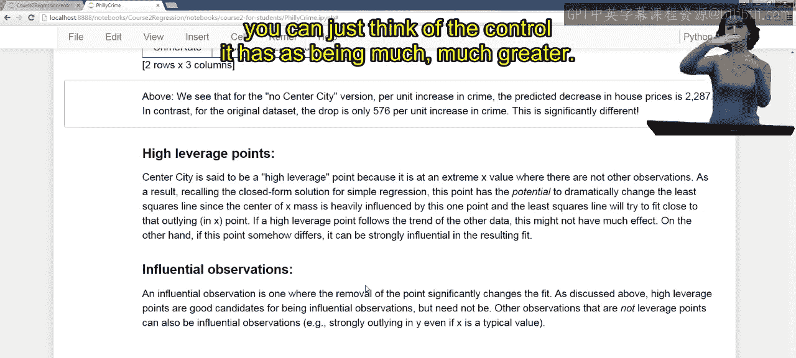

# 机器学习：第2课：高杠杆点与影响点分析

在本节课中，我们将学习线性回归中两个重要的概念：**高杠杆点**和**影响点**。我们将通过一个具体的房价与犯罪率关系的案例，演示如何识别这些点，并理解它们对回归模型拟合结果的巨大影响。

## 移除市中心数据点

上一节我们介绍了如何拟合一个简单的线性回归模型。本节中，我们来看看当数据集中存在极端值时会发生什么。

在初始的数据散点图中，我们注意到一个代表“市中心”的观测点。该点的犯罪率远高于其他城镇，同时其房屋价值也呈现出与犯罪率趋势不符的较高水平。这个点可能对回归线产生不适当的影响。

为了探究其影响，我们将执行以下操作：从数据集中移除这个代表市中心的观测点，然后重新拟合回归模型，并比较系数变化。

以下是具体步骤：
1.  识别并移除犯罪率为0（即市中心本身）的数据行。
2.  在移除该点后的新数据集上重新绘制散点图。
3.  使用相同模型（`house_value ~ crime_rate`）进行拟合。

## 比较模型系数

完成新模型的拟合后，我们需要量化移除一个数据点所带来的影响。最直接的方法是比较两个模型的系数。

我们得到了两组回归系数：
*   **包含市中心时的模型**：斜率为 `-576`。这意味着，根据该模型，犯罪率每增加一个单位，房屋价值平均下降576美元。
*   **移除市中心后的模型**：斜率为 `-2287`。这意味着，根据新模型，犯罪率每增加一个单位，房屋价值平均下降2287美元。

仅仅移除了一个数据点，我们对“犯罪率如何影响房价”的解释就发生了根本性的改变。这引出了我们对高杠杆点和影响点的讨论。

## 理解高杠杆点与影响点

从上面的对比可以看出，单个数据点有时能极大地改变模型。下面我们来定义并区分两个关键概念。

**高杠杆点**是指在其输入变量（X轴）上为异常值的点。它的X值（本例中为犯罪率）远大于或远小于数据集中其他观测值。在数学上，简单线性回归的闭式解中包含与X值的质心（即平均值）相关的项。一个极端的X值会显著改变这个质心的位置，从而影响整个回归线的拟合。

**影响点**是指那些如果从数据集中移除，会导致模型拟合结果发生显著变化的观测点。一个点要成为强影响点，通常需要同时满足两个条件：1）它是高杠杆点（X值异常）；2）它的Y值（响应变量）不遵循数据主体所显示的趋势。

需要强调的是：
*   高杠杆点不一定是强影响点。如果它的Y值恰好落在由其他数据点决定的趋势线上，移除它可能不会显著改变拟合结果。
*   非高杠杆点（即X值在典型范围内的点）也可能成为影响点，例如一个Y值极高的异常点。但是，当X值范围内数据点密集时，其他点会共同制约回归线，因此单个点的影响力相对较小。

本节课中我们一起学习了高杠杆点和影响点的概念。我们通过一个实例看到，一个在X轴上异常的观测点（高杠杆点），如果其Y值也偏离趋势，就可能成为强影响点，极大地改变回归模型的系数和我们对变量关系的理解。在分析数据时，识别并理解这些特殊点至关重要。