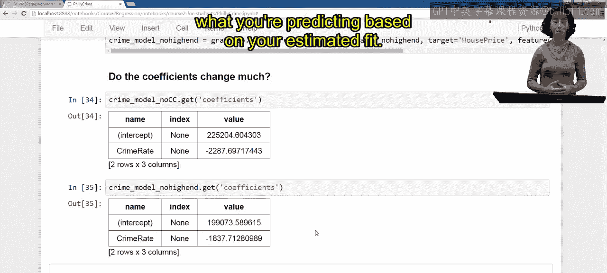

# 华盛顿大学《机器学习（回归，第2课⧸共4课）｜Machine Learning》中英字幕 p28 27_高杠杆点的影响：移除高端城镇.zh_en -BV11b421H7XL_p28-

。

So that's our discussion on high leverage points and influential observations。

 But I want to think about。Whether if you go back to our data。

 I think it's easier to discuss this looking at the observations。Herear what we see。On the top part。

 there's a collection of five different observations。

So these are five different towns that have very high value compared to what you see for all of the other towns。

 so a question is even though these points aren't high leverage points because they're in this typical X range。

Are they influential observations， meaning if we remove these observations。

 will the fit change very much， so now let's just see what happens in this data。Okay。

 so we're going to remove these。What we're saying here we're going to remove these high value outlier neighborhoods and redo our analysis。

So what we're doing here is we're creating a data which I'm going to call sales underscore no high end for no high end towns。

 which takes our data still with Center City removed and just filters out all the towns that have average values greater than $350。

000 so let's fit this new data set and again， let's compare coefficients so I'm going to compare the coefficients to our fit with center city removed to the fit that further removes these highend houses or sorry these high end towns and what you see is yeah。

 there is some influence on the estimated coefficients but not nearly as significant as what we saw by simply removing Center City so in this case we've removed five observations。

Out of a total of 97 observations and we see that the impact of crime rate on predicted decrease in house value changes by a couple hundred dollars。

 but not by the amount that we saw by just removing that onecent city observation earlier on。

 so this shows that high leverage points can be much more likely to be influential observations for just small deviations from the data than outing observations that are within our X our typical X range。

Okay， so the summary of all of this analysis and discussion is the fact that when you have your data and you're making some fit and making predictions or interpreting the coefficients。

 it's really， really important to do some data analysis to do visualizations of your data or different checks for whether you have these highleage points or these outline observations and checking whether they might potentially be these influential observations。

 because that can dramatically change how you're interpreting or what you're predicting based on your estimated fit。

