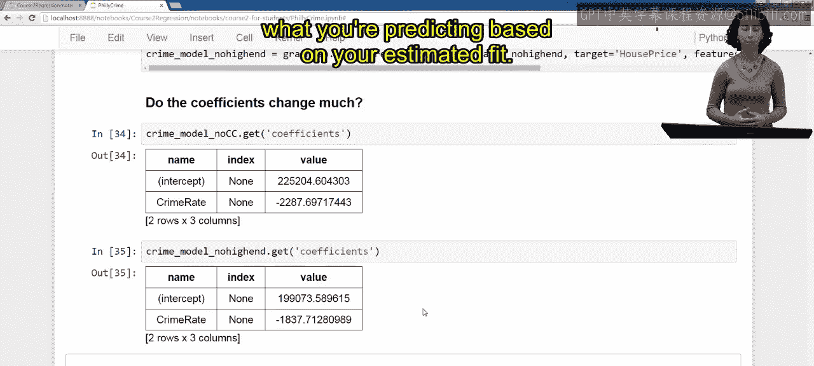
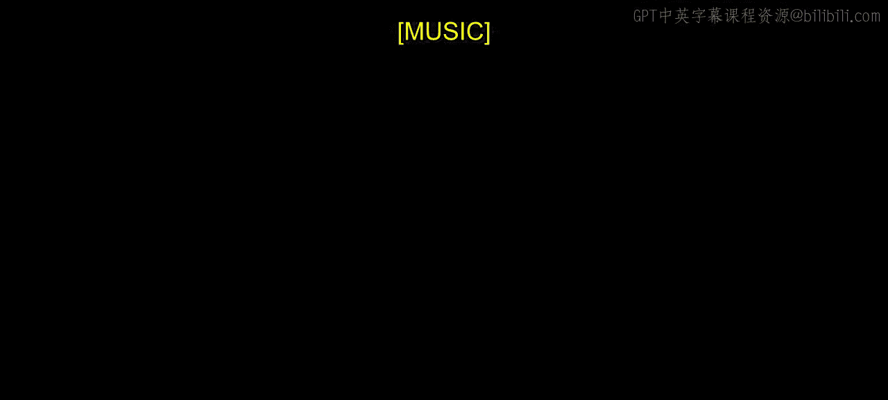

# 机器学习：第2课：高杠杆点与影响点分析


在本节课中，我们将学习如何识别和处理线性回归中的高杠杆点与影响点。我们将通过一个实际案例，探讨移除不同类型的数据点对回归模型系数估计的影响，并理解进行数据分析和可视化检查的重要性。

## 高杠杆点与影响点的回顾

上一节我们介绍了高杠杆点和影响点的概念。高杠杆点是指在自变量（X）空间上远离其他数据点的观测值，它们对回归线的拟合位置有潜在的巨大影响。影响点则是指那些如果被移除，会显著改变模型拟合结果的观测值。

## 分析高价值城镇的影响

现在，让我们回到数据集中，通过观察具体的观测值来探讨这个问题。下图展示了数据的一部分：


在图的顶部，我们可以看到五个不同的观测值聚集在一起。这代表五个不同的城镇，它们的房屋平均价值远高于数据集中所有其他城镇。

一个关键问题是：尽管这些点因其X值（如犯罪率）处于典型范围内而不是高杠杆点，但它们是否属于影响点？换句话说，如果我们移除这些观测值，模型的拟合结果会发生很大变化吗？接下来，让我们在数据中验证这一点。

## 移除高价值城镇的实验

我们将执行以下操作：移除这些高价值的异常城镇，并重新进行分析。

以下是具体的操作步骤，我们通过代码创建一个新的数据集：

```python
# 创建新数据集，过滤掉平均价值高于35万美元的城镇
sales_no_high_end = sales_data[sales_data['avg_value'] <= 350000]
```

我们首先移除了中心城市（Center City），现在进一步过滤掉所有平均价值大于35万美元的城镇。接着，我们用这个新数据集拟合模型。

## 比较模型系数

现在，我们来比较两个模型的系数。第一个模型是仅移除了中心城市的拟合结果，第二个模型是进一步移除了这些高端城镇后的拟合结果。

比较发现，移除这五个高端城镇确实对估计的系数产生了一些影响，但这种影响远不如之前仅仅移除中心城市那一个观测值时那么显著。

**关键发现**：
*   我们总共移除了 **5** 个观测值（数据总量为97个）。
*   犯罪率对房价预测值的影响系数变化了**几百美元**。
*   这个变化幅度远小于之前仅移除中心城市那**1**个观测值所带来的巨大变化。

这个实验表明，**高杠杆点**（如中心城市）即使与数据主体仅有微小偏差，也远比那些处于典型X值范围内的高价值**异常点**更有可能成为**影响点**。

## 核心结论与最佳实践

综上所述，当您拥有数据并进行模型拟合、预测或解释系数时，进行彻底的数据分析至关重要。

以下是进行有效分析的建议步骤：

*   **数据可视化**：绘制散点图、残差图等，直观检查数据分布和异常点。
*   **检查高杠杆点**：利用杠杆值统计量（如帽子矩阵的对角线元素）识别在自变量空间上特殊的点。
*   **检查影响点**：使用库克距离（Cook‘s Distance）等指标量化每个观测值对模型拟合的影响程度。
*   **敏感性分析**：通过有选择地移除疑似点并重新拟合模型，观察关键系数或预测值的变化幅度。

进行这些检查的原因是，高杠杆点和影响点可能会戏剧性地改变您基于估计模型所做出的解释或预测。忽略它们可能导致模型不稳定、结论不可靠。

## 课程总结

在本节课中，我们一起学习了：
1.  区分了**高杠杆点**（X空间异常）和**影响点**（显著改变模型拟合的点）。
2.  通过案例实验发现，一个**高杠杆点**（中心城市）对模型系数的影响，远大于多个处于典型X范围内的高价值**异常点**。
3.  掌握了在回归分析中，通过**可视化**和**统计诊断**来识别和处理这些特殊数据点的重要性。






