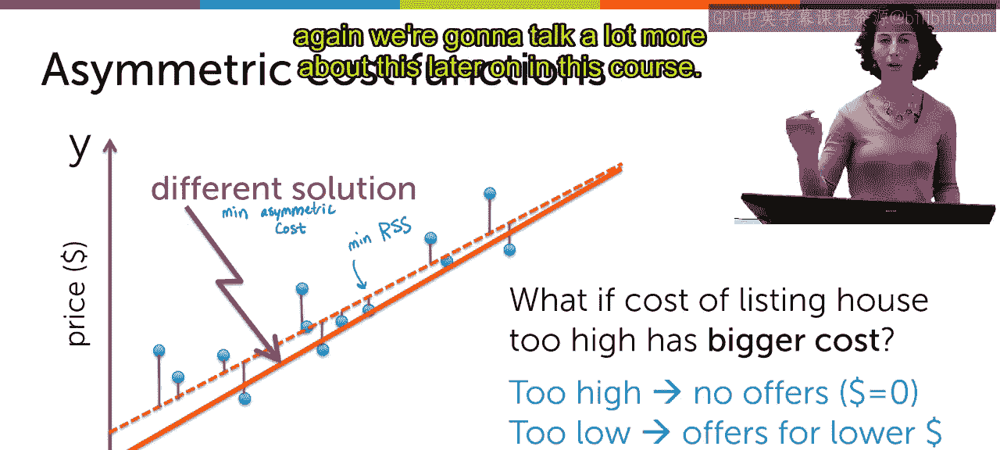

# 华盛顿大学《机器学习（回归，第2课⧸共4课）｜Machine Learning》中英字幕 p29 28_非对称成本函数.zh_en -BV11b421H7XL_p29-

。

Well， the last thing that I want to cover in this module is the fact that we've looked at a very simple notion of errors。

 this residual sum squares and it's actually really， really commonly used in practice。

 but we're going to talk a lot more about different types of errors later in the course。

 but I wanted to go through some of the intuition of what happens if we use a different measure of error so this residual sum squares that we've been looking at is something that's called a symmetric cost function and that's because what we're assuming when we look at this error metric is the fact that if we overestimate the value of our house that has the same cost as if we underestimate the value of the house。

And the question is， do we actually believe that that's the case and what happens if there might not be symmetric costs to these errors？

But what if the cost of listing my house sales price as too high is bigger than the cost。

 if I listed it as too low。 So， for example， if I list the value as too high。

 then maybe no one will even come see the house or they come see it and say， oh。

 it's definitely not worth it。 I'm not putting in an offer。 So the result might be， I get no offers。

 And so as a seller， that's a big cost to me。 I've gone through this whole thing of trying to sell my house。

 I want or need to sell my house。 and I get no offers。 On the other hand。

 if I list the sales price as too low， Of course， I won't get offers as high as I could have。

 if I had more accurately estimated the value of the house。

 But I still get offers and maybe that cost to me is less bad than getting no offers at all。

 For example， if I have to move to another state， I have no choice but to sell my house。Okay。

 so in this case， it might be more appropriate to use an asymmetric cost function where the errors are not weighed equally between these two types of mistakes and instead of this dash orange line here。

U。Which represents our fit when we're minimizing residual sum of squares。

 I will get some different solution。 again， sorry， I love to write over my animations。Here。

 this is the fit minimizing residual sum squares， and this other orange line here is this other solution using an asymmetric loss。

It is asymmetric。Loss， and specifically an asymmetric loss。 let me just say， asymmetric cost。UWhere？

I prefer to underestimate the value then over， and that's what you see here is in general we're predicting the values as lower as compared to the line that we got or our predictions using residual sum squares。

Okay， so that's just a little bit of intuition about what would happen using different cost functions and again we're going to talk a lot more about this later on in this course。

。