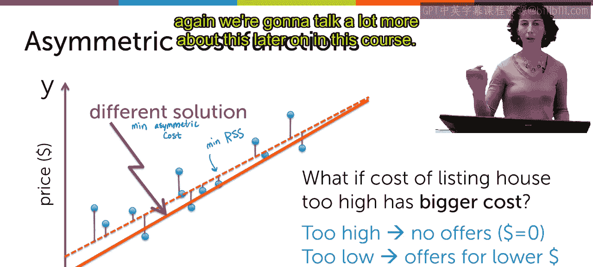

# 机器学习：第2课：非对称成本函数

在本节课中，我们将要学习成本函数的概念，特别是探讨当预测错误的成本不对称时，会发生什么情况。我们将了解对称成本函数（如残差平方和）的局限性，并引入非对称成本函数的基本思想。

## 对称成本函数回顾

上一节我们介绍了残差平方和（RSS）作为衡量模型预测误差的标准方法。其公式为：

**RSS = Σ(y_i - ŷ_i)²**

其中，`y_i`是真实值，`ŷ_i`是预测值。

这个函数被称为**对称成本函数**，因为它假设高估和低估预测值所带来的“成本”或“惩罚”是相同的。例如，在房价预测中，模型认为预测价格比真实价格高10万美元，与预测价格比真实价格低10万美元，所犯的错误程度是一样的。

## 非对称成本的现实场景

然而，在现实世界的许多决策中，不同类型的错误可能带来截然不同的后果。对称假设并不总是成立。

以下是房价预测中的一个例子，说明成本可能不对称：

*   **高估房价的成本**：如果将挂牌价定得过高，可能导致无人看房，或看房后无人出价。最终结果可能是房子完全卖不出去，这对于急需卖房的卖家来说是巨大的损失。
*   **低估房价的成本**：如果将挂牌价定得过低，虽然可能会迅速收到出价，但无法获得房屋应有的最高价值，卖家会损失一部分潜在收益。

在这个场景中，“卖不出去”的成本可能远高于“卖得便宜一些”的成本。因此，高估的错误比低估的错误代价更高。

## 非对称成本函数的影响

如果我们考虑到这种不对称的成本，并设计一个相应的**非对称成本函数**，那么模型拟合出的最优结果将会改变。

与最小化对称的RSS得到的拟合线（下图中的虚线）不同，使用一个**倾向于惩罚高估错误**的非对称成本函数进行优化，会得到一条新的拟合线（下图中的实线）。

如图所示，新的拟合线（实线）整体位于RSS拟合线（虚线）的下方。这意味着模型学会了系统性地给出更保守（更低）的预测，以避免因高估而付出更大代价。

## 总结

本节课中我们一起学习了成本函数的核心概念。我们回顾了**对称成本函数**（如残差平方和）的原理与局限。更重要的是，我们通过房价预测的例子，理解了在实际应用中预测错误成本往往**不对称**。当高估和低估的后果不同时，我们需要使用**非对称成本函数**来训练模型，这将引导模型学习到不同的、更符合实际业务需求的预测策略。在本课程的后续部分，我们将深入探讨更多不同类型的误差衡量方法。