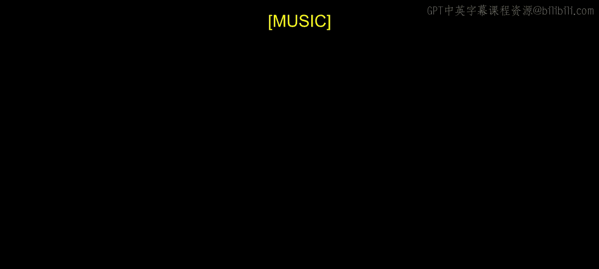
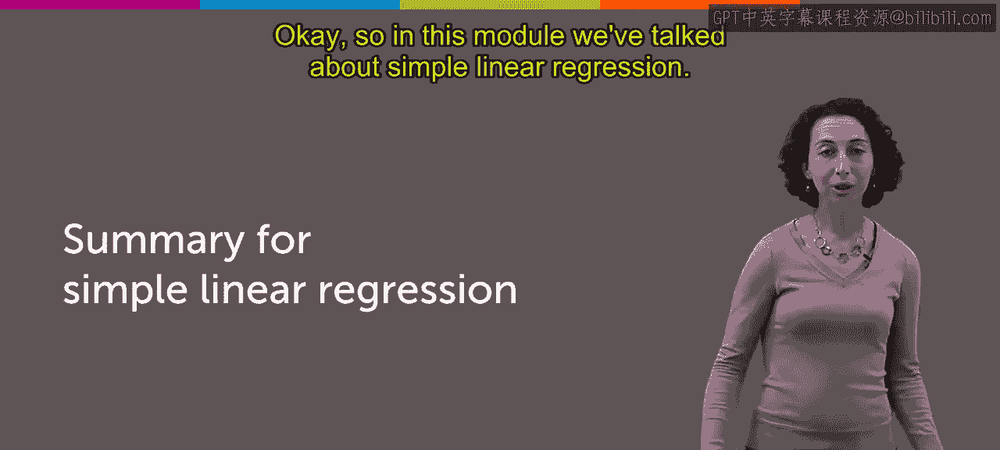
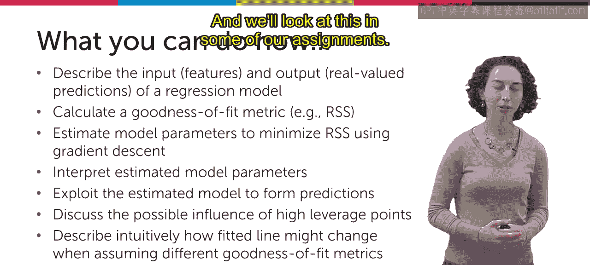

# 华盛顿大学《机器学习（回归，第2课⧸共4课）｜Machine Learning》中英字幕 p30 29_简要回顾.zh_en -BV11b421H7XL_p30-

。

Okay， so in this module we've talked about simple linear regression and what we've seen is we've described what the model is。

 we just have a single input， single output and fitting a line， our model is just a simple line。

To describe the relationship between our input X and our output Y。

 we've talked about goodness of fit of a specific line to our data and the measure being residual sum squares that we've talked about in this module。

 and we've also talked about some ways to think about interpreting our fitted line and using it to form predictions。

 but a big emphasis was on thinking about how do we actually fit that line to the data and we talked about different optimization techniques。

 the big one being gradient descent， and using that to minimize our residual sum squares to come up with our fitted line that we're going to use for predictions。

Even though this is a very， very simple and basic tool。

 it's actually incredibly powerful and we'll look at this in some of our assignments。

。