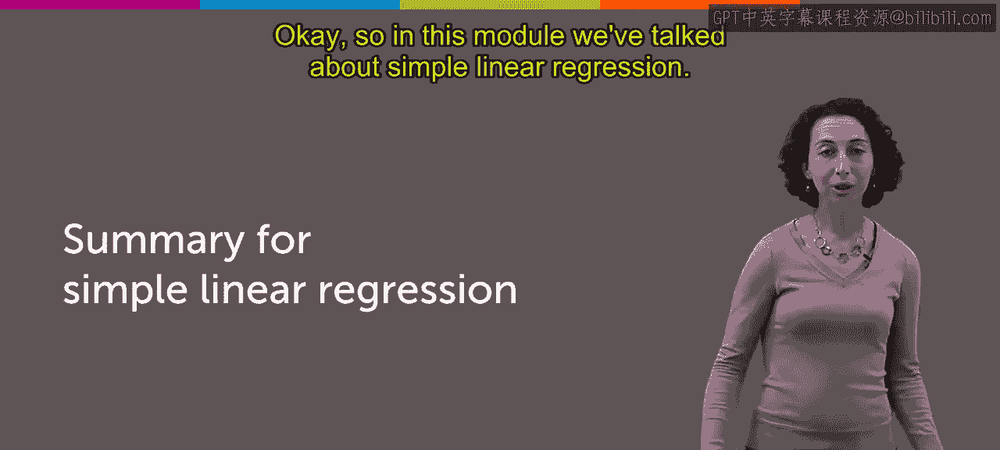
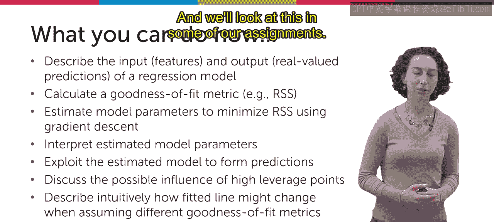

# 机器学习：第2课：简单线性回归回顾 🧠

在本节课中，我们将回顾简单线性回归的核心概念。我们将探讨模型定义、衡量拟合优度的方法、如何解释模型并进行预测，以及如何通过优化技术（特别是梯度下降）来拟合数据。尽管简单线性回归是一个基础工具，但其应用非常广泛且强大。

---

## 模型定义 📈

上一节我们介绍了机器学习的基本概念，本节中我们来看看简单线性回归的具体模型。

简单线性回归模型描述的是单个输入变量 **X** 与单个输出变量 **Y** 之间的关系。该模型通过拟合一条直线来刻画这种关系。

模型公式为：
**Y = w₀ + w₁X**

其中：
*   **Y** 是预测的输出。
*   **X** 是输入特征。
*   **w₀** 是截距。
*   **w₁** 是斜率。

这条直线就是我们的预测模型。

---

## 拟合优度与残差平方和 📊

在定义了模型之后，我们需要一个标准来衡量某条特定直线对数据的拟合程度。这个衡量标准就是**残差平方和**。

残差是指数据点的真实值 **Y** 与模型预测值 **Ŷ** 之间的差值。残差平方和则是所有数据点残差的平方之和。

其计算公式为：
**RSS = Σ (Yᵢ - Ŷᵢ)²**

**RSS** 的值越小，表明模型的预测直线与数据点的整体偏差越小，即拟合效果越好。

---

## 模型解释与预测 🔮

得到拟合直线后，我们可以用它进行两件事：解释关系和做出预测。

*   **解释关系**：斜率 **w₁** 表示当输入 **X** 增加一个单位时，输出 **Y** 的平均变化量。截距 **w₀** 表示当 **X** 为 0 时的 **Y** 的预测值。
*   **形成预测**：对于任何一个新的 **X** 值，我们可以将其代入公式 **Ŷ = w₀ + w₁X** 来计算对应的预测输出 **Ŷ**。

---

## 模型拟合：梯度下降法 ⚙️

前面的小节讨论了如何评估一条线的拟合效果，但最关键的问题是：我们如何找到那条最优的拟合直线？这就需要用到优化技术，核心方法是**梯度下降法**。

我们的目标是找到能使**残差平方和**最小化的参数 **w₀** 和 **w₁**。梯度下降法通过迭代更新参数来实现这一目标。

以下是该算法的基本步骤：

1.  初始化参数 **w₀** 和 **w₁**（例如，设置为0）。
2.  计算当前参数下的损失函数（即RSS）的梯度。
3.  沿梯度下降的方向，以学习率 **η** 为步长，更新参数：
    **wⱼ := wⱼ - η * (∂RSS/∂wⱼ)**
4.  重复步骤2和3，直到参数收敛或达到预设的迭代次数。

通过最小化残差平方和，我们最终能得到用于预测的拟合直线。

---

## 总结 🎯

本节课中我们一起学习了简单线性回归的核心内容。我们首先定义了使用直线进行预测的模型 **Y = w₀ + w₁X**。接着，我们引入了**残差平方和**作为衡量模型拟合优度的关键指标。然后，我们探讨了如何解释模型参数并进行预测。最后，我们重点介绍了使用**梯度下降**这一优化算法来寻找最佳拟合参数的过程。尽管简单线性回归结构简单，但它是一个极其强大且基础的工具，在后续的实践中我们将看到它的广泛应用。