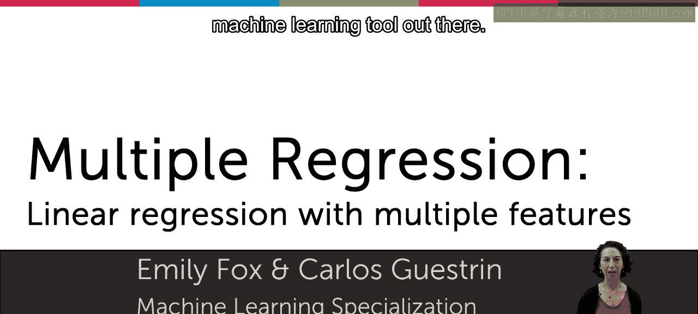

# 华盛顿大学《机器学习（回归，第2课⧸共4课）｜Machine Learning》中英字幕 p31 30_多元回归简介.zh_en -BV11b421H7XL_p31-

。

In this module we're going to be looking at multiple regression。

 which is linear regression when you have multiple features where each feature is some function of either a single input or multiple inputs and this concept of multiple regression is really important in practice。

 it's probably the most widely used statistical and machine learning tool out there。

。

