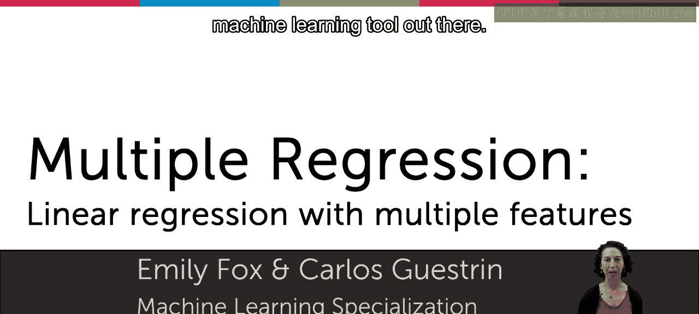

机器学习：第2课：多元回归简介

在本节课中，我们将要学习**多元回归**。这是一种当你拥有多个特征时的线性回归方法，其中每个特征可以是单个或多个输入的函数。多元回归的概念在实践中至关重要，它可能是目前应用最广泛的统计与机器学习工具之一。

---

上一节我们介绍了单变量线性回归的基本概念。本节中，我们来看看当数据包含多个特征时，模型应如何扩展。

### 从单变量到多元回归

在单变量线性回归中，我们使用一个输入特征 `x` 来预测目标 `y`，模型形式为：
`y = w0 + w1 * x`

然而，现实世界中的问题通常更为复杂，一个结果往往受到多个因素的影响。例如，预测房价时，不仅需要考虑房屋面积，还需要考虑卧室数量、房龄、地理位置等。为了处理这种情况，我们需要引入多元回归。

### 多元回归模型

多元回归模型是单变量模型的自然延伸。它假设目标变量 `y` 与 `d` 个输入特征 `x1, x2, ..., xd` 之间存在线性关系。其模型公式如下：

`y = w0 + w1*x1 + w2*x2 + ... + wd*xd`

其中：
*   `y` 是我们要预测的目标变量。
*   `x1, x2, ..., xd` 是 `d` 个输入特征。
*   `w0` 是**截距**或**偏置**项。
*   `w1, w2, ..., wd` 是每个特征对应的**权重**或**系数**，表示该特征对预测结果的影响程度。

为了更简洁地表示，我们通常使用向量形式。将所有特征（包括一个值为1的虚拟特征以代表截距 `w0`）组合成一个特征向量 **x**，将所有权重组合成一个权重向量 **w**，则模型可以表示为：

`y = **w**^T **x**`

这里，**w**^T 表示权重向量 **w** 的转置，**w**^T **x** 表示两个向量的点积。

### 核心概念与解释

以下是理解多元回归的几个关键点：

*   **特征函数**：模型中的每个 `x_j` 可以是一个原始输入，也可以是原始输入的某个函数（例如平方、对数、交互项）。这提供了极大的灵活性，允许我们捕捉数据中更复杂的模式。
*   **权重解释**：权重 `w_j` 表示，在**保持所有其他特征不变**的情况下，特征 `x_j` 每增加一个单位，预测值 `y` 平均变化 `w_j` 个单位。这是多元回归分析中非常重要的因果解释基础。
*   **模型训练**：与单变量回归类似，我们需要从数据中学习最佳的权重向量 **w**。这通常通过最小化一个损失函数（如**残差平方和**）来实现。寻找最优 **w** 的过程称为“拟合”模型。

### 实践重要性

多元回归之所以成为最广泛使用的工具之一，是因为它兼具解释性和预测能力。它不仅能给出预测值，还能量化每个因素对结果的影响大小，这对于商业决策、科学研究等领域至关重要。其数学形式相对简单，计算高效，且为许多更复杂的机器学习模型奠定了基础。

---

本节课中我们一起学习了多元回归的基本概念。我们了解了如何将线性回归从单一特征扩展到多个特征，掌握了多元回归的模型公式及其向量表示，并讨论了权重系数的核心解释。理解多元回归是进入更广阔机器学习世界的重要一步。