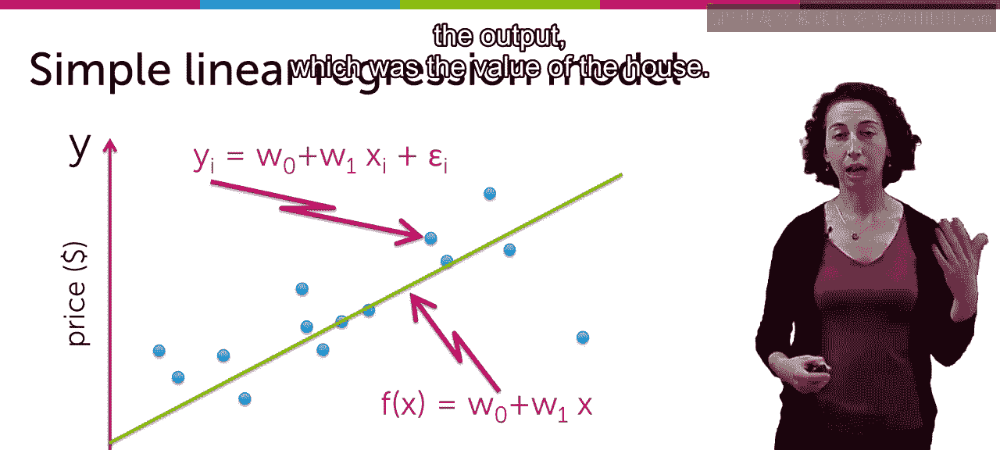
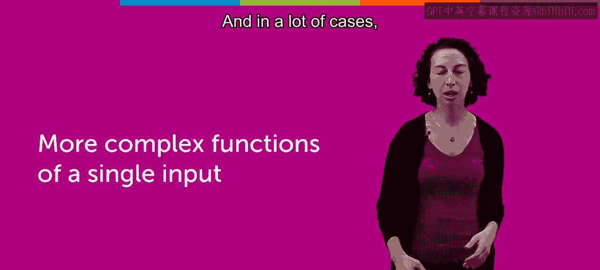
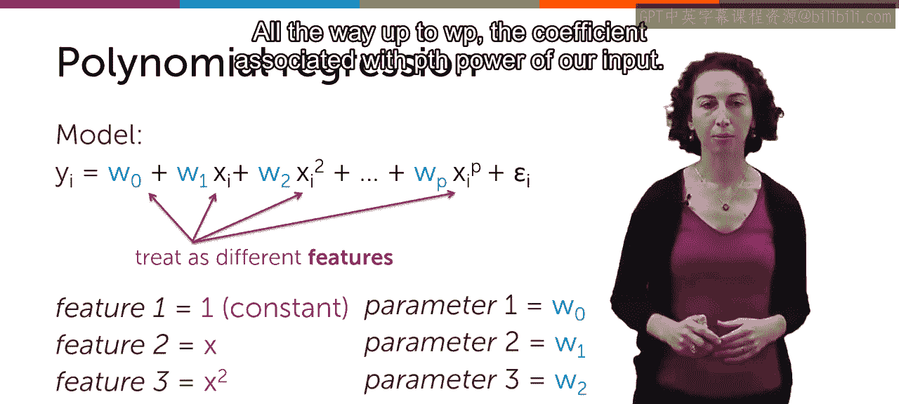
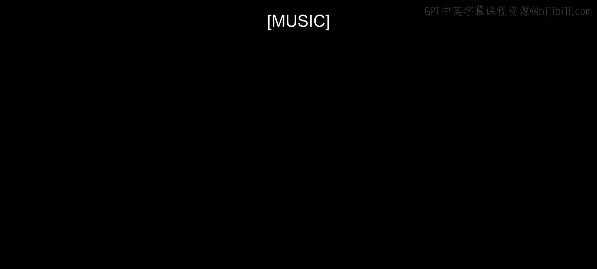

# 华盛顿大学《机器学习（回归，第2课⧸共4课）｜Machine Learning》中英字幕 p32 31_多项式回归.zh_en -BV11b421H7XL_p32-

。

So to start with， let's look at the machine learning model， this multiple regression model。

 and let's just recall where we left off in the last module where we were talking about simple linear regression。

 where our goal was just to fit a line to the data and we just had a single input and in our example we always talked about having square feet and trying to model the relationship between square feet of a house and the output which was the value of the house。

But as the name implies， this simple linear regression model is really simple and in a lot of cases we're going to be interested in more complex functions of our input。

 So one example of this is something called polynomial regression and we actually saw this back in the first course in the specialization and in that case what we did was we took our simple linear regression model and our fit of that of course at that time when we were in the first course of the specialization。

 we didn't have all this terminology that we learned in the last module but now we know that this is a simple linear regression model and we take this fit and we show it to our friend and we say hey look。

 this is so cool， I have this line that I fit to my data and now I can predict the value of my house。

And your friend，'s a little bit skeptical。And says， dude。

 it's not a linear relationship between square feet and the value of a house。

He's looking at the data and saying， just doesn't believe it。Instead， he thinks it's a quadratic fit。

 so what your friend is saying is that he doesn't believe the model that you use。

 he doesn't believe that it's just this linear relationship， of course， plus error。

 he thinks that there's this quadratic function which has the following equation underlying the relationship between square feet and house value。

 and again， our regression model is going to assume that there's some noise around that。

But of course you could consider even higher order polynomials， for example， here。

 I'm showing some piece order polynomial that you might choose to be your model of the relationship between square feet and the value of the house。

So here's our generic polynomial regression model where we take our observation Yi and model it as this polynomial in terms of the。

 for example， square feet of our house， which is just some input X。

 and then we assume that there's some error epsilon I。

 so that's the error associated with the Ithe observation。And what we see is that in this model。

 in contrast to our simple linear regression model。

 we have all these powers of x that are now appearing in the model and what we can do is we can treat these different powers of x as features okay so now we're introducing this new word features and what features are they're just some function of your input so in this case in particular our features just to be very explicit our first feature of the model is just the number one which is called the constant feature then the second feature of our model is x so that's just the linear term just like we had in simple linear regression。

And then our third feature is x squared， and we keep going up to our p plus1 feature。

 which is x to the power P。And associated with each one of these features in our model is a parameter。

 so we have some p plus1 parameters， W0， which is just the intercept term all the way up to WP。

 the coefficient associated with the p power of our input。

🎼。

