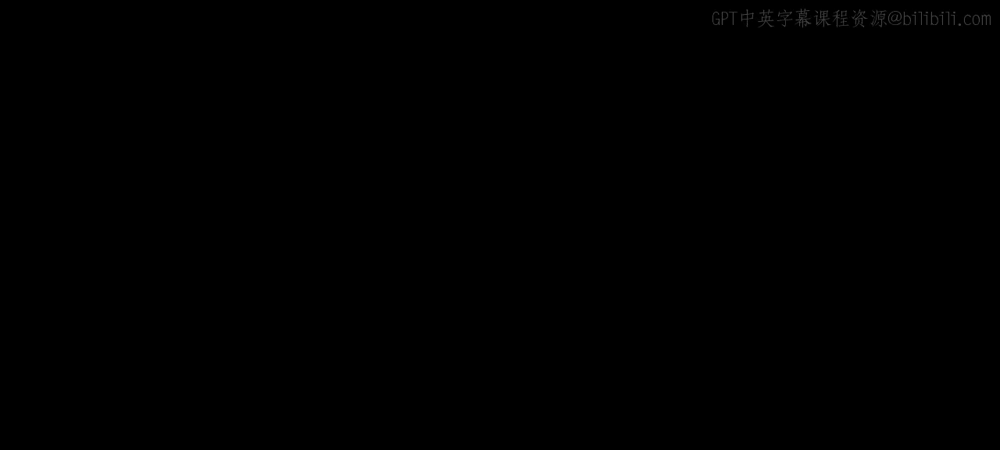
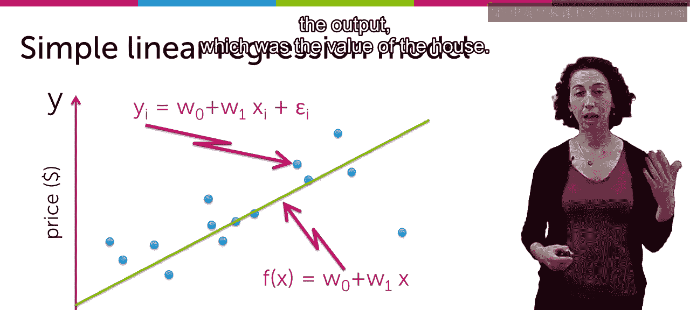
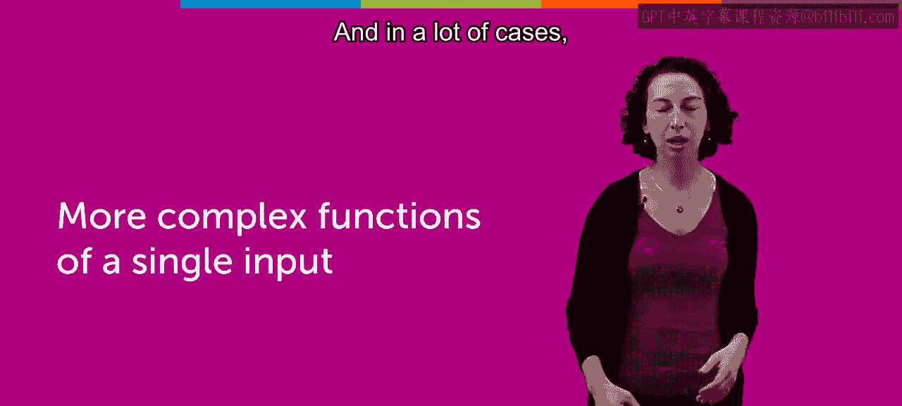
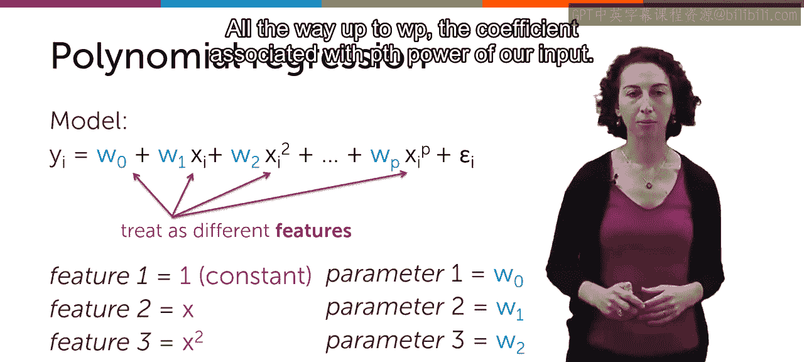
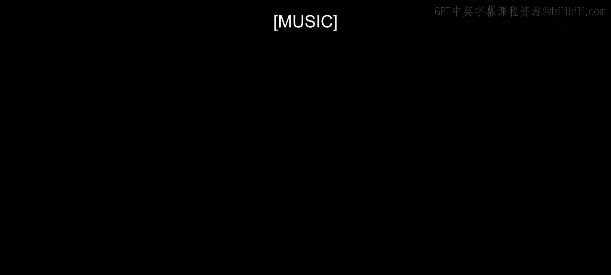

# 机器学习：第2课：多项式回归

在本节课中，我们将要学习多项式回归。这是一种比简单线性回归更灵活的模型，它允许我们使用输入变量的高次幂来拟合数据，从而捕捉更复杂的非线性关系。

---

上一节我们介绍了简单线性回归模型，它仅用一个输入变量来拟合一条直线。本节中我们来看看如何扩展这个模型，以处理更复杂的函数关系。

## 从简单线性回归到多项式回归

在上一模块中，我们讨论了简单线性回归。我们的目标是给数据拟合一条直线。在例子中，我们总是讨论房屋面积（平方英尺）与房屋价值之间的关系。

但顾名思义，简单线性回归模型确实非常简单。在许多情况下，我们会对输入变量更复杂的函数关系感兴趣。

多项式回归就是这样一个例子。我们实际上在专项课程的第一门课中已经见过它。当时我们采用了简单线性回归模型并进行了拟合。当然，那时我们还没有学习上一模块中的所有术语，但现在我们知道那是一个简单线性回归模型。

我们把这个拟合结果展示给朋友看，并说：“嘿，看，这太酷了，我有一条拟合数据的直线，现在我可以预测我的房子价值了。”

然而，你的朋友有点怀疑。他看着数据说：“老兄，房屋面积和房屋价值之间不是线性关系。”他不相信这个模型。相反，他认为应该是一个二次拟合。

所以你的朋友是在说，他不相信你使用的模型。他不相信那只是一个线性关系加上误差。他认为存在一个二次函数，其方程描述了房屋面积和房屋价值之间的潜在关系。当然，我们的回归模型会假设这个关系周围存在一些噪声。

你甚至可以考虑更高阶的多项式。例如，这里展示了一个四阶多项式，你可以选择它作为房屋面积与房屋价值之间关系的模型。

## 多项式回归模型

以下是通用的多项式回归模型。我们将观测值 `Yi` 建模为输入 `X`（例如房屋面积）的多项式函数，并假设存在一个误差项 `εi`，这是与第 `i` 个观测值相关的误差。

**公式：**
`Yi = w0 + w1*Xi + w2*Xi^2 + ... + wp*Xi^p + εi`

我们看到，与简单线性回归模型相比，这个模型中出现了 `x` 的所有这些幂次。我们可以将这些 `x` 的不同幂次视为特征。

现在，我们引入“特征”这个新词。特征只是你输入变量的某种函数。具体来说，在这个模型中，我们的特征非常明确：

以下是模型的特征列表：
*   第一个特征是常数 `1`，称为常数特征。
*   第二个特征是 `x`，即线性项，就像我们在简单线性回归中一样。
*   第三个特征是 `x` 的平方。
*   我们一直持续到第 `p+1` 个特征，即 `x` 的 `p` 次幂。

在我们的模型中，与这些特征中的每一个相关联的是一个参数。因此，我们有 `p+1` 个参数：`w0`（截距项）一直到 `wp`（与输入 `p` 次幂相关的系数）。

---

本节课中我们一起学习了多项式回归。我们了解到，通过将输入变量的不同幂次（如 `x^2`， `x^3` 等）视为新的特征，我们可以将线性回归框架扩展到拟合非线性关系。这使得模型能够更灵活地描述数据中更复杂的模式。