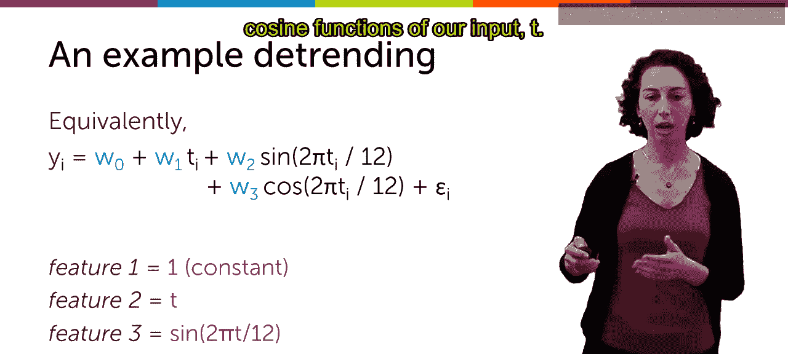

# 华盛顿大学《机器学习（回归，第2课⧸共4课）｜Machine Learning》中英字幕 p33 32_建模季节性.zh_en -BV11b421H7XL_p33-

。

Okay， so that was just one example of how we can think about looking at features of a single input。

 but there are lots of other examples。 And let's just go through one application in particular where this is very useful。

 and that's in de trendending time series。 So here what I'm showing is I'm showing。

House sales which are these gray dots and there's a whole bunch of them this is a real data set so lots and lots of house sales over time。

 so instead of plotting house sales versus square feet here we're looking at the trends in house value over time and this plot in particular is for the Seattle metropolitan region and this is some data that you guys have been playing around with throughout this specialization。

And what this black curve shows here is the average house value versus time。

So just to be very specific， our observation or our output YI is the sales price of the I house and our input is going to be the time of that house sales。

 so we're going to denote that by T subi for the IE house and the time is recorded monthly because house sales are recorded monthly。

 at least in the US。And one thing that we see is that on average。

 the value of houses tends to increase with time。So that's one effect that we probably want to capture。

 But then there's another more subtle effect that might be hard to see from this plot。

 but it's the fact that。Most houses are listed for sale in the summer。

 that's the common housing season in the US and the good houses they go really quickly。In contrast。

 in， for example， November and December， especially here in rainy Seattle。

 very few houses are listed for sale， very few people are going out shopping for houses in the rain。

So what ends up happening is any transactions that you see during these months are really from leftover inventory that was sitting around from the summer and just didn't sell in the summer because they weren't the best houses during that really competitive period。

 but if people are desperate need to buy a house in November or December。

 they're left with whatever inventory is there or there's some other special circumstance for why that house sale is going on。

 And so the result of this is the fact that you tend to see higher prices in the summer and lower prices in some of the off months。

 And so what that means is what there's what's called seasonality。

 seasonality is the effect where over some period of time。

 which in this case is over the course of months。We see an effect where there's repeated pattern of prices。

 increasing， decreasing， increasing decreasing。So this is something that we'd like to model and the way in which we're going to model this is as follows we're going to assume that our I house sales。

 the price of that that house sale is。Comprised of the following different components。

 there's one component which models just this increasing trend over time and for the sake of this slide we're just assuming a very simple linear trend。

 so this part is just our simple linear regression model where our input is this time index TI。

Then though， we're going to add some more features to this model and the feature that we're going to add is this sinusoidal component。

 which is capturing the seasonality， this fluctuation of increased prices in the summer decreased in the off seasons。

Um。And what we want is we want this sinusoid to reset every year because we see this pattern repeated again and again every year in our data。

 so we're going to choose the period of this sinusoid。And if you don't remember your trigonometry。

 that's okay， just look at this picture of the sinus soy that'll be sufficient for what I'm talking about。

 but the idea is that it resets every 12 months， and so that's captured by this two pi T over 12 term。

嗯。And then。The issue， though， is that in general， in this case。

 I've talked about the fact that prices tend to increase in the summer months and decrease in offs months。

 But in general， you don't really know where that seasonality trend occurs。 So there's some phase。

 some unknown face this process。 We can think of that just as a shift。

 And that's represented by that fee parameter there。

I marked it in blue because that's the color of our parameters， and just to animate this here。

 what I'm saying is we don't know where this sinusoidal kind of trend is appearing in our data。

Whether the peaks occur in June or January or something like this， okay。嗯。

But now we have an issue because one of our parameters， this fee term， appears within this function。

Of our input ti。So we haven't yet talked about this， but what this means is that we're in this form。

 it's no longer just a simple linear regression where the parameters or weights of our model are just multiplying the inputs or the functions of the input。

So it looks more complicated。But there's a nice trick we can do here。

 and that again is going back to some trigonometry。

 specifically the following trigonoometric identity， which says that if you take sine of a minus B。

Then that's equivalent to sine a cosine B minus cosine a sine B hopefully I got that ordering correct。

 and if you apply that identity specifically to the case we have here。

 what you see is the following where this phi parameter。

 now what we have are two multiplicative terms， we have a cosine phi and a sine phi are really a negative sine phi。

 multiplying the functions of our input TI which are shown in orange。

And so we can think of cosine of phi and minus sine phi as just some W parameters in our model。

And that's summarized right here， so an equivalent way to represent the model that we had on this slide here。

Is as follows where we have again this linear term， and then the sinineusoidal component。

 we're breaking up into a sine and cosine term。With these linear multipliers。

 W2 and W3 to account for this unknown shift or phase to this function。So to make this very concrete。

 again we're in a feturized situation where the first feature of our model is just that constant feature。

 the second feature is just a linear feature， T itself， our input。

 but the third feature and fourth feature are these sine and cosine functions， of our input T。

Okay， so let's apply this model to our housing data and here in this plot we've done just that we're fitting a polynomial trend to capture this increase in prices over time。

 as well as this sinusoidal seasonal component to capture these fluctuations of prices with the season。

And so that's what's shown in this dark blue line here and in particular in this case instead of just a simple linear trend we fit a fifth order polynomial that's why we get a little bit more interesting of a shape over time and to see this the effect of this sine cosine basis these features let's zoom into this plot so now i've just。

Zoomed in on a little chunk of this data， and you really see that sine and cosine having an effect with prices going up and down over the course of seasons across these different years。

