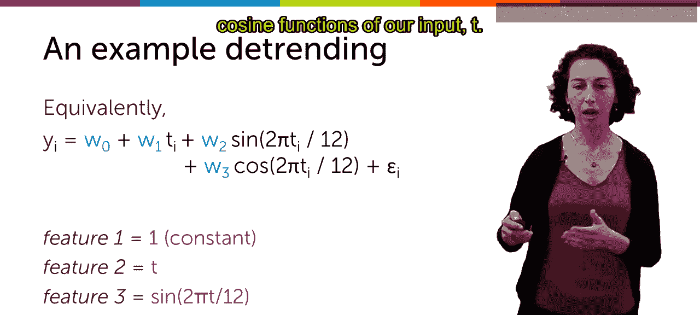

# 机器学习：第2课：建模季节性 📈

在本节课中，我们将学习如何为时间序列数据建模，特别是如何捕捉数据中随时间变化的趋势和周期性模式（即季节性）。我们将通过一个房价随时间变化的实际案例来演示。

## 概述：时间序列与季节性

上一节我们介绍了如何通过特征工程来观察单个输入的特征。本节中，我们来看看一个特别有用的应用：为时间序列数据去趋势并建模季节性。

时间序列数据是按时间顺序记录的数据点。在许多情况下，数据不仅会呈现长期趋势（如房价随时间上涨），还会呈现周期性波动（如夏季房价高，冬季房价低）。这种周期性波动被称为**季节性**。

## 房价数据示例

我们使用的数据是西雅图都会区的房屋销售数据。每个数据点代表一次房屋销售。

*   **输出 Yᵢ**：第 i 栋房屋的销售价格。
*   **输入 Tᵢ**：第 i 次销售发生的时间（按月记录）。

下图中的灰点代表所有房屋销售，黑色曲线代表房价随时间变化的平均值。

从图中可以观察到两个主要效应：
1.  **长期趋势**：房价平均值随时间呈上升趋势。
2.  **季节性**：房价在一年内呈现周期性波动（例如夏季价格高，冬季价格低）。

## 构建季节性模型

为了同时捕捉趋势和季节性，我们假设房屋售价由以下几个部分组成：

1.  **趋势成分**：用一个关于时间 Tᵢ 的函数来建模长期趋势。为简化，我们可以先使用线性模型：`趋势 = w₀ + w₁ * Tᵢ`。
2.  **季节性成分**：用一个正弦函数来建模每年的周期性波动。我们希望这个正弦波每12个月（一年）重复一次。

一个直观的想法是使用如下模型：
`价格 = w₀ + w₁ * Tᵢ + sin( (2π * Tᵢ / 12) + φ )`
其中，`φ`（相位）是一个参数，用于控制正弦波峰谷出现的时间点（例如，峰值是在六月还是一月）。

然而，这里存在一个问题：参数 `φ` 位于 `sin()` 函数内部，这使得模型不再是关于参数的简单线性形式，拟合起来更复杂。

## 三角恒等式技巧

为了解决上述问题，我们可以利用一个三角恒等式进行转换。该恒等式为：
`sin(A + B) = sin(A)cos(B) + cos(A)sin(B)`

应用这个恒等式，我们可以将包含相位 `φ` 的正弦项重写：
`sin( (2π * Tᵢ / 12) + φ ) = sin(2πTᵢ/12) * cos(φ) + cos(2πTᵢ/12) * sin(φ)`

现在，`cos(φ)` 和 `sin(φ)` 变成了可以线性相乘的系数。我们将其重命名为新的权重参数 `w₂` 和 `w₃`。

于是，我们的模型等价地变为：
`价格 = w₀ + w₁ * Tᵢ + w₂ * sin(2πTᵢ/12) + w₃ * cos(2πTᵢ/12)`

这个模型又回到了我们熟悉的**线性回归**形式！只不过我们的特征现在包括了：
*   **特征1**：常数项（1）
*   **特征2**：时间本身（Tᵢ）
*   **特征3**：`sin(2πTᵢ/12)`
*   **特征4**：`cos(2πTᵢ/12)`

以下是模型转换的总结：

## 应用于房价数据

现在，让我们将这个模型应用到实际的房价数据中。我们不仅使用了线性项，还使用了更高阶的多项式（例如五阶多项式）来更灵活地捕捉长期趋势，同时加入了正弦和余弦特征来捕捉季节性。

拟合结果如下图所示，深蓝色曲线代表了我们的完整模型。

为了更清楚地观察季节性效应，我们可以放大数据图的某一部分。在放大的视图中，可以清晰地看到房价随着不同年份的季节更替而上下波动的模式，这正是正弦和余弦特征所捕捉到的周期性。

## 总结

本节课中我们一起学习了如何为时间序列数据建模季节性。核心步骤包括：
1.  识别数据中的长期趋势和周期性模式。
2.  使用多项式特征（如 Tᵢ, Tᵢ², …）来建模趋势。
3.  使用正弦和余弦函数作为特征来建模固定周期（如一年）的季节性波动。
4.  利用三角恒等式将带有相位参数的非线性模型转换为关于权重的标准线性回归模型，从而可以利用线性回归工具进行简单高效的拟合。

通过这种特征工程方法，我们可以用线性回归框架来建模复杂的、包含周期性变化的时间序列数据。