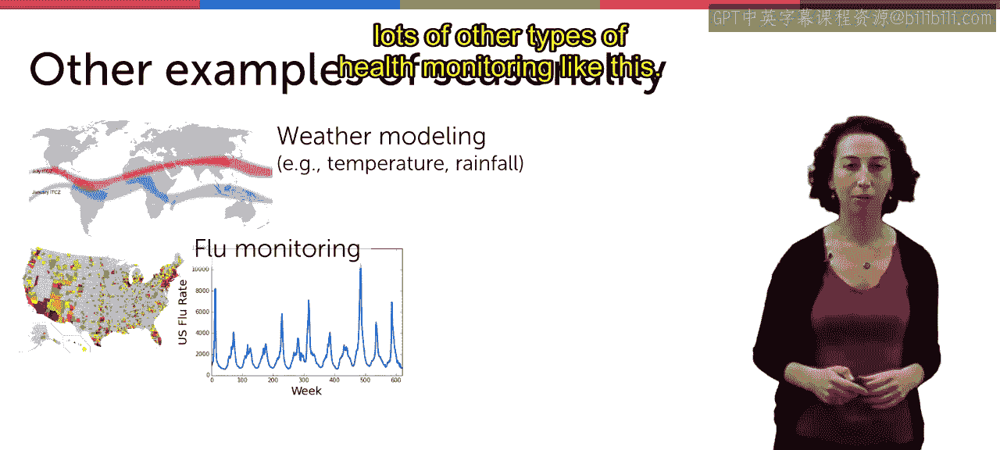

# 华盛顿大学《机器学习（回归，第2课⧸共4课）｜Machine Learning》中英字幕 p34 33_我们在哪里看到季节性.zh_en -BV11b421H7XL_p34-

。

So we keep talking about this housing application and it's really a nice intuitive way to describe the different methods in regression that we're going to be talking about and that we have been talking about but regression。

 like we've mentioned is much， much， much more widely applicable and this notion of capturing seasonality is also appears in lots of applications beyond just housing and so I wanted to spend a little time talking about other places where we see this seasonal the seasonality or seasonal effects coming into play。

 And one which makes a lot of sense is if you're doing weather modeling。

 let's say you're trying to predict the temperature or rainfall。

 well if you're thinking about temperature， while there's variation in temperature across a day。

 it's hotter during the daytime hours and cooler during the night but of course it's also hotter in the summer and cooler in the winter So there's actually this seasonal at different timescales。

 so in addition to just having that。One signine and cosine that we showed in that housing model where in that case we're just looking at this monthly effect repeating every year。

 well for weather modeling， if you're predicting temperature。

 you might want to add in s and cosine functions at different frequencies to capture the fact that there are these daily effects as well as these monthly effects and maybe other effects as well。

嗯。Also， you might be thinking about doing flu monitoring。

 so you want to think about modeling the incidence rate of flu in， for example。

 here the picture I'm showing is in the United States in a whole bunch of different regions and if we look at any one of those regions and we look at the rate of flu over time。

 well of course there are going to be peaks during flu season and valleys during the off months and so you see this kind of seasonal pattern in flu monitoring and lots of other types of health monitoring like this。

And you also see it in things like e-commerce， for example。

 Amazon is really interested in being able to stock their inventory pretty accurately and if you're thinking about selling jackets。

 you have some warehouse here in the US and you want to figure out how many snowjas or ski jackets to stock well of course you're going to want to stock more in the winter months than you would in the summer months because more people are likely to purchase jackets in the winter than in the summer So that's another place where seasonality is really important and it appears in so many applications。

 another one that you might not think of is motion capture and just trying to model how a person walks over time and if you look at the data if you put sensors over a person's body and look at how they walk if you take those recordings。

 you're going to get these kind of up and down， up and down swings as a person's going through their different motions raising their knees or walking are their arms。

And so in this plot here， I'm looking at some sensor trajectories from a person wearing a motion capture suit as they're going through different behaviors。

 and you clearly see this type of seasonality here as well。🎼。

