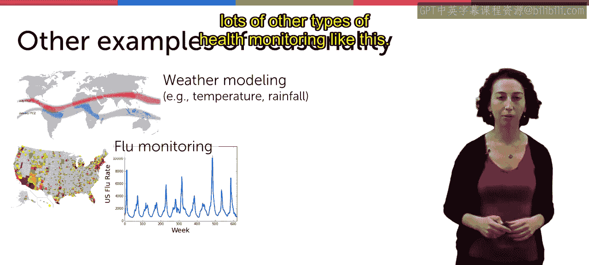

# 机器学习：第2课：季节性效应的广泛应用

在本节课中，我们将探讨回归分析中“季节性”这一核心概念。我们将看到，季节性效应不仅存在于房价预测中，还广泛出现在天气建模、流感监测、电子商务库存管理乃至动作捕捉等多个领域。理解这些应用场景，有助于我们更好地掌握如何为不同问题设计合适的回归模型。

## 🏠 从房价到更广阔的应用

上一节我们以房价预测为例，介绍了如何使用正弦和余弦函数来捕捉月度或年度周期性变化。实际上，回归分析和季节性建模的应用范围要广泛得多。本节中，我们将看看季节性效应在其他领域是如何体现的。

## 🌤️ 天气建模中的多尺度季节性

在天气建模中，例如预测温度或降雨量，季节性效应表现得非常明显。温度在一天之内有变化（白天热，夜晚凉），同时在一年之中也有变化（夏季热，冬季凉）。这意味着存在不同时间尺度上的季节性。

为了准确建模，我们可能需要引入多个不同频率的正弦和余弦函数。例如，一个函数捕捉**每日**循环，另一个函数捕捉**每年**循环。其核心公式可以扩展为：

**y = w0 + w1 * sin(2π * t / T_daily) + w2 * cos(2π * t / T_daily) + w3 * sin(2π * t / T_yearly) + w4 * cos(2π * t / T_yearly) + ...**

其中 `T_daily` 和 `T_yearly` 分别代表日周期和年周期。

## 🤒 健康监测中的周期性规律

季节性在健康监测领域也至关重要，例如流感监测。下图展示了美国多个地区的流感发病率随时间的变化。

观察任一地区的数据，都会发现清晰的季节性模式：流感季会出现发病高峰，而在非流感月份则处于低谷。这种周期性规律也出现在许多其他类型的健康监测中。

## 📦 电子商务与库存管理

在电子商务领域，季节性对库存管理有直接影响。以亚马逊销售滑雪夹克为例，公司需要精准预测库存以优化仓储。

以下是库存决策中考虑季节性的逻辑：
*   冬季月份需要储备更多夹克，因为购买需求更高。
*   夏季月份则需要减少库存，以避免积压。

因此，准确建模销售数据的季节性，对于控制成本和满足客户需求都极为重要。

## 🎬 动作捕捉中的重复模式

一个可能意想不到的应用领域是动作捕捉。当给人穿上动作捕捉服并记录其行走等动作时，附着在身体各部位的传感器会产生轨迹数据。

下图展示了一个人进行不同行为时，某个传感器的运动轨迹。

可以清晰地看到，随着人物完成抬膝、摆臂、行走等重复动作，传感器数据也呈现出上下波动的季节性模式。建模这种周期性对于分析人体运动规律至关重要。

## 📝 总结

本节课我们一起探索了季节性效应在多个领域的应用。从直观的天气温度变化、流感的年度流行，到商业中的库存周期，乃至人体运动的重复模式，季节性无处不在。理解这些实例，能帮助我们在面对新问题时，识别出潜在的周期性规律，并运用正弦、余弦函数等工具将其有效地构建到回归模型中，从而做出更准确的预测。