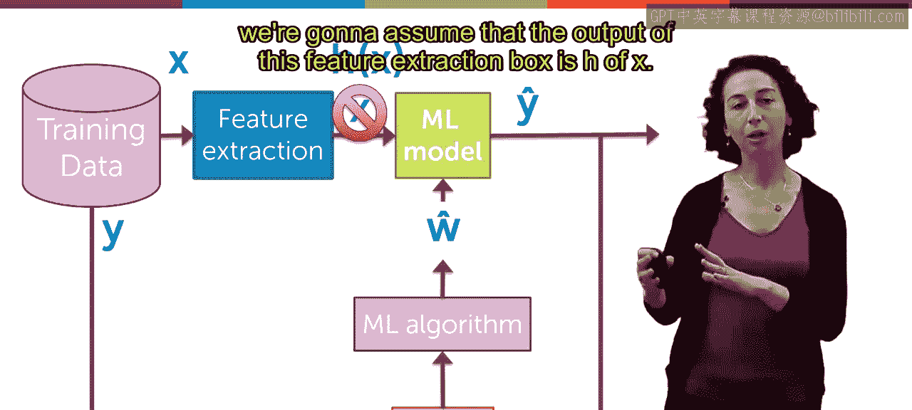

# 华盛顿大学《机器学习（回归，第2课⧸共4课）｜Machine Learning》中英字幕 p35 34_单一输入的一般特征回归.zh_en -BV11b421H7XL_p35-

。

So we talked about polynomial regression where you have different powers of your input and we also talked about seasonality where you have these sine and cosine bases。

 but we can really think about any function of our single input so let's write down our model a little bit more generically in terms of some set of features and I'm going to denote each one of my features with this function H so H0 is going to be my first feature H1 my second feature H capital D my last feature so we can more compactly represent this model using the sigma notation than we introduced previously where we put an index I equals1 to capital D saying we're summing over each of these capital D different features and just to be very clear。

H subj of x is our Jth feature， and Wj is the regression coefficient or weight associated with that feature。

So just to give some examples that we've gone through， this first feature might just be one。

 this constant feature that we've used in all of the past examples。

 and when we think about our second feature， H1， maybe that's just our linear term x。

 our third feature might be x squared or maybe it's our sine basis。

 or we could think of lots of other feature examples and when we get to our capital D feature。

 maybe it's just our input rates， the P power when we're thinking about polynomial regression。

So going back to our regression flowchar or block diagram here。

 we kind of swept something under the rug before， we never really highlighted this blue feature extraction box and we just said the output of it was X Well really now that we've learned a little bit more about regression and this notion of features really the output of this feature extraction is not x but H of x it's our features of our input X so X is really the input to our feature extractor and output is some set of functions of X so for the remainder of this course we're going to assume that the output of this feature extraction box is H of X。

