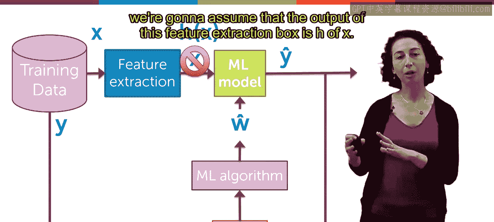

# 机器学习：第2课：单一输入的一般特征回归

在本节课中，我们将学习如何将回归模型从简单的线性或多项式形式，推广到使用任意函数作为特征的一般形式。我们将理解特征提取的概念，并学习如何用更通用的数学符号来描述回归模型。

---

上一节我们介绍了多项式回归和季节性回归，它们都使用了输入的不同函数作为特征。本节中，我们来看看如何将这些概念统一到一个更通用的框架中。

我们可以将模型更通用地写为一系列特征的组合。我们用函数 **H** 来表示每个特征。**H₀** 是第一个特征，**H₁** 是第二个特征，以此类推，直到第 **D** 个特征 **H_D**。

我们可以使用之前介绍过的求和符号更紧凑地表示这个模型：
`ŷ = Σ_{j=1}^{D} w_j * H_j(x)`
其中，**H_j(x)** 是我们的第 **j** 个特征，**w_j** 是与该特征关联的回归系数或权重。

以下是几个我们已经见过的特征示例：
*   **H₀(x) = 1**：这是我们在所有例子中都使用过的常数特征。
*   **H₁(x) = x**：这是线性项。
*   **H₂(x) = x²** 或 **sin(x)**：这可以是二次项或正弦基函数。
*   **H_D(x) = x^P**：在多项式回归中，这可能是输入的第 **P** 次幂。

---

回顾我们之前介绍的回归流程图或框图，有一个部分我们之前没有详细说明，那就是蓝色的“特征提取”框。我们之前简单地说它的输出是 **x**。但现在，随着我们对回归和特征概念的深入理解，这个特征提取框的真正输出并不是 **x**，而是 **H(x)**，即我们输入 **x** 的特征函数集合。

因此，**x** 实际上是特征提取器的输入，而输出是 **x** 的某些函数集合 **H(x)**。在本课程接下来的部分，我们将假设这个特征提取框的输出是 **H(x)**。

---

本节课中，我们一起学习了如何将回归模型推广到使用任意特征函数的一般形式。我们定义了特征函数 **H_j(x)** 和对应的权重 **w_j**，并用求和公式清晰地表达了模型。最后，我们明确了在机器学习流程中，原始输入 **x** 需要经过特征提取步骤，转化为特征向量 **H(x)**，才能用于后续的模型训练和预测。理解这个一般化的框架，是学习更复杂模型的基础。