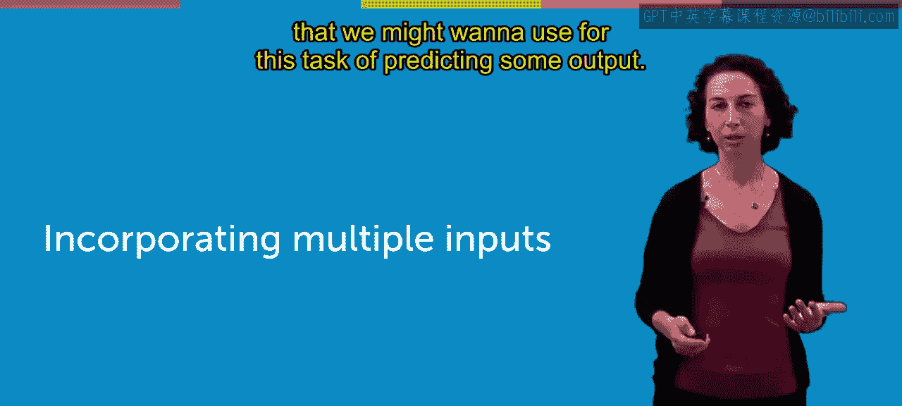
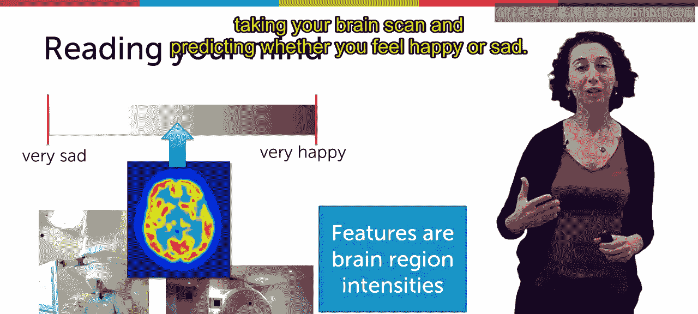

# 华盛顿大学《机器学习（回归，第2课⧸共4课）｜Machine Learning》中英字幕 p36 35_多输入使用的动机.zh_en -BV11b421H7XL_p36-

。

Well， up to this point in this course， we've assumed that we just have a single input like square feet and we're trying to use that to predict the output like the value of the house。

 but often we have lots of different attributes。Different inputs that we might want to use for this task of predicting some output。

And we talked about this in the first course where we said。

 even if we have a more complicated function of the relationship between square feet and house value like this quadratic function instead of the simple line。

 well that still might not be a great predictive model because you might go into the data set and say。

 oh well， there's this other house， that even though it has very similar square footage to my house。

It's just fundamentally a different house in this example。

 this house only has this pink house that I'm just showing here， only has one bathroom。

 but my house has three bathrooms， so my house of course should have a higher value than this house with just one bathroom。

So what we're saying is that we need to add more inputs to our regression model。

So instead of just recording square feet and using that to predict the house value。

 well I'm going to record other inputs as well， for example I'm going to record the number of bathrooms in the house and I'm going to use both of these two inputs to predict my house price。

In particular， in this higher dimensional space， I'm going to fit some function that models the relationship between number of square feet and number of bathrooms and the output。

 the value of the house。And so in particular， one simple function that I can think about is just modeling。

This function as w0 plus w1 times the number of square feet plus w2 times the number of bathrooms。

So in that picture， we just talked about square feet and number of bathrooms as the inputs that we're looking at for our regression model。

 but of course， associated with any house， there's lots of different attributes and lots of things that we could use as inputs to our regression model Well this notion of having multiple inputs in our regression model is not just useful for housing data like we mentioned at the beginning of this module。

 there are lots and lots of applications that use this idea of multiple regression and I'm just going to talk through one that I think is really cool and that's reading your mind。

 What could be cooler than that。 So you get some brain scan。 maybe it's MEG or fMRI。

 But the point is that there's some recording of your brain activity。

 And in this case it's going to be in response to seeing some word or some image or something like this and what we get out is an image of your brain。

 and this brain is divided into what are called voxels you can think of them as。

ixBut there' are these little volumetric regions where we have intensities associated with each one of those different foxels。

And we're going to use these intensities as are multiple inputs。

 so these are going to be the different features that are going into our model。

To predict whether you felt very sad or very happy in response to whatever you were shown。

So we're going to have some data where people were shown an image and they respond on the scale about whether they were very sad or very happy and there's some scale in which they respond to this question and so what we have are these pairs of brain images and happiness responses。

 so the happiness response is our output the brain image is our input to this regression model。

 and again just to emphasize the place where this multiple regression comes in is the fact that we don't have just one input we have a whole collection of inputs。

 the whole set of different voxels in your brain， the intensities associated with those are what we're using to try and find the relationship between this brain image and the response of happiness。

Okay， so to be clear， the way in which we read your mind is we can think about taking your brain scan and predicting whether you feel happy or sad。

