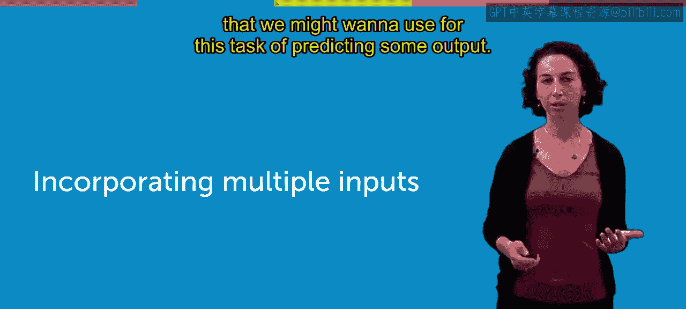
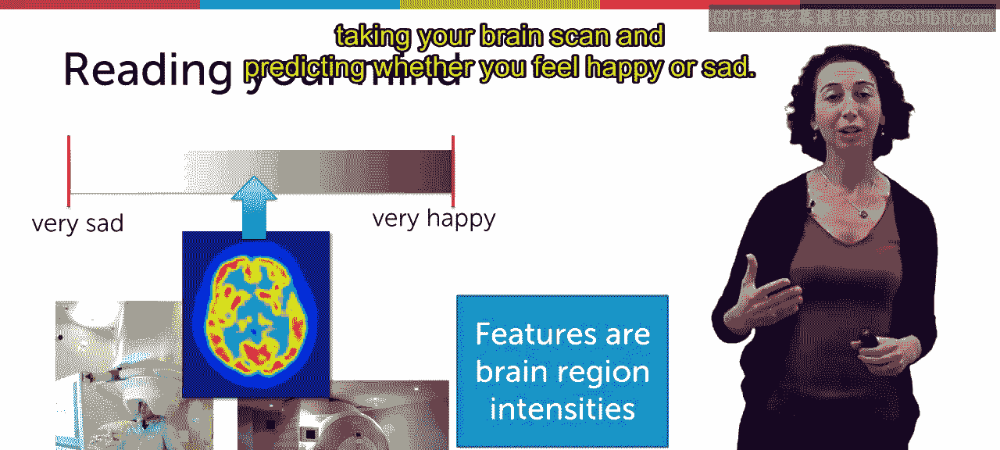

# 机器学习：第2课：多输入回归的动机 🧠

在本节课中，我们将要学习为什么在回归模型中需要使用多个输入变量。我们将从简单的单输入模型出发，探讨其局限性，并理解引入多个输入如何能帮助我们构建更准确、更强大的预测模型。

---

## 从单输入到多输入

上一节我们介绍了使用单一输入（如房屋面积）来预测输出（如房价）的基本线性回归模型。本节中我们来看看，为什么仅使用一个输入往往是不够的。

到目前为止，本课程假设我们只有一个输入（例如平方英尺），并试图用它来预测输出（例如房屋价值）。但通常，我们拥有许多不同的属性和输入，可用于预测某个输出。

我们在第一门课程中讨论过，即使我们使用更复杂的函数（如二次函数）来描述面积与房价的关系，而不是简单的直线，这可能仍然不是一个很好的预测模型。因为你可能会在数据集中发现，即使另一栋房子与你的房子面积非常相似，它本质上也是不同的。例如，图中这栋粉色的房子只有一个浴室，而你的房子有三个浴室。因此，你的房子当然应该比这栋只有一个浴室的房子价值更高。

这表明，我们需要向回归模型添加更多输入。我们不仅要记录平方英尺并用它来预测房屋价值，还要记录其他输入，例如房屋的浴室数量。我们将使用这两个输入来共同预测房价。

具体来说，在这个更高维度的空间中，我们将拟合一个函数，来建模平方英尺数、浴室数量与输出（房屋价值）之间的关系。一个简单的函数模型可以表示为：

**`房价 = w0 + w1 * 面积 + w2 * 浴室数量`**

在这个例子中，我们只讨论了面积和浴室数量作为回归模型的输入。当然，与任何房屋相关的还有许多不同的属性和特征，都可以用作回归模型的输入。

---

## 多输入回归的广泛应用

多输入回归模型的概念不仅适用于我们在此模块开头提到的住房数据，还有大量应用都使用了多元回归的思想。接下来，我将介绍一个我认为非常酷的应用：**“读心术”**。

有什么比读心术更酷的呢？你接受一次脑部扫描，可能是脑磁图（MEG）或功能磁共振成像（fMRI）。关键在于，这记录了你大脑的活动。在这种情况下，它是对看到某个单词、图像或类似刺激的反应。我们得到的是你大脑的图像，这个大脑被划分为称为**体素**的小区域。你可以将它们想象为三维像素，这些小体积区域中的每一个都有与之关联的强度值。

我们将使用这些强度值作为多个输入。这些将成为输入我们模型的不同特征，用于预测你在看到刺激后感到非常悲伤还是非常快乐。

我们拥有一些数据，其中人们被展示图像，并按照从非常悲伤到非常快乐的量表进行回应。我们得到的是这些**大脑图像**和**快乐反应**的配对数据。快乐反应是我们的输出，大脑图像是我们回归模型的输入。再次强调，多元回归的用武之地在于，我们不是只有一个输入，而是有一整套输入——即你大脑中所有不同体素的强度值集合。我们正是利用这些来尝试寻找大脑图像与快乐反应之间的关系。

为了明确起见，“读心”的方式是，我们可以考虑获取你的脑部扫描图，并预测你感到快乐还是悲伤。

---

## 总结

本节课中我们一起学习了引入多输入回归模型的动机。我们认识到，仅依赖单一输入特征（如房屋面积）进行预测存在局限性，因为现实世界的结果往往由多个因素共同决定。通过引入更多相关输入（如浴室数量），我们可以构建更精确的模型。最后，我们探讨了多元回归在“读心术”等前沿领域的酷炫应用，它通过分析大脑扫描中众多体素的强度（即多个输入）来预测情绪状态。这为我们后续学习如何具体构建和训练多输入回归模型奠定了基础。