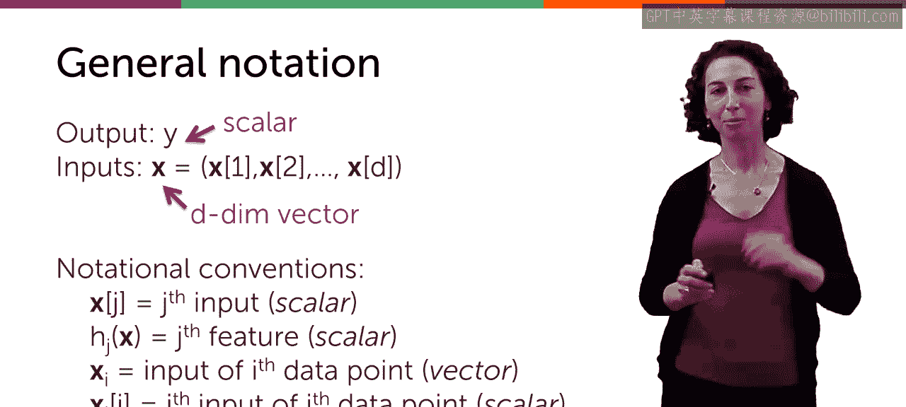

# 华盛顿大学《机器学习（回归，第2课⧸共4课）｜Machine Learning》中英字幕 p37 36_定义符号.zh_en -BV11b421H7XL_p37-

。

Okay， well， I want to take some time to do something that's rather boring。

 but it's actually very important and that's to talk about notation。

The reason it's important is because unfortunately。

 there's no standard convention in the machine learning community for how to denote the things that we're going to be going through in this module。

 and so we have chosen our notation。And we really， really like it。

 but it might be different than notation you've seen before。

 so I want to go very slowly through this notation and what it means so that it's very clear in the following slides when I'm using this notation what I mean by it。

 okay。So in this case， when we're talking about multiple regression。

 our inputs are a whole collection of different inputs like number of square feet， bedrooms。

 bathrooms and so on， and we're going to put these all together into a vector X and I'm going to use this boldface notation。

To represent the fact that this is a vector in some communities。

 they might put a bar under a little arrow over， or there are lots of other options。

 but we're going to use bold X to denote some。Little D dimensional vector。

 meaning there are little D different inputs in our model。Okay。

 then we're going to assume that our output is just some scalar。

 so that's just going to be a normal y， no boldness to it。It might be very bold。

 but it's not boldald face， okay？嗯。Okay， so our notational conventions are going to be bold x square brackets of j is going to take this vector x and just like you would in Python is going to grab out that Jth element okay so the result of that is going to be the Jth input。

To our model and that's just a scalar like number of square feet for the house for our features。

 we're going to use these functions H that we talked about before。

 so H subj is our j feature and in the case of multiple inputs it's gonna it might be and we'll go through this a little bit more in a couple slides it might be a function of multiple input so in general our features are a function of this bold X。

 this entire d dimensionsional vector。Then when we use bold X sub I。

 what we're saying is that's our Ith input， so the input associated with our Ith observation。

 the Ith house and our data set for our housing application。And then just to be very， very clear。

 bold X， sub i square brackets， J。Means we're going to look at this D dimensionional input vector for this Ih house。

So the number of square feet bedrooms， bathrooms， et cetera for this Eh house。

 and we're going to grab out the Jath。Input， which might be number of bathrooms， okay。

 so that's again just a scalar。Okay。I said I was going to go through that slowly。

 I think I went through that slowly， but again， it's very important。

 so take a little snapshot of this slide it's going to be this notation is going to be used throughout the rest of the course。

