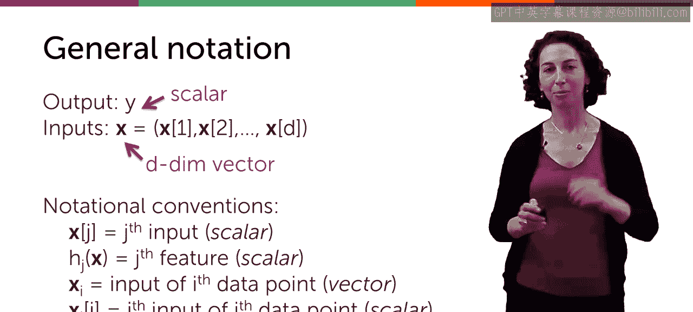

# 机器学习：第2课：定义符号 📝

在本节课中，我们将学习机器学习中，特别是多元回归模型里，用于描述输入、输出和特征的核心符号与表示方法。明确这些符号对于理解后续课程内容至关重要。

## 概述

我们将介绍用于表示输入向量、输出标量、特征函数以及数据集中特定观测值的符号约定。这些约定将贯穿整个课程。

## 符号详解

上一节我们介绍了回归的基本概念，本节中我们来看看如何用精确的符号来描述模型中的各个部分。

首先，在多元回归中，我们的输入是多个不同的变量，例如房屋面积、卧室数量、浴室数量等。我们将这些变量组合成一个向量。

以下是输入与输出的符号定义：
*   **X**： 表示一个 **D** 维的输入向量。其中包含 **D** 个不同的输入变量。符号使用粗体 **X** 表示。
*   **y**： 表示一个标量输出。例如房屋价格。符号使用正常的 *y* 表示，不加粗。

接下来，我们需要定义如何访问向量中的元素以及特征函数。

以下是访问元素与特征函数的符号定义：
*   **x[j]**： 表示从向量 **x** 中取出第 **j** 个元素。结果是一个标量，例如某个房屋的面积。这类似于 Python 中的索引操作。
*   **h_j**： 表示第 **j** 个特征函数。在多元输入的情况下，特征函数通常是整个输入向量 **X** 的函数，即 **h_j(X)**。

最后，当我们在数据集的上下文中讨论时，需要指明是哪一个观测值。

以下是数据集中观测值的符号定义：
*   **X_i**： 表示数据集中第 **i** 个观测值的输入向量。例如数据集中第 *i* 栋房屋的所有特征值。
*   **X_i[j]**： 表示第 *i* 个观测值的输入向量中的第 *j* 个元素。这是一个标量，例如第 *i* 栋房屋的浴室数量。

## 总结

本节课中我们一起学习了机器学习回归模型中使用的基本符号。我们明确了用粗体 **X** 表示输入向量，用 *y* 表示输出标量，用 **x[j]** 索引向量元素，用 **h_j** 表示特征函数，并用下标 *i* 和 *j* 来指代数据集中的特定观测值和特征。请务必熟悉这些符号，因为它们将在后续课程中持续使用。