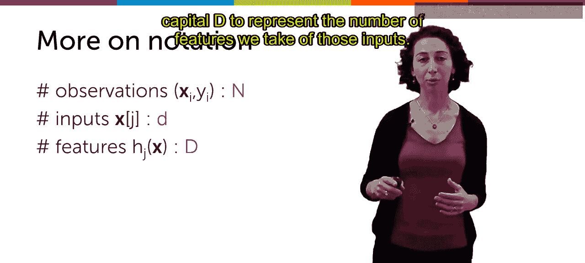

# 华盛顿大学《机器学习（回归，第2课⧸共4课）｜Machine Learning》中英字幕 p38 37_多输入特征的回归.zh_en -BV11b421H7XL_p38-

。

So let's go back to something a little bit more interesting or hopefully more interesting。

 I guess more interesting if you're a statistician which is our regression model and in this slide I'm being very careful about the boldface notation and you'll see that I'm very careful with this boldface notation throughout this course so it's meaningful okay so when we have these multiple inputs。

The simplest model we can think of。It's just assuming that our Ith observation is just a function directly of the inputs themselves。

 not other functions of the inputs， just taking number of square feet， number of bathrooms。

 number of bedrooms and plugging those directly into our linear model。And again。

 we still have this noise term Epsilon I。So just to be very explicit about the features associated with this simple hyperplane model。

 well， the first feature in our model is just this one， this constant feature。

 the second feature is the first input for example， number of square feet。

Third feature indexing is weird， the third feature is our second input， for example。

 number of bathrooms， and this goes on and on till we get to our last input。

 which is the little D plus one feature for example。

 maybe lot size more generically instead of just a simple hyperplane just like we talked about instead of just a simple line you can fit a polynomial。

Well， instead of just this simple hyperplane， we can fit some d dimensionsional curve。

This is capital D dimensional curve because we're going to assume that there's some capital D different features of this of these multiple inputs。

 so just as an example， maybe our zeroth feature is just that one constant term that's the pretty typical。

That just shifts up and down where this curve lives in this space and then maybe our first feature might be just our first input like in the hyperplan example。

 which is square feet and the second feature is the it could be the second input like in our hyperplan example or it could be some other function of any of the inputs。

 maybe we want to take log of the seventh input which happens to be number of bedrooms times just the number of bathrooms。

 so in this case our second feature of the model is relating log number of bathrooms times number log number of bedrooms times number of bathrooms to the output。

And then we get all the way up to our capital D feature。

 which is just some function of any of the inputs to our regression model。

So this is our generic multiple regression model with multiple features and again we can take this big sum and represent it with this capital sigma notation so this formula Yi equals the sum of WJ HJ of x plus epsilon I that is going to be an equation we use a lot okay that's why I put this green box around this equation this is an important equation that's going to follow us for the rest of this module and throughout this course。

Okay， so just one more slide on notation， we're going to use capital N to represent the number of observations we have。

 we're going to use little D to represent the number of inputs。

And we're going to use capital D to represent the number of features we take of those inputs。

。

