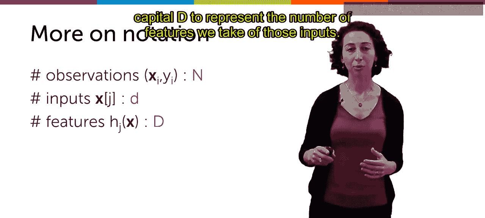

# 机器学习：第2课：多特征回归模型

在本节课中，我们将学习如何将回归模型从单一输入特征扩展到多个输入特征。我们将介绍模型的基本形式、符号表示，并解释如何构建更复杂的特征。

---

## 从简单模型到多输入特征

上一节我们讨论了简单的线性回归模型。本节中，我们来看看当预测目标依赖于多个输入时，如何构建模型。

假设我们想预测房价，输入可能包括房屋面积、浴室数量和卧室数量。最简单的模型是假设第 `i` 个观测值直接是这些输入的函数，而不是输入的其他函数。模型形式如下：

**公式**：`y_i = w_0 + w_1 * (面积) + w_2 * (浴室数) + w_3 * (卧室数) + ε_i`

其中 `ε_i` 是噪声项。

以下是与此简单超平面模型相关的特征定义：
*   第1个特征是一个常数项（例如 `1`），用于调整曲线在空间中的位置。
*   第2个特征是第一个输入（例如，房屋面积）。
*   第3个特征是第二个输入（例如，浴室数量）。
*   依此类推，直到最后一个输入成为第 `d+1` 个特征（例如，地块大小）。

---

## 超越简单超平面：引入特征函数

与我们可以用多项式替代简单直线一样，我们也可以用 `D` 维曲线替代简单的超平面。这里 `D` 表示我们从多个输入中构建的不同特征的数量。

在更通用的模型中，每个特征可以是输入变量的任意函数。例如：
*   第0个特征通常是常数项 `1`。
*   第1个特征可以是第一个输入本身（如房屋面积）。
*   第2个特征可以是第二个输入，也可以是其他输入的函数（例如，`log(卧室数) * 浴室数`）。
*   以此类推，直到第 `D` 个特征，它可以是回归模型中任何输入的函数。

因此，通用的多特征回归模型可以表示为：

**公式**：`y_i = Σ_{j=0}^{D} w_j * h_j(x) + ε_i`

其中 `h_j(x)` 是第 `j` 个特征函数。这个公式非常重要，将在本模块乃至整个课程中反复使用。

---

## 重要符号总结

最后，我们来明确几个关键符号的定义，以确保表述清晰：

*   **N**：表示我们拥有的观测数据数量。
*   **d**：表示原始输入变量的数量。
*   **D**：表示我们从输入中构建的特征总数。

---

本节课中，我们一起学习了如何构建多特征回归模型。我们从最简单的多输入线性模型出发，引入了特征函数的概念，从而能够构建更复杂的非线性关系模型，并明确了模型的关键公式和符号定义。理解这些基础是后续学习更高级回归技术的关键。