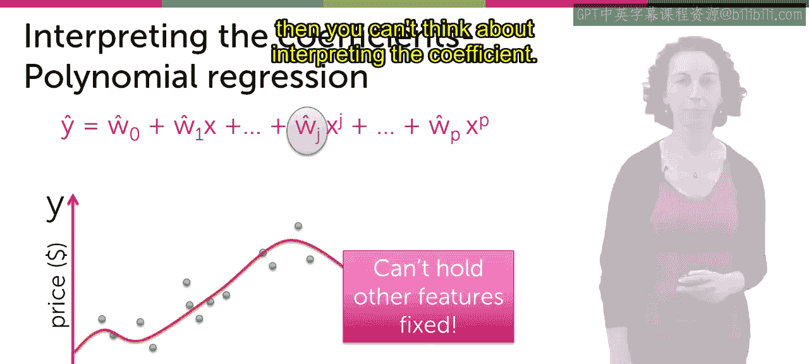
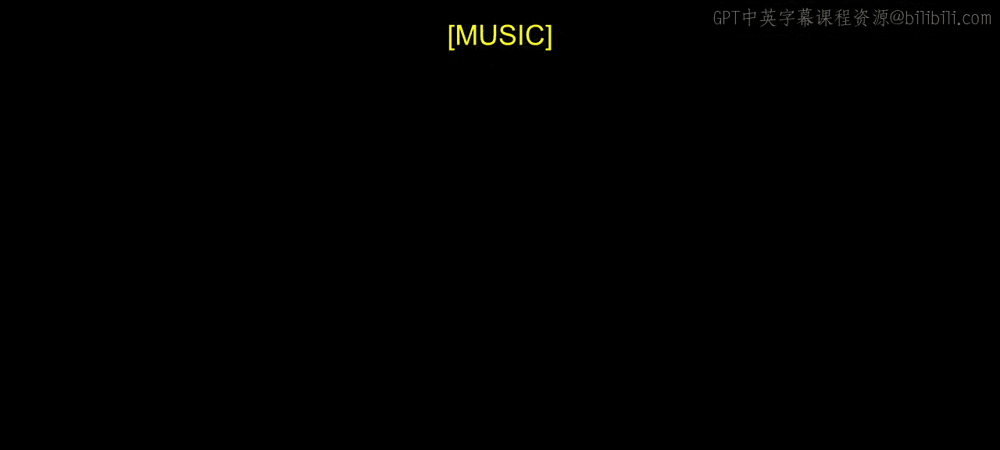

# 华盛顿大学《机器学习（回归，第2课⧸共4课）｜Machine Learning》中英字幕 p39 38_解释多元回归拟合.zh_en -BV11b421H7XL_p39-

。

So just like we did in simple linear regression， we can think about interpreting the coefficients of our fitted function。

But first let's remember what we did for this simple linear regression model where when we looked at our estimated function。

 our fitted function， it was just some fitted line， we had a W hat zero and a W hat one。

 those were our estimated parameters of this model Well we said W hat zero that was just it had an interpretation in terms of the intercept of this line so the value of a house with no square feet let's just ignore that one that one's going to have the same interpretation throughout all of these models that we're talking about。

But let's talk about W hat1， Okay， so in our simple linear regression model。

 what we said was W hat1 was the predicted change in our output per unit change in our input。

 so predicted change in the house value。For a one square foot change in the house that we're looking at。

Okay， so now let's think about how do we interpret the coefficients if we have two inputs instead of just one。

Well， in this case， what we can do is we can think about just fixing the other input so let's fix our first input the number of square feet of the house and then think about what's the effect of the number of bathrooms。

And if we fixed the number of square feet， what that equivalent to is we're just taking a slice through this space for however many square feet we're looking at。

And when we take a slice through this hyperplane。So there's this hyperplane。

 let me see if I can draw this， there's this hyperplane living here in 3D space。

 we take a slice and once you slice that hyperplane， you just get a line。

So that's this line here for a fixed number of square feet and then when we think about the interpretation of W hat2。

 the coefficient on the number of bathrooms in the house。

 what that's saying is well it's the slope of this line so that means for a single unit change in our input which here is number of bathrooms so adding one bathroom。

 what's the predicted change in the output， the value of the house， so just to be very clear。

 we're taking a house of a fixed size。And we're adding a bathroom。

 maybe we're changing some room to be a bathroom or knocking something down， putting in a bathroom。

 and we're saying， how much does that increase the value of my house to make that change。

 not changing the size of the house， that's going to stay the same。

 but adding a bathroom to the number of counts of bathrooms in this house。

So that's the interpretation of W hat2 Well what happens when we go to a more general model with some little D different inputs？

Well in this case， when we think about interpreting any given coefficient of our fitted model。

 we're going to fix all the other inputs in the model and we're just going to look at that one that we can vary so for example。

 number of bedrooms okay and so when we're looking at the coefficient associated with number of bedrooms。

 the interpretation is what's the predicted change in the value of my house。

If I change just adding one bedroom to the house with everything else fixed。

So when you think about the interpretation of a coefficient。

 you have to be very careful that the interpretation is in the context of what you have in the model。

 so let me give you an example。Where if I。Think about the coefficient on number of bedrooms if I have square footage of the house in my model。

Well， what does it mean if I increase the number of bedrooms？

What I've had to do is make some other room smaller。

 let's say I'm always working with manipulating the existing bedrooms， okay。

 so the house currently has three bedrooms and I'm going to modify it to have four bedrooms。Well。

 what that probably means for the house is that that house has four smaller bedrooms than a house of the same size with three bedrooms。

So for a lot of people。That might not actually add value。

 that might decrease the value to have four small bedrooms might have less value than three nicer more grand bedrooms。

 depends on the person or the family， of course， but you can end up with a negative coefficient on the influence of the number of bedrooms to the value of the house because what it's saying is that as you keep adding。

 imagine adding all the way up to 1 bedrooms， of course the impact on the value of the house can go down if you're not able to increase the size of the house。

 if you're fixing the size of the house。But what if you remove square feet from the model and you refit this model？

Well， let's think about the coefficient on number of bedrooms。 In this case。

 it's most likely going to be some positive number because number of bedrooms is indicative of the size of the house。

 We can use that as a proxy when we don't have square feet in the model itself。

So if I think of reading some listing with a house with 10 bedrooms。

Probably I don't imagine them to be these tiny tiny little bedrooms。

 I just imagine a really big house， so I imagine the value of that house would be quite large compared to a house with one or two bedrooms So what I'm saying is that thinking about the coefficient this maybe positive or big positive number when I don't have square feet versus the coefficient associated with number of bedrooms。

 if I include square feet being negative。I can have totally different interpretations unless I think of the interpretation as I should in the context of what's included in the model。

 and I'm saying this again and again and again because it's a really common mistake to just look at the coefficient and say。

 oh， as I increase the number of bedrooms， the value goes down。No。

 think about the coefficient in the context of what you've put into the model。 Okay。

 now I think I've said that enough times you guys will remember that。Okay。

 so now let's try to interpret the coefficients in a polynomial regression model。

 and here I'm just assuming that we have one input like number of square feet and our features are different powers of this input。

So what would be the interpretation of the Jth coefficient？Well。

 I have to think about fixing everything else in the model。

 but if everything else is a power of this one input that I'm changing， I can't do that。

 so here unfortunately we can't think about interpreting the coefficients in the way that we did in the simple hyperplane example of the previous slide。

So just a little word of warning that if you're ever in a situation where you can't hold all your other features fixed。

 then you can't think about interpreting the coefficient。

。

