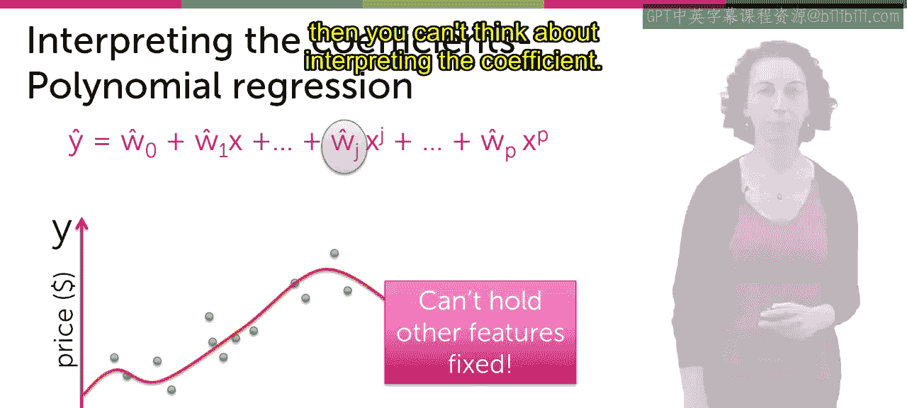
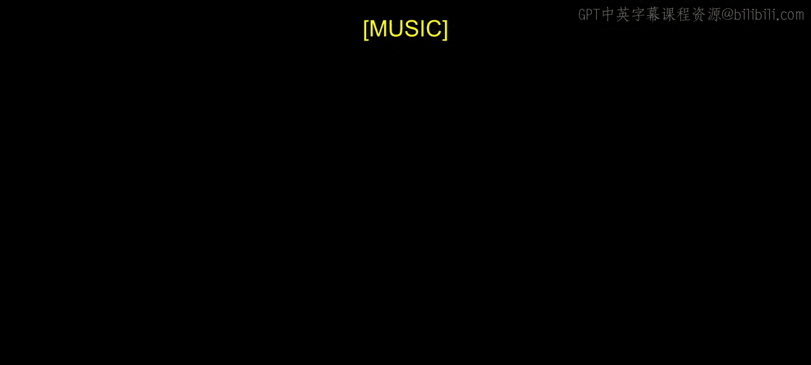

# 机器学习：第2课：解释多元回归拟合 📊

在本节课中，我们将学习如何解释多元线性回归模型的拟合系数。我们将从简单的线性回归模型开始，逐步过渡到具有多个输入特征的多元模型，并探讨在多项式回归等更复杂模型中解释系数时需要注意的问题。

---

## 回顾简单线性回归

上一节我们介绍了简单线性回归模型。现在，我们首先回顾一下如何解释其拟合系数。

在简单线性回归模型中，我们有一个拟合函数，它是一条直线，形式为：

`ŷ = ŵ₀ + ŵ₁ * x`

其中，`ŵ₀` 和 `ŵ₁` 是我们估计的模型参数。

*   `ŵ₀` 是截距，代表当输入 `x` 为零时预测的输出值。在我们的房价例子中，可以理解为“零平方英尺”房屋的价值，但这个解释通常不具实际意义。
*   `ŵ₁` 是斜率，其解释为：**对于输入 `x` 的每一个单位变化，预测输出 `ŷ` 的平均变化量**。例如，如果 `x` 是房屋面积（平方英尺），那么 `ŵ₁` 就表示房屋面积每增加一平方英尺，预测的房价平均变化量。

---

## 解释多元线性回归系数

现在，我们来看看当模型有两个输入特征时，例如房屋面积（`x₁`）和卫生间数量（`x₂`），应如何解释系数。

我们的拟合函数现在是一个三维空间中的平面：

`ŷ = ŵ₀ + ŵ₁ * x₁ + ŵ₂ * x₂`

为了解释系数 `ŵ₂`（对应卫生间数量），我们需要**固定另一个输入特征 `x₁`（房屋面积）**。这相当于在三维空间中，沿着一个固定的 `x₁` 值“切”一刀，得到的截面是一条直线。

以下是解释多元回归系数的关键步骤：

1.  **固定其他所有输入特征**。
2.  **观察目标特征变化对输出的影响**。

因此，`ŵ₂` 的解释是：**在房屋面积（`x₁`）保持不变的情况下，每增加一个卫生间，预测房价的平均变化量**。这意味着我们考虑的是在不改变房屋总面积的前提下（例如，将某个房间改造为卫生间），增加卫生间对房价的影响。

---

### 扩展到更一般的多元模型

对于具有 `d` 个不同输入特征的更一般模型：

`ŷ = ŵ₀ + ŵ₁ * x₁ + ŵ₂ * x₂ + ... + ŵ_d * x_d`

解释任何一个系数 `ŵ_j`（对应特征 `x_j`）的方法是一致的：

> **在模型中所有其他特征保持不变的情况下，特征 `x_j` 每增加一个单位，预测输出 `ŷ` 的平均变化量。**

例如，对于卧室数量（`x_j`）的系数，其解释是：**在房屋面积、卫生间数量等其他所有特征都固定的情况下，每增加一间卧室，预测房价的平均变化量。**

---

## 理解系数的上下文依赖性 ⚠️

解释系数时，必须**极其小心地考虑模型的上下文**，即模型中包含了哪些其他特征。同一个特征的系数，在不同的模型中可能有完全不同的符号和含义。

让我们通过一个例子来说明：

*   **情景A：模型包含“房屋面积”和“卧室数量”**
    *   此时，“卧室数量”的系数可能为**负数**。因为如果房屋总面积固定，增加卧室通常意味着每个卧室的面积变小。对许多买家而言，三间宽敞的卧室可能比四间狭小的卧室更有价值。
    *   系数的解释是：**在房屋面积不变的情况下**，增加卧室对价值的影响。

*   **情景B：模型仅包含“卧室数量”（不包含“房屋面积”）**
    *   此时，“卧室数量”的系数很可能是一个**正数**。因为卧室数量在这里充当了房屋大小的**代理变量**。通常，卧室越多的房子总面积也越大，因此价值更高。
    *   系数的解释是：**不考虑具体面积**，卧室数量对价值的总体影响。

**核心要点**：不能孤立地看待一个系数并得出结论（例如，“哦，卧室越多，房价越低”）。必须结合模型中的其他特征来理解其含义：“**在控制了其他变量（如面积）之后**，该特征的影响是什么？”

---

## 多项式回归中的系数解释

最后，我们探讨一种特殊情况：多项式回归模型。假设我们只有一个原始输入 `x`（如房屋面积），但特征是其不同次幂：

`ŷ = ŵ₀ + ŵ₁ * x + ŵ₂ * x² + ŵ₃ * x³ + ...`

在这种情况下，我们**无法**像之前解释多元线性回归系数那样，去解释 `ŵ_j`。

**原因**：我们无法做到“固定其他所有特征”。因为所有特征（`x`, `x²`, `x³`, ...）都源自同一个原始变量 `x`。改变 `x` 会同时改变所有特征，我们无法在改变 `x` 的同时保持 `x²` 或 `x³` 不变。

因此，**对于多项式回归或任何特征之间存在函数依赖关系的模型，单个系数的独立解释是没有意义的**。我们通常将整个多项式函数作为一个整体来解释其形状和趋势。

---

## 总结

本节课中，我们一起学习了如何解释回归模型的拟合系数：

1.  **简单线性回归**：系数 `ŵ₁` 表示输入每变化一单位，输出的预测变化量。
2.  **多元线性回归**：系数 `ŵ_j` 表示**在固定模型中所有其他特征的情况下**，特征 `x_j` 每变化一单位，输出的预测变化量。
3.  **上下文至关重要**：系数的符号和大小强烈依赖于模型中包含的其他特征。必须始终在模型上下文中进行解释。
4.  **多项式回归的局限**：当特征之间存在严格的函数关系（如幂次关系）时，单个系数的独立解释不再有效。

理解如何正确解释系数是运用回归模型进行洞察和决策的基础，请务必牢记其条件性和上下文依赖性。