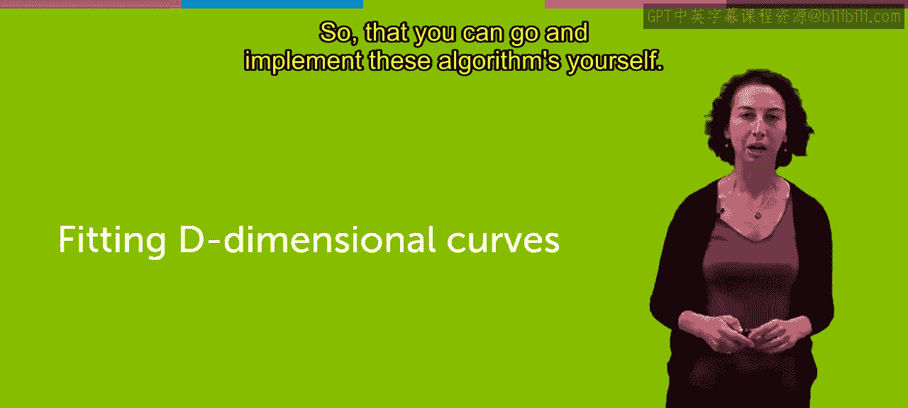
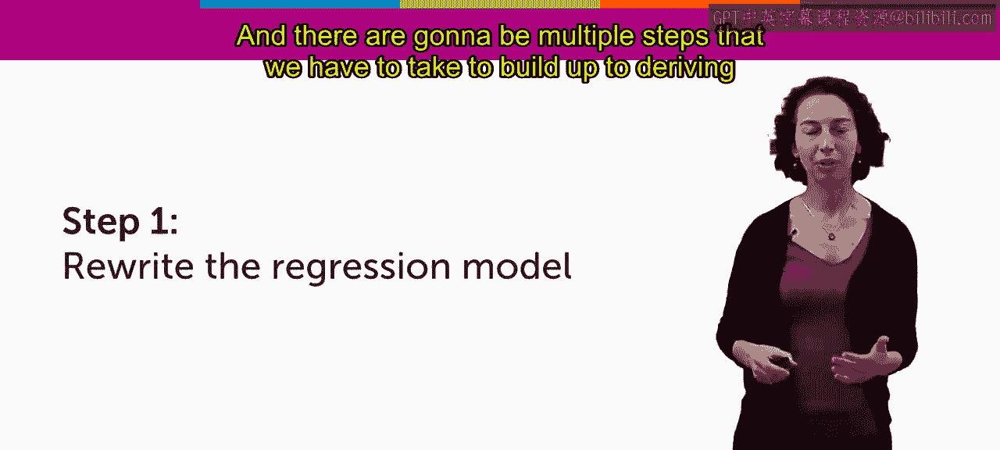
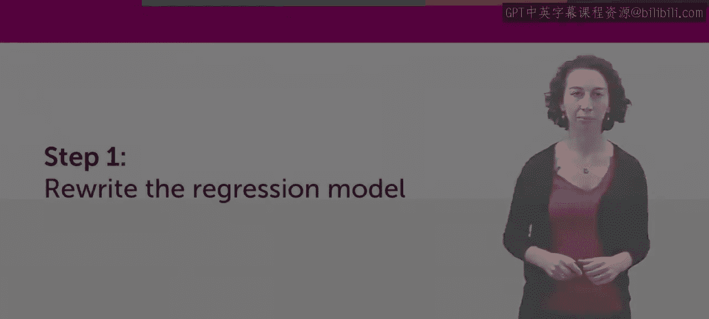
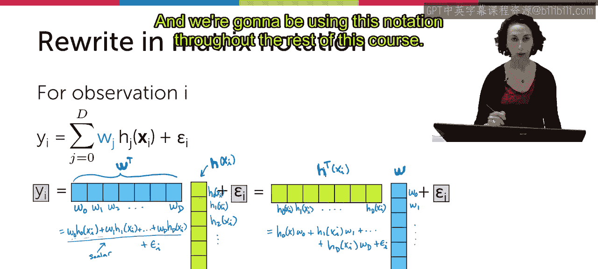
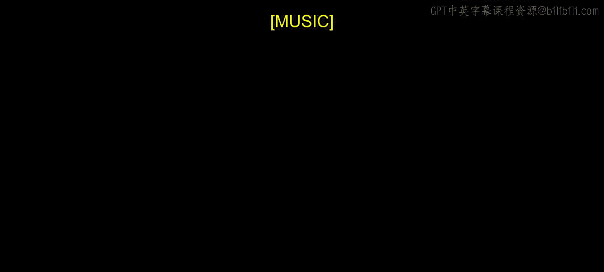

# 华盛顿大学《机器学习（回归，第2课⧸共4课）｜Machine Learning》中英字幕 p40 39_用向量符号重写单一观测模型.zh_en -BV11b421H7XL_p40-

。

Okay， so we've discussed at great length this multiple regression model and we've also talked about how to think about interpreting the coefficients of the fitted model now let's turn to how to actually fit this model to a set of data。

And so you actually did this in the first course of the specialization。

 you did a multiple regression fit。But in that case， you're using some pre implemented algorithms。

 but now what we're going to do is show you what's under the hood so that you can go and implement these algorithms yourself。

So to be clear， in this part of this module， we're talking about the algorithms associated with multiple regression and in particular。

 like we did in the simple linear regression case， we're going to talk about two different algorithms。

 one is just a closeform solution and the other is gradient descent。

And there are going to be multiple steps that we have to take to build up to deriving these algorithms。

 and the first is simply to rewrite our regression model。

In particular， we're going to rewrite our multiple regression model， which is shown here。

 this was the equation that was in that green box a little while ago。

 so we're going to rewrite this in matrix notation and to do this what we note is the fact that our Ithe observation。

 which I'm going to show us this pink square can be written in terms of the multiplication of two vectors where the first vector are going to be all of our parameters。

 all of our regression coefficients， W0， W1 W2 all the way up to W capital D。

And then this green vector， which are all our different features of the input。

 So this is going to be h0 of x。I， H1 of X I。H2 of X， I。All the way up to H capital D。

 our D feature of Xi。And then we're going to add our error term。

 which I'm going to use this gray square to represent。 So when we multiply these two vectors。

 let's just describe what happens。 Well we take this first element。

 multiply that by the first element of this blue vector。

 And then we're going to add the second element of this green vector times the second element of this blue vector and keep doing this all along。

 So what we get just to be very explicit is。W 0， H 0 X I plus then when we multiply the second elements。

 we get W1 times H1 of X I plus all the way up to。The teeth。Mulplication we do is WD， HDd of Xi。

 and then we're going to go and we're going to add Epsilon I。Okay。

 so that's how we do a multiplication between a row vector and a column vector。

 It's often called an inner product and what we can denote it by。Is。We're going to call this entire。

Vectctor here， we're going to call it W。 and on this slide I'm going to write it。

 I'm going to emphasize the fact that it's bold。To capture my vector notation。

 but I'm not going to go through that on every slide。

I'm just hoping that if I don't write a subscript like WJ， that you remember that it's the vector。

Okay。And this here， this vector， I'm going to write as。H。Again， this bold notation。H of X I and x。

 of course， is bold as well。Okay， but in particular。

 when I'm going to think of vectors always as being defined as columns。Okay， as a column。

 so a vertical vertical line that we're showing here， and if it defines a row。

 then I'm going to call that the transpose， okay， the notation is you just put a little T。

On the top of the vector and what it means is take your vertical column and just lay it on its side。

 So let me take this pen if this were my vector and I take its transpose。

 it's going to become a row vector。All the same elements。

 so if there are a bunch of elements in this vector， those still appear in that order。

In the vector defined as a row。Okay， and the same is going to be true for matrices。

 We're going to talk about that later when we think about a square matrix and think about the transpose。

 we're just going to lay it on its side。 Okay， so that's what transpose is。

 So let's rewrite this multiplication。 So what we have is this bold W transpose times this bold H vector of。

Bold X of I plus epsilon I。And Epsilon I is just a scalar and just a little quiz。

 what's W transpose times H， is that a vector or a scalar？It's a scalar。Okay so the result。

 and we can see that here。That this is just a scalar。Okay。

 so equivalent to this multiplying W transpo times H。 Well you can also think about multiplying。

H transpose of x。Times， W。And the reason is because when you go through and multiply。

Let's be very pedantic here to be clear in these early slides because we're going to be using this linear algebra again and again。

So I'll just write this out。Of X I， W0， W1， all the way up to WD。

 When I go through and multiply these things out， it's exactly the same result I get。H0。

 X I times W 0， or you could have written that in the other order， like I did before， H1， X I。

 W1 plus。All the way up to。H， capital D， X， I， W D plus epsilon， I。

So exactly the same as what we had before， and we're going to be using this notation。

Throughout the rest of this course。

