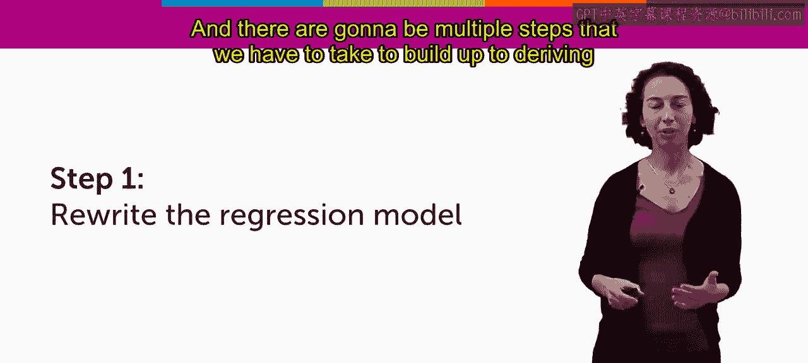
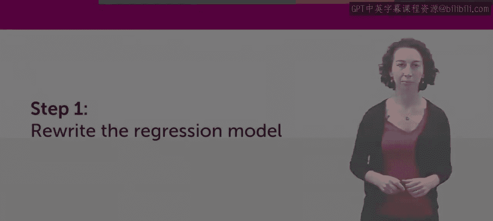
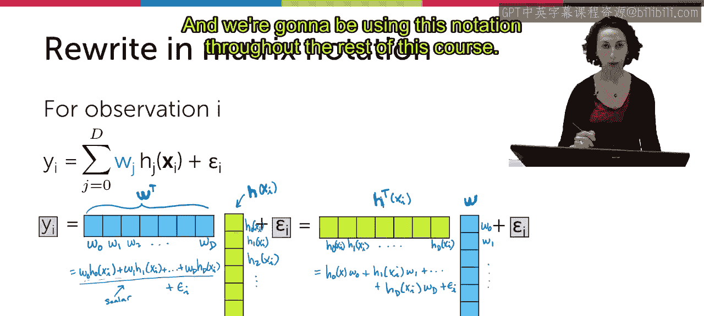

# 机器学习：回归：第2课：用向量符号重写单一观测模型 🧮

在本节课中，我们将学习如何将多元回归模型用向量和矩阵的符号重写。这是理解后续回归拟合算法（如闭式解和梯度下降）的关键第一步。通过使用线性代数符号，我们可以更简洁、更高效地表示和计算模型。

---

上一节我们详细讨论了多元回归模型及其系数的解释。本节中，我们来看看如何用向量符号来重写这个模型，为后续推导拟合算法打下基础。

具体来说，我们将重写之前展示的多元回归模型方程。我们注意到，对于第 `i` 个观测值，其模型可以表示为两个向量的乘积。

以下是构成模型的各个部分：
*   **参数向量 `w`**：这是一个包含所有回归系数的列向量，即 `w0, w1, w2, ..., wD`。
*   **特征向量 `h(x_i)`**：这是一个包含第 `i` 个观测值所有特征变换的列向量，即 `h0(x_i), h1(x_i), h2(x_i), ..., hD(x_i)`。
*   **误差项 `ε_i`**：这是一个标量，代表第 `i` 个观测值的随机误差。

当我们计算这两个向量的内积（即点乘）时，过程如下：
`w0 * h0(x_i) + w1 * h1(x_i) + w2 * h2(x_i) + ... + wD * hD(x_i) + ε_i`

为了使用标准的线性代数符号，我们通常将参数向量 `w` 视为列向量。为了计算它与另一个列向量 `h(x_i)` 的内积，我们需要将其中一个转置为行向量。这里，我们选择转置参数向量 `w`。

因此，第 `i` 个观测值的模型可以简洁地写为：
`y_i = w^T * h(x_i) + ε_i`
其中 `w^T` 表示参数向量 `w` 的转置（即行向量），`h(x_i)` 是特征列向量。这个乘法的结果是一个标量，即预测值。

一个重要的性质是，内积的结果与向量的顺序无关。因此，以下两种写法是等价的：
`y_i = w^T * h(x_i) + ε_i`
`y_i = h(x_i)^T * w + ε_i`
两者展开后都会得到相同的求和式。在本课程后续内容中，我们将频繁使用这种向量化表示法。

---

本节课中，我们一起学习了如何将多元回归模型针对单一观测值的表达式，从冗长的求和形式重写为紧凑的向量内积形式 `y_i = w^T * h(x_i) + ε_i`。掌握这种表示法是理解后续矩阵运算和拟合算法的基础。下一节，我们将把整个数据集的模型用矩阵形式表示出来。