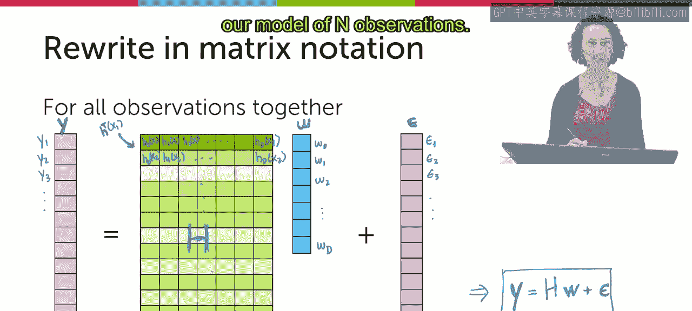

# 华盛顿大学《机器学习（回归，第2课⧸共4课）｜Machine Learning》中英字幕 p41 40_用矩阵符号重写所有观测的模型.zh_en -BV11b421H7XL_p41-

。

Okay， so that was rewriting the model for just a single observation， but it's going to be very。

 very helpful in our deriving these algorithms。To write the equation for all the observations stacked up together so we're going to have to dig through a little bit of linear algebra in order to have a really nice closedform solution for fitting this model。

 So let's start by just stacking up all our observations taking all these pink squares that I showed on this previous slide here。

 and putting them into one big vector where this vector is my first house， my second house。

 my third house sale， all the way up to how many observations so I have in my data， capital n。

 that's my capital nth house sale。And I can write the model for all these observations in this big matrix vector notation。

Where here again， I have this W vector that we talked about before。Where I have W0。

 W1 W2 to W capital D， and I know that each one of my observations has an error associated with it。

 there's the error for the first observation， error for the second observation。

 error for the third observation。All the way up to the error for this n observation。

 and I'm going to call this vector。This capital n dimensional vector， epsilon。Okay。

 so now let's describe this big green box， this matrix。Well， how do I form my first observation。

 I multiply the weights by the features of that first observation。

 so the features of that first observation are H0 of x1。H1 of x1， H2 of x1。

All the way up to H capital D of x1。So if I do， if I just forget the fact that it's in a big matrix。

 if I just look at that row。That looks exactly like my H transpose， my little H transpose， Okay。

 so this row。Is this little？H。Transpose of x1。And so just for that row。

 I get the same result as what I showed on the previous slide。 I multiply W by H transpose and that。

Forms that that functional fit for that observation。And then I just add that noise term。

 and so then I do this for each one of my observations， the same is true for the second observation。

 but when I go and plug into my features， of course I have to plug in the input。

 the X associated with that second observation。All the way to， well let me just be very clear。

Let me write one more so it's clear H1， x2。All the way up to H capital D of x2。

 and I do this for every row of this big matrix until I get to my nth observation and I plug in XN into my set of features。

All the way up to H capital D of x n。Okay， I'm going to call this really big matrix here。Capital H。

And what we're saying。Is we're saying that we can write our entire regression model for capital and observations。

As this Y vector， I sorry I should。Annotate the fact that this pink vector here I'm calling bold Y。

 so this y vector。Is equal to this H matrix。Times。This W vector。I'm still sticking with the bolds。

 but I'm going to give up very soon， okay？Plus， this epsilon vector that represents all the errors in my model。

Okay， so this is our matrix notation for our model of n observations。

🎼。

