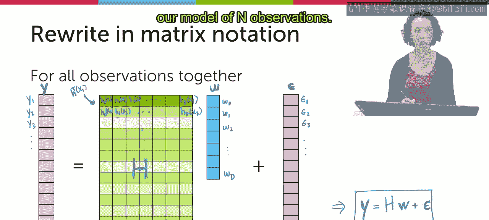

# 机器学习：第2课：用矩阵符号重写所有观测的模型

在本节课中，我们将学习如何将适用于单个观测的线性回归模型，扩展到包含所有观测的数据集。我们将使用矩阵和向量的符号来简洁地表示整个模型，这是推导后续算法（如闭式解）的关键一步。

上一节我们介绍了如何用向量形式表示单个观测的模型。本节中我们来看看如何将所有观测堆叠在一起，并用矩阵符号统一表示。

## 从单个观测到所有观测

之前，我们将单个观测的模型写为：
`y_i = h(x_i)^T w + ε_i`
其中，`h(x_i)` 是特征向量，`w` 是权重向量，`ε_i` 是误差。

为了处理所有 `N` 个观测，我们将所有目标值 `y_i` 堆叠成一个向量 `Y`，将所有误差 `ε_i` 堆叠成一个向量 `ε`。

以下是构建完整模型矩阵表示的关键步骤：

1.  **构建目标向量 Y**：这是一个 `N` 维列向量，包含从第一个到第 `N` 个观测的所有目标值。
    `Y = [y_1, y_2, ..., y_N]^T`

2.  **构建设计矩阵 H**：这是一个 `N × (D+1)` 的矩阵。每一行对应一个观测，每一列对应一个特征（包括常数项 `h_0`）。
    `H = [ [h_0(x_1), h_1(x_1), ..., h_D(x_1)], [h_0(x_2), h_1(x_2), ..., h_D(x_2)], ..., [h_0(x_N), h_1(x_N), ..., h_D(x_N)] ]`

3.  **构建权重向量 w**：这是一个 `(D+1)` 维列向量，包含所有权重参数。
    `w = [w_0, w_1, ..., w_D]^T`

4.  **构建误差向量 ε**：这是一个 `N` 维列向量，包含每个观测的误差。
    `ε = [ε_1, ε_2, ..., ε_N]^T`

## 完整的矩阵模型

利用以上定义的矩阵和向量，我们可以将整个线性回归模型简洁地重写为：
`Y = H w + ε`

这个公式的含义是：目标值向量 `Y` 等于设计矩阵 `H` 乘以权重向量 `w`，再加上误差向量 `ε`。设计矩阵 `H` 的每一行 `h(x_i)^T` 与权重向量 `w` 的点积，正是对第 `i` 个观测的预测值。

本节课中我们一起学习了如何用矩阵符号重写线性回归模型。我们将所有观测的目标值、特征和误差分别组织成向量和矩阵，最终得到了一个紧凑的模型表示 `Y = H w + ε`。这个表示法是后续求解模型参数（即权重 `w`）的基础，它使我们能够利用线性代数的工具高效地处理大规模数据集。