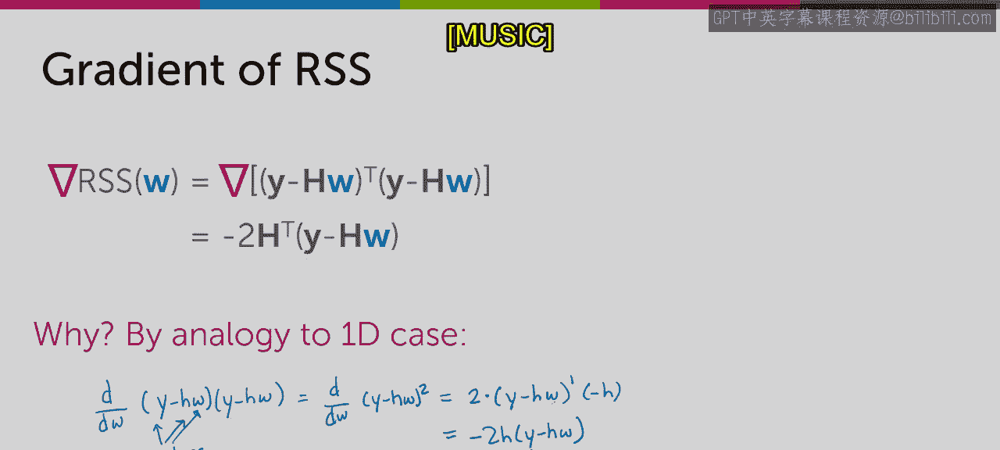

# 华盛顿大学《机器学习（回归，第2课⧸共4课）｜Machine Learning》中英字幕 p42 42_计算RSS梯度.zh_en -BV11b421H7XL_p42-

。

Okay， so now we're on to the final important step of the derivation。

 which is taking the gradient because as we saw in the simple regression case。

 the gradient was important both for our closed form solution， as well as， of course。

 for the gradient descent algorithm。 So what's the gradient of our residual sum squares and this multiple regression case。

 Well， it's the gradient of this matrix notation that we use for representing the residual sum squares and if you know gradients of vectors and matrices which were not assuming you do so。

Please don't think that you need to know this， but the result is minus2 H transpose。

 so taking that big green matrix and turning it on its side times y minus H of w。

 which again is that matrix， I mean sorry， that vector of residuals。And why is this the result， Well。

 I'm not going to give a complete proof of this。 I'm just going to give some motivation， just。

I'm going to walk through an analogy to a 1D case and we'll see some patterns and maybe you'll believe that that's the result in the matrix case。

So in particular， if we think about taking the derivative with respect to W of a function that is y minus HW。

Times y minus HW， where these things are all scalrs。So， this is the。

1D analog to this equation here where the gradient is just this derivative of this one parameter W。

 the arrow is not quite pointing to W。嗯。Well， what's the derivative of this。

 It's equivalent to the derivative with respect to W of y minus HW squared。

And like we've done multiple times in this course now。

 when I take the derivative with respect to W of some function raised the power by the chain rule。

 I bring that power down。Then I'm going to multiply by。The function， H W raised to the power minus-1。

 And then I'm going to。Take the derivative of the inside and what's the derivative of this function with respect to W。

 it's minus H。 And so the result here is minus2 H。Y minus HW。So we have the minus2 in both cases。

 this little scalar H is this big matrix in our case and y minus Hw in the scalar case。

 this big vector matrix notation here okay so。Just believe that this is the gradient。

 we didn't want to bog you down in too much linear algebra or too much in terms of derivatives。

 but if we have this notation， then we can derive everything we need to for our two different solutions to fitting this model。

🎼。