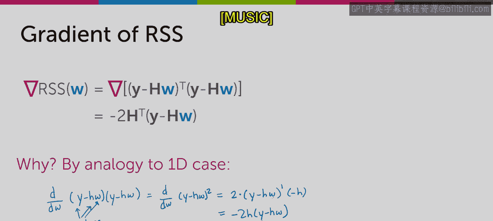

# 机器学习：第2课：计算RSS梯度


在本节课中，我们将学习如何计算多元线性回归中残差平方和（RSS）的梯度。梯度计算是推导模型闭式解以及实现梯度下降算法的关键步骤。

## 梯度推导概述

上一节我们介绍了多元回归中RSS的矩阵表示法。本节中，我们来看看如何计算这个RSS函数的梯度。梯度是一个向量，它指向函数值增长最快的方向，在优化问题中至关重要。

## 梯度的矩阵形式

在多元回归中，残差平方和（RSS）的梯度具有以下简洁的矩阵形式：

**梯度公式：**
```
∇RSS(w) = -2 * H^T * (y - Hw)
```

在这个公式中：
*   **`H`** 是特征数据矩阵（设计矩阵）。
*   **`H^T`** 是矩阵 `H` 的转置。
*   **`y`** 是目标值向量。
*   **`w`** 是待求的权重参数向量。
*   **`(y - Hw)`** 是残差向量。

这个结果可以直接用于后续的模型求解。

## 从一维情况理解梯度公式

为了帮助理解这个矩阵梯度公式的由来，我们可以通过一个简化的一维类比来观察其中的模式。

考虑一个仅有一个参数 `w` 和单个数据点的情况。此时，RSS函数简化为一个标量函数：
```
RSS(w) = (y - Hw)^2
```
这里，`y` 和 `H` 都是标量。

我们对这个标量函数求关于 `w` 的导数。根据链式法则，计算过程如下：

**求导过程：**
1.  将平方项的指数2乘到前面。
2.  保留内部函数 `(y - Hw)` 的一次方。
3.  乘以内部函数 `(y - Hw)` 关于 `w` 的导数，即 `-H`。

因此，导数为：
```
d(RSS)/dw = 2 * (y - Hw) * (-H) = -2H * (y - Hw)
```

## 对比一维与多维公式

通过对比，我们可以发现清晰的对应关系：

以下是标量（一维）情况与向量/矩阵（多维）情况的公式对比：

*   **标量导数**：`-2 * H * (y - Hw)`
*   **梯度（矩阵形式）**：`-2 * H^T * (y - Hw)`

两者的结构非常相似：
1.  都有系数 **`-2`**。
2.  都包含 **`(y - Hw)`** 项，即残差。
3.  主要区别在于：标量情况下的 **`H`**，在矩阵情况下变成了其转置 **`H^T`**。这个变化是为了确保矩阵乘法的维度匹配。

这个类比让我们有理由相信矩阵梯度公式的正确性，而无需深入复杂的线性代数或矩阵微积分证明。

## 总结



本节课中，我们一起学习了多元线性回归中残差平方和（RSS）梯度的计算。我们得到了核心的梯度公式 **`∇RSS(w) = -2H^T(y - Hw)`**，并通过与一维情况的类比，理解了该公式的结构和组成部分。这个梯度表达式是求解回归模型权重参数的基础，无论是通过闭式解方程还是梯度下降迭代法都离不开它。