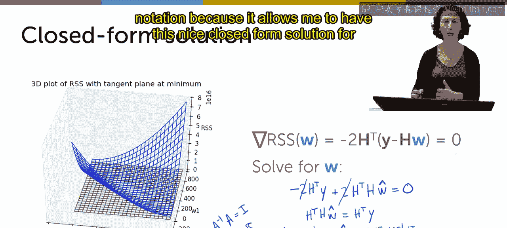

# 华盛顿大学《机器学习（回归，第2课⧸共4课）｜Machine Learning》中英字幕 p43 43_方法1：闭式解.zh_en -BV11b421H7XL_p43-

。

So the first approach that we're going to talk about is just a closed form solution where we take our gradient and simply set it equal to zero and solve for W。

 just like we did in the simple regression case。Okay。

 here's my gradient of our residual sum of squares， and I've set it equal to0。

 and now let's solve for w。 So let's do out this multiplication here where we're going to get minus2 h transpose y。

 and then we're going to get a plus2。H transpose H times W。And we're setting this equal to zero。

And so these matrix multiplies act very similarly to if these had been scrs。

 but we have to keep the order。 The order is very important that we couldn't have swept。

Switch it around to be YH transpose， okay？So now let's solve this equation。

 first of all the two cancels out， we can just divide both sides by2。

 and so what I'm going to end up with is h transpose hW equals， I bring this to the other side。

 h transpose y， then I'm going to multiply both sides， by H transpose h inverse。So h transpose H W。

 and now I'm going to multiply pre multiply the other side by the same H transpose h inverse。

 H transpose y。And what so this is a little aside， what is a matrix8 inverse times？The same matrix A。

Well， that's the definition。So by definition of a matrix inverse， that is the identity matrix。

And another aside。 So that's a。 number one， Another aside， if， if I take。

The identity matrix and multiply by any vector， so I'll call the vector V， I just get V back。

 or if I take the matrix and multiply by any matrix， big V， I'm going to get that matrix back。Okay。

 so what we see if we apply these two identities here is that together。

These two terms H transpose H is like our big a matrix here。 So we have a matrix times its inverse。

 This is just going to be the identity。 Then we have the identity matrix times of vector W。

 That's just going to be the W vector so。We have W。

 and let me put hats on because remember that once we set this equal to zero and solve for W。

This is our estimated set of coefficients， so I'm going to put a hat on W。

And what we see is W hat is simply equal to h transpose h inverse H transpose y。

So this is one of those aha moments。Maybe， maybe you missed it because the aha moment is we have a whole collection of different parameters。

 W0 all the way up to WD。 These are the things multiplying all the features we're using in our multiple regression model。

And in one line， I've written the solution to the fit， I've fit all of W0。

 W1 all the way up to W capital D， just by doing this matrix multiply。Okay。

 so this motivates why we went through all this work to write things in this matrix notation because it allows me to have this nice close form solution for all my parameters written very compactly。

